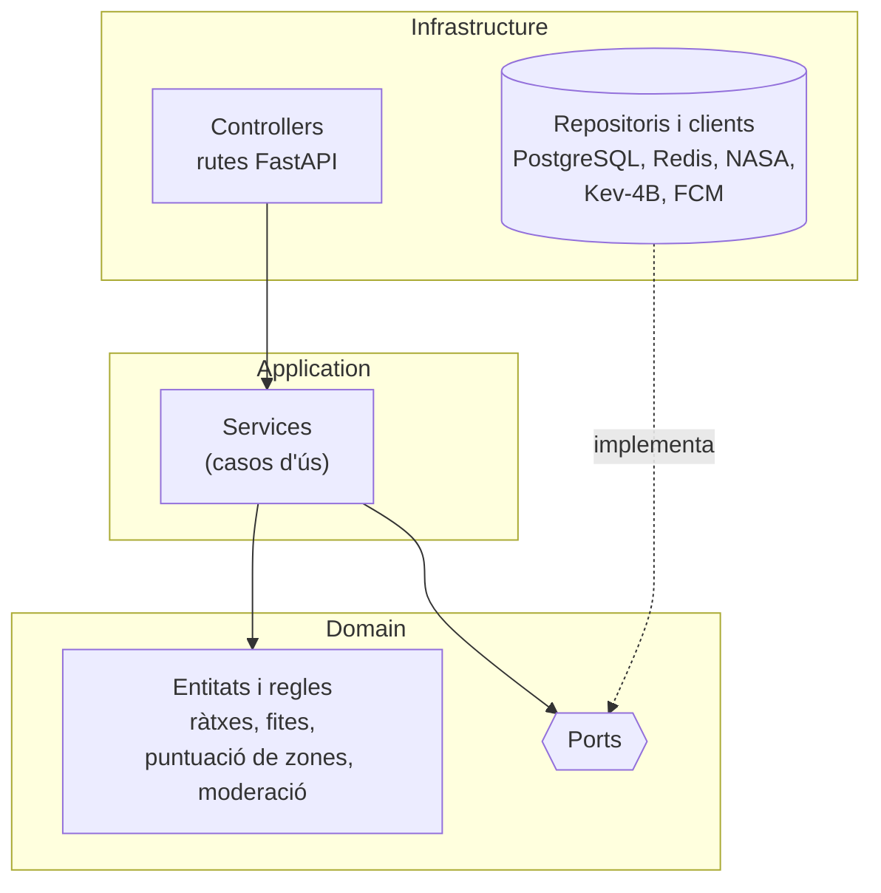

# Perseida · Backend

[English](README.md) | **Català** | [Español](README.es.md)

> 🚧 **En construcció.** El projecte és al primer sprint. `app/` i `tests/` ja són reals (el mòdul `health` és l'exemple de referència), però la majoria de mòduls (persistència, autenticació, xat) encara no estan implementats.

Backend de **Perseida**, una aplicació mòbil multiplataforma de divulgació, exploració i seguiment de fenòmens astronòmics, desenvolupada com a projecte de PES (UPC-FIB). Exposa l'API REST i el xat en temps real que fan servir l'app mòbil i el panell d'administració, i integra les NASA Open APIs i altres proveïdors externs.

## Responsabilitats

Un únic procés FastAPI integra tres responsabilitats:

- **API REST** per a l'app mòbil i el panell d'administració (Swagger/OpenAPI sempre sincronitzat amb el codi).
- **WebSocket** per al xat en temps real (sales d'esdeveniment i 1-a-1), amb Redis pub/sub.
- **Planificador (APScheduler, dins del procés)** per a tasques periòdiques: notificacions programades, reinici de ràtxes diàries i purga de contingut caducat (publicacions multimèdia de 24 h).

Àrees funcionals principals: esdeveniments astronòmics (catàleg, filtres, mapa, subscripcions, exportació `.ics`), contingut diari de la NASA (APOD), gamificació (ràtxes, fites, quiz diari), comunitat (seguiment, xats d'esdeveniment, xats directes, votació de fotografies), recomanació de zones d'observació (meteorologia + contaminació lumínica + PostGIS), notificacions (FCM), moderació i administració.

## Stack tecnològic

| Àmbit | Tecnologia |
|---|---|
| Llenguatge | Python 3.14 |
| Framework | FastAPI (async) |
| ORM / migracions | SQLModel (SQLAlchemy) · Alembic (s'executa automàticament a l'entrypoint del contenidor) |
| Base de dades | PostgreSQL 18 + PostGIS (font de veritat) |
| Cache / pub-sub | Redis 8 (cache lazy amb TTL; res es persisteix només aquí) |
| Planificador | APScheduler |
| Autenticació | Google OAuth2 + PKCE · validació de tokens de Google via JWKS · sessió pròpia del backend (JWT) |
| Moderació | Microservei Kev-4B (model local, crida síncrona) |
| Dependències | `uv` (versions exactes, `uv.lock` versionat) |
| Qualitat | `ruff` (lint + format, complexitat màx. 10), `mypy` estricte, SonarQube Cloud |
| Tests | `pytest`, `pytest-asyncio`, `pytest-cov`, `httpx`, `respx` |

## Arquitectura: hexagonal



- `domain`: lògica de negoci sense dependència de frameworks, BD ni serveis externs (l'única llibreria externa permesa és Pydantic). Conté les entitats, els value objects, els errors de domini i els **ports** (`Protocol`) que descriuen què necessita el negoci de l'exterior ([ADR-0016](../obsidian_vault/decisions/0016-ports-i-entitats-riques-al-domini.md)).
- `application`: **services** (casos d'ús) que orquestren les entitats a través dels ports. Sense regles de negoci pròpies ni FastAPI, SQLModel, Redis o httpx.
- `infrastructure`: tot el que toca l'exterior: **controllers** (rutes FastAPI), **repositoris** i clients externs que implementen els ports, i el *composition root* (`dependencies.py`, `@lru_cache` + `Depends`, [ADR-0017](../obsidian_vault/decisions/0017-injeccio-de-dependencies-i-services-singleton.md)).

**Regla de dependències:** `domain` només importa la biblioteca estàndard, Pydantic i `app.domain`; `application` només això i `app.application`; `infrastructure` pot importar qualsevol capa. Ho verifica `tests/architecture/test_layer_dependencies.py`.

Patró per a dades externes (p. ex. APOD): la primera petició crida l'API externa i en desa el resultat a Redis (i a PostgreSQL quan cal); les següents se serveixen des de la cache. Si l'API externa cau, es retornen les dades de la cache en lloc d'un 500.

## Estructura

```
backend/
├── app/
│   ├── main.py            # app factory de FastAPI i lifespan
│   ├── domain/            # entities, value objects, ports
│   │   ├── shared/        # jerarquia DomainError
│   │   └── health/        # models i ports
│   ├── application/       # services
│   │   ├── shared/        # jerarquia ApplicationError
│   │   └── health/        # cas d'ús
│   └── infrastructure/    # routers, persistence, redis, clients
│       ├── api/           # handlers d'errors (RFC 9457) i correlation id
│       └── health/        # adaptadors, router i cablejat
├── tests/
│   ├── unit/              # domini i application, amb fakes
│   ├── integration/       # API amb httpx + ASGITransport
│   ├── architecture/      # regles de dependències entre capes
│   ├── fakes/             # ports en memòria per als tests
│   ├── fixtures/          # respostes enregistrades de NASA/meteo, dades geo
│   ├── factories/         # usuaris, esdeveniments, missatges, fites
│   └── moderation_dataset/# joc etiquetat d'avaluació de Kev-4B (ca/es/en)
├── pyproject.toml
└── uv.lock
```

`alembic/` (migracions) i `.env.example` arribaran amb la persistència.

### Afegir una funcionalitat

El mòdul `health` és l'exemple de referència. Per a un mòdul nou `<nom>`:

1. **Domini** (`app/domain/<nom>/`): entitats/value objects a `models.py` i els ports a `ports.py` (p. ex. `HealthReport` i el protocol `HealthCheck`).
2. **Application** (`app/application/<nom>/`): el service que usa els ports (`HealthService`), sense FastAPI.
3. **Infrastructure** (`app/infrastructure/<nom>/`): els adaptadors que implementen els ports (`checks.py`), el provider `get_<nom>_service` amb `@lru_cache` i `<Nom>ServiceDep` (`dependencies.py`), i el router amb el seu model de resposta (`router.py`).
4. Registra el router a `create_app()` (`app/main.py`).
5. **Tests**, després del codi: unitaris amb fakes (`tests/fakes/`), integració de l'API amb `dependency_overrides`; el test d'arquitectura continua verificant les capes.

## Errors

Contracte d'errors únic ([ADR-0018](../obsidian_vault/decisions/0018-errors-rfc-9457-amb-codis-estables.md)). El codi de domini i d'application llença errors tipats amb un `code` estable (`SCREAMING_SNAKE`, p. ex. `EVENT_NOT_FOUND`); només `infrastructure` coneix HTTP, així que no hi ha cap `HTTPException` fora d'ella.

| Error | Capa | Status |
|---|---|---|
| `NotFoundError` | `domain/shared/errors.py` | 404 |
| `ConflictError` | `domain/shared/errors.py` | 409 |
| `ValidationError`, `BusinessRuleViolation` | `domain/shared/errors.py` | 422 |
| `UnauthorizedError` | `application/shared/errors.py` | 401 |
| `ForbiddenError` | `application/shared/errors.py` | 403 |
| `ExternalServiceError` (proveïdor extern caigut, sense cache) | `application/shared/errors.py` | 503 |
| Altres `DomainError` / `ApplicationError` | | 400 |

```python
raise NotFoundError("EVENT_NOT_FOUND", "Event 42 does not exist")
raise UnauthorizedError("INVALID_SESSION")  # el missatge per defecte és el code
```

`DomainError(code, message=None)` i `ApplicationError(code, message=None)` comparteixen signatura; `message` és tècnic (logs i `detail`) i mai es mostra a l'usuari: el frontend tradueix pel `code`. El status es resol a `infrastructure/api/error_handlers.py` (`STATUS_BY_ERROR`, recorrent l'MRO de la classe), de manera que una subclasse nova hereta el del pare.

Tot error es respon com a `application/problem+json` (RFC 9457):

```json
{
  "type": "about:blank",
  "title": "Not Found",
  "status": 404,
  "detail": "Event 42 does not exist",
  "instance": "/api/events/42",
  "code": "EVENT_NOT_FOUND",
  "correlation_id": "5c0e0b8e-6d57-4f7b-9d0e-0d6a1f6f4c11"
}
```

- `title` és la frase HTTP estàndard; `type` sempre és `about:blank`.
- Errors de validació de la petició: 422, `code` `VALIDATION_ERROR` i `errors[]` amb un `{field, message, type}` per camp (les branques d'una unió de Pydantic, com `x.int`, es retallen a `x`). Els errors 5xx es registren amb `warning`.
- Rutes inexistents i altres errors HTTP conserven el seu status amb `NOT_FOUND`, `METHOD_NOT_ALLOWED` o `HTTP_<status>`.
- Excepcions inesperades: 500 `INTERNAL_ERROR` amb un `detail` genèric; cap traça ni nom de classe surt del servidor (va al log amb el `correlation_id`).
- **Correlation id:** la capçalera `X-Correlation-ID` s'afegeix a totes les respostes. Un valor entrant només es reutilitza si compleix `[A-Za-z0-9._-]{1,128}`; si no, es genera un `uuid4`. El mateix id surt al cos com a `correlation_id`.

Afegir un codi: llença la classe existent amb el `code` nou des de `domain`/`application`, registra'l al [catàleg de codis](../.agents/skills/gestio-errors/references/cataleg-codis.md) i afegeix-ne els textos ca/es/en al frontend. Mai es reanomena un `code` publicat.

## Planificador

APScheduler (`AsyncIOScheduler`) s'executa dins del procés de l'API: s'inicia al *lifespan* de FastAPI i s'atura a l'aturada. No hi ha *job store*: les tasques es registren a l'arrencada.

| Variable | Per defecte | Significat |
|---|---|---|
| `SCHEDULER_ENABLED` | `true` | amb `false` no s'inicia el planificador ni apareix a `/api/health` |
| `SCHEDULER_TIMEZONE` | `UTC` | fus horari IANA del planificador |

**Registrar una tasca** (l'únic lloc): afegeix una línia a `register_jobs` de `app/infrastructure/scheduler/jobs.py`, amb el port `JobScheduler` (`app/domain/scheduler/ports.py`):

```python
def register_jobs(scheduler: JobScheduler) -> None:
    scheduler.add_interval_job("purge-expired-posts", purge_service.run, seconds=3600)
```

- La tasca és una `async def` sense arguments (construeix-ne el service amb els mateixos providers que l'API, [ADR-0017](../obsidian_vault/decisions/0017-injeccio-de-dependencies-i-services-singleton.md)); s'executa al bucle d'esdeveniments, per tant no ha de bloquejar.
- Cada tasca s'executa amb `max_instances=1` i `coalesce=True`: una tasca lenta no se solapa amb si mateixa i les execucions perdudes es fusionen.
- Una excepció es registra al log (JSON, camp `job` amb el nom) i no atura ni el planificador ni l'API.
- `/api/health` informa del component `scheduler` mentre està activat.
- Se suposa un únic procés d'API; amb diverses rèpliques caldria un bloqueig distribuït.

Els logs (també els d'uvicorn) s'escriuen a stderr com un objecte JSON per línia, amb `correlation_id` quan n'hi ha (`app/infrastructure/logging.py`). Un `SCHEDULER_TIMEZONE` desconegut falla a l'arrencada amb un error de configuració.

## Contractes de servei (Spotwise, grup 21B)

- **Proveïm:** `GET /api/events/active` i `GET /api/events/upcoming` retornen els esdeveniments astronòmics rellevants (títol, descripció breu, categoria com `lunar`, `solar`, `meteor_shower`).
- **Consumim:** la cerca d'espais de Spotwise (biblioteques i cafeteries de Barcelona) per suggerir punts de trobada als esdeveniments.

## Executar i testejar

Prerequisit: [`uv`](https://docs.astral.sh/uv/). La versió de Python (3.14) la fixa `.python-version` i `uv` la instal·la si cal.

```bash
cd backend                    # des de l'arrel del repositori
uv sync                       # instal·la les dependències (entorn virtual a .venv)
uv lock --check               # verifica que uv.lock està al dia amb pyproject.toml
uv run ruff check .           # lint
uv run ruff format --check .  # comprova el format sense modificar fitxers
uv run mypy .                 # tipatge estricte
uv run pytest                 # tests (amb cobertura)
uv run uvicorn app.main:app --reload  # arrenca l'API (http://127.0.0.1:8000/api/docs)
```

- Les dependències s'afegeixen amb `uv add` / `uv add --dev` i versió exacta (`==`); no s'usa `pip`.
- Tota la configuració (ruff, mypy, pytest, cobertura) és a `pyproject.toml`.

L'stack complet (API, PostgreSQL/PostGIS, Redis, moderació) s'arrenca amb Docker Compose des de [`../infra`](../infra/README.ca.md). Copia `.env.example` a `.env`; els secrets reals mai es versionen.

## Integració contínua

El workflow [`.github/workflows/ci.yml`](../.github/workflows/ci.yml) executa el job `backend` a cada pull request cap a `develop` o `main` i a cada push a `develop` o `main`. En una PR només s'executa si han canviat `backend/**` o el propi workflow; si no, el job queda com a omès (*skipped*) i no bloqueja la PR. Un push nou a la mateixa PR cancel·la l'execució anterior.

Ordres exactes (des de `backend/`, les mateixes que el workflow):

```bash
cd backend                                 # des de l'arrel del repositori
uv sync --locked                           # falla si uv.lock no està al dia
uv run ruff check .                        # lint
uv run ruff format --check .               # format
uv run mypy .                              # tipatge estricte
uv run pytest --cov-report=xml:coverage.xml  # tests + informe de cobertura
```

- **Cobertura:** l'informe es publica com a artefacte `backend-coverage` (`coverage.xml`). Per descarregar-lo: GitHub → pestanya **Actions** → l'execució → secció **Artifacts** al final de la pàgina de resum.
- **Serveis:** PostgreSQL (PostGIS 18) i Redis 8 s'aixequen sols com a service containers a la CI. No cal Docker Compose ni `.env`.

## Redis

Redis només és una cache amb TTL i el bus pub/sub del xat WebSocket; no hi viu res que hagi de sobreviure (la font de veritat és PostgreSQL). El client asíncron es crea al `lifespan` de FastAPI i es tanca en aturar l'aplicació. Configuració (vegeu `.env.example`):

- `REDIS_HOST`, `REDIS_PORT`: adreça del servidor (`redis://host:port`).
- `CACHE_DEFAULT_TTL_SECONDS`: TTL per defecte en segons (3600 si no es defineix).
- `REDIS_SOCKET_TIMEOUT_SECONDS`: timeout de connexió i de socket en segons (2 si no es defineix); un Redis penjat es comporta com un miss.

Per executar un Redis local: `docker run -d --name perseida-redis -p 6379:6379 redis:8` i `REDIS_HOST=localhost`.

**Ports** (`app/domain/shared/ports.py`): `Cache` (`get`, `set` amb un `ttl_seconds` opcional per clau) i `PubSub` (`publish`, `subscribe`). Els adaptadors Redis són a `app/infrastructure/cache/`; s'injecten amb `CacheDep` i `PubSubDep` (també funcionen en endpoints WebSocket).

**Cache lazy:** `get_or_load(cache, key, load, adapter, ttl_seconds=None)` (`app/application/shared/cache.py`) retorna el valor de la cache o crida `load`, el desa i el retorna. Si Redis cau, `RedisCache` registra un avís i es comporta com una fallada, de manera que la dada s'obté igualment de la font (cap HTTP 500).

**Convenció de claus:** qui crida fa servir `<domini>:<id>` i l'adaptador ho desa com `cache:<domini>:<id>`, p. ex. `cache:apod:2026-10-05`. Cada funcionalitat tria el seu TTL.

**Pub/sub:** `async with pubsub.subscribe(canal) as missatges:` dona els missatges publicats després d'entrar al bloc; tots els subscriptors del canal reben cada missatge i els d'altres canals no. Si Redis falla es llança `ExternalServiceError` (`PUBSUB_UNAVAILABLE`, HTTP 503).

Els tests d'integració (`tests/integration/test_redis.py`) s'executen si hi ha `REDIS_HOST`; la CI aixeca Redis 8.

## Autenticació

L'app inicia la sessió amb Google (OAuth2 + PKCE) i envia l'`id_token` de Google al backend, que mai rep el codi d'autorització ni desa cap contrasenya ([ADR-0008](../obsidian_vault/decisions/0008-google-oauth2-pkce-jwks-i-sessio-propia.md)). El backend en comprova el token i emet una sessió pròpia.

**Flux:**

1. `POST /api/auth/google` amb `{"id_token": "<token de Google>"}`.
2. `GoogleJwksVerifier` comprova la signatura RS256 amb les claus públiques de Google (JWKS, en memòria durant 1 hora; un `kid` desconegut provoca una descàrrega nova, com a màxim un cop per minut), l'emissor, l'audiència (`GOOGLE_CLIENT_ID`), la caducitat i que el correu estigui verificat. Si no: 401 `INVALID_GOOGLE_TOKEN`. Si Google no respon i no hi ha claus en memòria: 503 `IDENTITY_PROVIDER_UNAVAILABLE`.
3. El port `AccountGateway` retorna l'estat del compte: suspès o banejat → 403 `ACCOUNT_SUSPENDED`; esborrat → 403 `ACCOUNT_DELETED`.
4. El backend emet dos JWT signats amb HS256 i `JWT_SECRET`: un access token (15 minuts) i un refresh token (30 dies), amb les claims `sub` (el `google_sub`), `jti`, `type` (`access` o `refresh`), `iat` i `exp`. Cadascun es registra a Redis com a `session:<type>:<jti>` amb un TTL igual a la seva durada.
5. Resposta `200`: `{"access_token", "refresh_token", "token_type": "bearer", "expires_in"}` (`expires_in` en segons).

Un token és vàlid només si la signatura i la caducitat són correctes **i** la seva clau existeix a Redis. Esborrar la clau revoca el token a l'instant; si Redis es reinicia, les sessions es perden i els usuaris tornen a iniciar sessió amb Google. Si Redis no està disponible, els endpoints responen 503 `SESSION_UNAVAILABLE`.

**Renovació:** `POST /api/auth/refresh` amb `{"refresh_token": "..."}` retorna un parell nou i esborra el refresh anterior de Redis; tornar-lo a usar retorna 401 `INVALID_SESSION`.

**Configuració** (`.env.example`; `AuthSettings` a `app/infrastructure/auth/config.py`):

| Variable | Significat |
|---|---|
| `GOOGLE_CLIENT_ID` | Audiència (`aud`) esperada del token de Google |
| `JWT_SECRET` | Clau HS256, d'almenys 32 caràcters; mai no se'n versiona una de real |
| `ACCESS_TOKEN_MINUTES` | Durada de l'access token (15 per defecte) |
| `REFRESH_TOKEN_DAYS` | Durada del refresh token (30 per defecte) |

**Protegir un endpoint:** afegeix `CurrentSessionDep`. Llegeix `Authorization: Bearer <access token>` i retorna les `SessionClaims`. Sense capçalera, amb un token invàlid o revocat, o amb un refresh token, respon 401 `INVALID_SESSION`.

```python
from app.infrastructure.auth.dependencies import CurrentSessionDep

@router.get("/me")
async def me(session: CurrentSessionDep) -> MeResponse:
    ...  # session.sub is the user's google_sub
```

**Connectar la US #45 (usuaris).** El domini defineix el port `AccountGateway` a `app/domain/auth/ports.py`:

```python
class AccountGateway(Protocol):
    async def get_status(self, identity: GoogleIdentity) -> AccountStatus: ...
```

`GoogleIdentity` porta `google_sub`, `email` i, opcionals, `name` i `picture`. `AccountStatus` és `active`, `suspended`, `banned` o `deleted` (`deleted` quan `deleted_at` està informat). Per connectar-lo:

1. Escriu l'adaptador a `infrastructure` (cerca l'usuari per `google_sub`, el crea al primer accés i retorna el seu estat).
2. Substitueix `ProvisionalAccountGateway()` per l'adaptador a `build_auth_service` (`app/infrastructure/auth/dependencies.py`). La implementació provisional, que **accepta tots els comptes**, és a `app/infrastructure/auth/provisional_account_gateway.py` i la treu la #45.
3. El tancament de sessió també és de la #45: revoca la sessió amb `SessionStore.delete(kind, jti)` (afegeix un mètode `logout` a `AuthService`).

Als tests fes servir `FakeAccountGateway` (`tests/fakes/auth.py`); `tests/integration/test_auth_api.py` mostra el flux complet amb Google simulat amb `respx`.

Els codis d'error (`INVALID_GOOGLE_TOKEN`, `INVALID_SESSION`, `ACCOUNT_SUSPENDED`, `ACCOUNT_DELETED`, `IDENTITY_PROVIDER_UNAVAILABLE`, `SESSION_UNAVAILABLE`) són a `app/application/auth/errors.py` i al catàleg d'errors.

## Testing i qualitat

- Piràmide de proves: ~70 % unitàries, ~30 % d'integració (PostgreSQL/PostGIS i Redis efímers, API amb `httpx.AsyncClient`, APIs externes simulades amb `respx`). No hi ha proves end-to-end a l'app mòbil.
- Objectius de cobertura: domini ≥ 80 %, aplicació ≥ 70 %, codi nou de cada PR ≥ 70 % (imposat pel Quality Gate de SonarQube Cloud).
- Llindars de requisits no funcionals verificats amb tests: recursos en cache ≤ 200 ms, consultes de proximitat ≤ 150 ms, endpoints privats rebutgen peticions sense sessió vàlida (401/403).

## Convencions

- GitFlow: `main` (producció, dispara CD), `develop` (integració, CI), `feature/*`, `release/*`, `hotfix/*`. Cap push directe a `main`/`develop`.
- Tota PR cap a `develop` necessita CI en verd i l'aprovació d'una persona diferent de l'autora.
- Definition of Done: criteris d'acceptació complerts, subtasques tancades, integrada a `develop` amb una PR revisada i amb les comprovacions superades.

## Relacionat

[Frontend](../frontend/README.ca.md) · [Infraestructura](../infra/README.ca.md) · [Obsidian vault](../obsidian_vault/README.ca.md)

## Equip

Manel Alaminos · Simona Duelt · Alex Garcia · Oriol Orbea · Javier Pascual · Raquel Rubio
