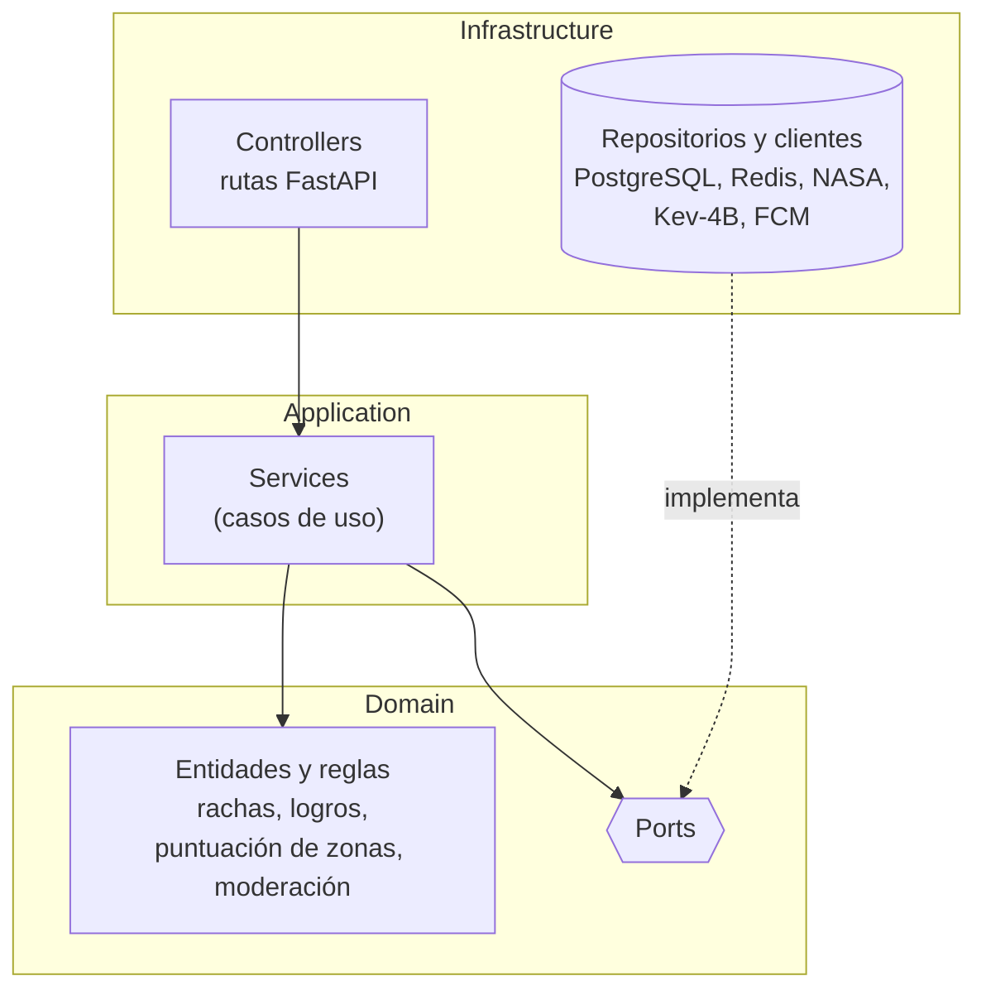

# Perseida · Backend

[English](README.md) | [Català](README.ca.md) | **Español**

> 🚧 **En construcción.** El proyecto está en el primer sprint. `app/` y `tests/` ya son reales (el módulo `health` es el ejemplo de referencia), pero la mayoría de módulos (persistencia, autenticación, chat) aún no están implementados.

Backend de **Perseida**, una aplicación móvil multiplataforma de divulgación, exploración y seguimiento de fenómenos astronómicos, desarrollada como proyecto de PES (UPC-FIB). Expone la API REST y el chat en tiempo real que usan la app móvil y el panel de administración, e integra las NASA Open APIs y otros proveedores externos.

## Responsabilidades

Un único proceso FastAPI integra tres responsabilidades:

- **API REST** para la app móvil y el panel de administración (Swagger/OpenAPI siempre sincronizado con el código).
- **WebSocket** para el chat en tiempo real (salas de evento y 1-a-1), con Redis pub/sub.
- **Planificador (APScheduler, dentro del proceso)** para tareas periódicas: notificaciones programadas, reinicio de rachas diarias y purga de contenido caducado (publicaciones multimedia de 24 h).

Áreas funcionales principales: eventos astronómicos (catálogo, filtros, mapa, suscripciones, exportación `.ics`), contenido diario de la NASA (APOD), gamificación (rachas, logros, quiz diario), comunidad (seguimiento, chats de evento, chats directos, votación de fotografías), recomendación de zonas de observación (meteorología + contaminación lumínica + PostGIS), notificaciones (FCM), moderación y administración.

## Stack tecnológico

| Ámbito | Tecnología |
|---|---|
| Lenguaje | Python 3.14 |
| Framework | FastAPI (async) |
| ORM / migraciones | SQLModel (SQLAlchemy) · Alembic (se ejecuta automáticamente en el entrypoint del contenedor) |
| Base de datos | PostgreSQL 18 + PostGIS (fuente de verdad) |
| Caché / pub-sub | Redis 8 (caché lazy con TTL; nada se persiste solo aquí) |
| Planificador | APScheduler |
| Autenticación | Google OAuth2 + PKCE · validación de tokens de Google vía JWKS · sesión propia del backend (JWT) |
| Moderación | Microservicio Kev-4B (modelo local, llamada síncrona) |
| Dependencias | `uv` (versiones exactas, `uv.lock` versionado) |
| Calidad | `ruff` (lint + formato, complejidad máx. 10), `mypy` estricto, SonarQube Cloud |
| Tests | `pytest`, `pytest-asyncio`, `pytest-cov`, `httpx`, `respx` |

## Arquitectura: hexagonal



- `domain`: lógica de negocio sin dependencia de frameworks, BD ni servicios externos (la única librería externa permitida es Pydantic). Contiene las entidades, los value objects, los errores de dominio y los **ports** (`Protocol`) que describen qué necesita el negocio del exterior ([ADR-0016](../obsidian_vault/decisions/0016-ports-i-entitats-riques-al-domini.md)).
- `application`: **services** (casos de uso) que orquestan las entidades a través de los ports. Sin reglas de negocio propias ni FastAPI, SQLModel, Redis o httpx.
- `infrastructure`: todo lo que toca el exterior: **controllers** (rutas FastAPI), **repositorios** y clientes externos que implementan los ports, y el *composition root* (`dependencies.py`, `@lru_cache` + `Depends`, [ADR-0017](../obsidian_vault/decisions/0017-injeccio-de-dependencies-i-services-singleton.md)).

**Regla de dependencias:** `domain` solo importa la biblioteca estándar, Pydantic y `app.domain`; `application` solo eso y `app.application`; `infrastructure` puede importar cualquier capa. Lo verifica `tests/architecture/test_layer_dependencies.py`.

Patrón para datos externos (p. ej. APOD): la primera petición llama a la API externa y guarda el resultado en Redis (y en PostgreSQL cuando hace falta); las siguientes se sirven desde la caché. Si la API externa cae, se devuelven los datos de la caché en lugar de un 500.

## Estructura

```
backend/
├── app/
│   ├── main.py            # app factory de FastAPI y lifespan
│   ├── domain/            # entities, value objects, ports
│   │   ├── shared/        # jerarquía DomainError
│   │   └── health/        # modelos y ports
│   ├── application/       # services
│   │   ├── shared/        # jerarquía ApplicationError
│   │   └── health/        # caso de uso
│   └── infrastructure/    # routers, persistence, redis, clients
│       ├── api/           # handlers de errores (RFC 9457) y correlation id
│       └── health/        # adaptadores, router y cableado
├── tests/
│   ├── unit/              # dominio y application, con fakes
│   ├── integration/       # API con httpx + ASGITransport
│   ├── architecture/      # reglas de dependencias entre capas
│   ├── fakes/             # ports en memoria para los tests
│   ├── fixtures/          # respuestas grabadas de NASA/meteo, datos geo
│   ├── factories/         # usuarios, eventos, mensajes, logros
│   └── moderation_dataset/# conjunto etiquetado de evaluación de Kev-4B (ca/es/en)
├── pyproject.toml
└── uv.lock
```

`alembic/` (migraciones) y `.env.example` llegarán con la persistencia.

### Añadir una funcionalidad

El módulo `health` es el ejemplo de referencia. Para un módulo nuevo `<nombre>`:

1. **Dominio** (`app/domain/<nombre>/`): entidades/value objects en `models.py` y los ports en `ports.py` (p. ej. `HealthReport` y el protocolo `HealthCheck`).
2. **Application** (`app/application/<nombre>/`): el service que usa los ports (`HealthService`), sin FastAPI.
3. **Infrastructure** (`app/infrastructure/<nombre>/`): los adaptadores que implementan los ports (`checks.py`), el provider `get_<nombre>_service` con `@lru_cache` y `<Nombre>ServiceDep` (`dependencies.py`), y el router con su modelo de respuesta (`router.py`).
4. Registra el router en `create_app()` (`app/main.py`).
5. **Tests** primero (TDD estricto, test `test:` en rojo antes del `feat:`): unitarios con fakes (`tests/fakes/`), integración de la API con `dependency_overrides`; el test de arquitectura sigue verificando las capas.

## Errores

Contrato de errores único ([ADR-0018](../obsidian_vault/decisions/0018-errors-rfc-9457-amb-codis-estables.md)). El código de dominio y de application lanza errores tipados con un `code` estable (`SCREAMING_SNAKE`, p. ej. `EVENT_NOT_FOUND`); solo `infrastructure` conoce HTTP, así que no hay ninguna `HTTPException` fuera de ella.

| Error | Capa | Status |
|---|---|---|
| `NotFoundError` | `domain/shared/errors.py` | 404 |
| `ConflictError` | `domain/shared/errors.py` | 409 |
| `ValidationError`, `BusinessRuleViolation` | `domain/shared/errors.py` | 422 |
| `UnauthorizedError` | `application/shared/errors.py` | 401 |
| `ForbiddenError` | `application/shared/errors.py` | 403 |
| `ExternalServiceError` (proveedor externo caído, sin caché) | `application/shared/errors.py` | 503 |
| Otros `DomainError` / `ApplicationError` | | 400 |

```python
raise NotFoundError("EVENT_NOT_FOUND", "Event 42 does not exist")
raise UnauthorizedError("INVALID_SESSION")  # el mensaje por defecto es el code
```

`DomainError(code, message=None)` y `ApplicationError(code, message=None)` comparten firma; `message` es técnico (logs y `detail`) y nunca se muestra al usuario: el frontend traduce por `code`. El status se resuelve en `infrastructure/api/error_handlers.py` (`STATUS_BY_ERROR`, recorriendo el MRO de la clase), de modo que una subclase nueva hereda el del padre.

Todo error se responde como `application/problem+json` (RFC 9457):

```json
{
  "type": "about:blank",
  "title": "Not Found",
  "status": 404,
  "detail": "Event 42 does not exist",
  "instance": "/api/events/42",
  "code": "EVENT_NOT_FOUND",
  "correlation_id": "5c0e0b8e-6d57-4f7b-9d0e-0d6a1f6f4c11"
}
```

- `title` es la frase HTTP estándar; `type` siempre es `about:blank`.
- Errores de validación de la petición: 422, `code` `VALIDATION_ERROR` y `errors[]` con un `{field, message, type}` por campo (las ramas de una unión de Pydantic, como `x.int`, se recortan a `x`). Los errores 5xx se registran con `warning`.
- Rutas inexistentes y otros errores HTTP conservan su status con `NOT_FOUND`, `METHOD_NOT_ALLOWED` o `HTTP_<status>`.
- Excepciones inesperadas: 500 `INTERNAL_ERROR` con un `detail` genérico; ninguna traza ni nombre de clase sale del servidor (va al log con el `correlation_id`).
- **Correlation id:** la cabecera `X-Correlation-ID` se añade a todas las respuestas. Un valor entrante solo se reutiliza si cumple `[A-Za-z0-9._-]{1,128}`; si no, se genera un `uuid4`. El mismo id sale en el cuerpo como `correlation_id`.

Añadir un código: lanza la clase existente con el `code` nuevo desde `domain`/`application`, regístralo en el [catálogo de códigos](../.agents/skills/gestio-errors/references/cataleg-codis.md) y añade sus textos ca/es/en en el frontend. Nunca se renombra un `code` publicado.

## Planificador

APScheduler (`AsyncIOScheduler`) se ejecuta dentro del proceso de la API: se inicia en el *lifespan* de FastAPI y se detiene al apagar. No hay *job store*: las tareas se registran al arrancar.

| Variable | Por defecto | Significado |
|---|---|---|
| `SCHEDULER_ENABLED` | `true` | con `false` no se inicia el planificador ni aparece en `/api/health` |
| `SCHEDULER_TIMEZONE` | `UTC` | zona horaria IANA del planificador |

**Registrar una tarea** (el único lugar): añade una línea a `register_jobs` de `app/infrastructure/scheduler/jobs.py`, con el puerto `JobScheduler` (`app/domain/scheduler/ports.py`):

```python
def register_jobs(scheduler: JobScheduler) -> None:
    scheduler.add_interval_job("purge-expired-posts", purge_service.run, seconds=3600)
```

- La tarea es una `async def` sin argumentos (construye su service con los mismos providers que la API, [ADR-0017](../obsidian_vault/decisions/0017-injeccio-de-dependencies-i-services-singleton.md)); se ejecuta en el bucle de eventos, por tanto no debe bloquear.
- Cada tarea se ejecuta con `max_instances=1` y `coalesce=True`: una tarea lenta no se solapa consigo misma y las ejecuciones perdidas se fusionan.
- Una excepción se registra en el log (JSON, campo `job` con el nombre) y no detiene ni el planificador ni la API.
- `/api/health` informa del componente `scheduler` mientras está activado.
- Se asume un único proceso de API; con varias réplicas haría falta un bloqueo distribuido.

Los logs (también los de uvicorn) se escriben en stderr como un objeto JSON por línea, con `correlation_id` cuando lo hay (`app/infrastructure/logging.py`). Un `SCHEDULER_TIMEZONE` desconocido falla al arrancar con un error de configuración.

## Contratos de servicio (Spotwise, grupo 21B)

- **Proveemos:** `GET /api/events/active` y `GET /api/events/upcoming` devuelven los eventos astronómicos relevantes (título, descripción breve, categoría como `lunar`, `solar`, `meteor_shower`).
- **Consumimos:** la búsqueda de espacios de Spotwise (bibliotecas y cafeterías de Barcelona) para sugerir puntos de encuentro en los eventos.

## Ejecutar y testear

Prerrequisito: [`uv`](https://docs.astral.sh/uv/). La versión de Python (3.14.9) la fija `.python-version` y `uv` la instala si hace falta.

```bash
cd backend                    # desde la raíz del repositorio
uv sync                       # instala las dependencias (entorno virtual en .venv)
uv lock --check               # verifica que uv.lock está al día con pyproject.toml
uv run ruff check .           # lint
uv run ruff format --check .  # comprueba el formato sin modificar archivos
uv run mypy .                 # tipado estricto
uv run pytest                 # tests (con cobertura)
uv run uvicorn app.main:app --reload  # arranca la API (http://127.0.0.1:8000/api/docs)
```

- Las dependencias se añaden con `uv add` / `uv add --dev` y versión exacta (`==`); no se usa `pip`.
- Toda la configuración (ruff, mypy, pytest, cobertura) está en `pyproject.toml`.

El stack completo (API, PostgreSQL/PostGIS, Redis, moderación) se levanta con Docker Compose desde [`../infra`](../infra/README.es.md). Copia `.env.example` a `.env`; los secretos reales nunca se versionan.

## Integración continua

El workflow [`.github/workflows/ci.yml`](../.github/workflows/ci.yml) ejecuta el job `backend` en cada pull request hacia `develop` o `main` y en cada push a `develop` o `main`. En una PR solo se ejecuta si han cambiado `backend/**` o el propio workflow; si no, el job queda como omitido (*skipped*) y no bloquea la PR. Un push nuevo a la misma PR cancela la ejecución anterior.

Comandos exactos (desde `backend/`, los mismos que el workflow):

```bash
cd backend                                 # desde la raíz del repositorio
uv sync --locked                           # falla si uv.lock no está al día
uv run ruff check .                        # lint
uv run ruff format --check .               # formato
uv run mypy .                              # tipado estricto
uv run pytest --cov-report=xml:coverage.xml  # tests + informe de cobertura
```

- **Cobertura:** el informe se publica como artefacto `backend-coverage` (`coverage.xml`). Para descargarlo: GitHub → pestaña **Actions** → la ejecución → sección **Artifacts** al final de la página de resumen.
- **Servicios:** PostgreSQL (PostGIS 18) y Redis 8 se levantan solos como service containers en la CI. No hacen falta Docker Compose ni `.env`.

## Redis

Redis solo es una caché con TTL y el bus pub/sub del chat WebSocket; no guarda nada que deba sobrevivir (la fuente de verdad es PostgreSQL). El cliente asíncrono se crea en el `lifespan` de FastAPI y se cierra al apagar la aplicación. Configuración (ver `.env.example`):

- `REDIS_HOST`, `REDIS_PORT`: dirección del servidor (`redis://host:port`).
- `CACHE_DEFAULT_TTL_SECONDS`: TTL por defecto en segundos (3600 si no se define).
- `REDIS_SOCKET_TIMEOUT_SECONDS`: timeout de conexión y de socket en segundos (2 si no se define); un Redis colgado se comporta como un miss.

Para ejecutar un Redis local: `docker run -d --name perseida-redis -p 6379:6379 redis:8` y `REDIS_HOST=localhost`.

**Puertos** (`app/domain/shared/ports.py`): `Cache` (`get`, `set` con un `ttl_seconds` opcional por clave) y `PubSub` (`publish`, `subscribe`). Los adaptadores Redis están en `app/infrastructure/cache/`; se inyectan con `CacheDep` y `PubSubDep` (también valen en endpoints WebSocket).

**Caché lazy:** `get_or_load(cache, key, load, adapter, ttl_seconds=None)` (`app/application/shared/cache.py`) devuelve el valor de la caché o llama a `load`, lo guarda y lo devuelve. Si Redis cae, `RedisCache` registra un aviso y se comporta como un fallo, así que el dato se obtiene igualmente de la fuente (sin HTTP 500).

**Convención de claves:** quien llama usa `<dominio>:<id>` y el adaptador lo guarda como `cache:<dominio>:<id>`, p. ej. `cache:apod:2026-10-05`. Cada funcionalidad elige su TTL.

**Pub/sub:** `async with pubsub.subscribe(canal) as mensajes:` entrega los mensajes publicados tras entrar en el bloque; todos los suscriptores del canal reciben cada mensaje y los de otros canales no. Si Redis falla se lanza `ExternalServiceError` (`PUBSUB_UNAVAILABLE`, HTTP 503).

Los tests de integración (`tests/integration/test_redis.py`) se ejecutan si hay `REDIS_HOST`; la CI levanta Redis 8.

## APOD (NASA)

`GET /api/apod` devuelve la imagen astronómica del día de la NASA; `GET /api/apod?date=AAAA-MM-DD`, la de esa fecha. El adaptador (`app/infrastructure/apod/nasa_provider.py`) la busca en este orden:

1. **Redis** (`cache:apod:<fecha>`, TTL 24 h).
2. **PostgreSQL** (tabla `apod`, una fila por fecha): se guarda cada APOD recibido de la NASA y, si está, se vuelve a poner en Redis.
3. **NASA**: la respuesta se guarda en PostgreSQL y en Redis. La API de la NASA (`https://api.nasa.gov/planetary/apod`) ya no devuelve el APOD real (ver abajo), así que el adaptador lee primero el **feed RSS** `https://science.nasa.gov/feed/apod-basic/` (no documentado; solo guarda los últimos **30 días**, ignora cualquier filtro de fecha y aquí no trae vídeos) y, si falla, la API JSON como alternativa (p. ej. fechas de más de 30 días).

Sin fecha, se busca el de hoy (UTC) en Redis y PostgreSQL; si no está, se pide a la NASA el último publicado. Si la NASA falla (error, timeout o respuesta inservible), se devuelve el dato guardado: el APOD de esa fecha o, para hoy, el último guardado. Sin nada guardado, la respuesta es 503 `APOD_UNAVAILABLE`. Si Redis cae, la petición sigue con PostgreSQL y la NASA.

Para no llamar a la NASA en cada petición, dos respuestas se guardan en Redis **15 minutos** (`RETRY_AFTER_SECONDS`): el resultado de hoy mientras la NASA aún no lo ha publicado (`cache:apod:today:<fecha>`) y una llamada fallida a la NASA (`cache:apod:unavailable:<fecha|latest>`), que no se repite hasta que caduca.

Configuración (`.env`):

| Variable | Por defecto | Significado |
|---|---|---|
| `NASA_API_KEY` | (obligatoria) | Clave de [api.nasa.gov](https://api.nasa.gov). En local vale `DEMO_KEY` (con límite de peticiones). Se envía en la cabecera `X-Api-Key`, nunca en la URL, para que no salga en los logs. |
| `NASA_CONNECT_TIMEOUT_SECONDS` | `3` | Timeout de conexión |
| `NASA_TIMEOUT_SECONDS` | `10` | Timeout total de una petición (sin reintentos) |
| `NASA_APOD_FEED_URL` | `https://science.nasa.gov/feed/apod-basic/` | Feed RSS del APOD (se prueba primero). Opcional, solo https. |
| `NASA_APOD_API_URL` | `https://api.nasa.gov/planetary/apod` | API JSON de la NASA (alternativa). Opcional, solo https. `NASA_API_KEY` se envía a esta URL: apúntala solo a un host de confianza. |

La API no arranca sin `NASA_API_KEY`. En producción viene del secret de GitHub `NASA_API_KEY`; nunca hagas commit de una clave real.

> Ahora mismo la API de la NASA responde con un relleno en lugar del APOD (el logo de NASA Science y un texto genérico, observado el 2026-10-21; el APOD se ha mudado a science.nasa.gov). Por eso el feed RSS va primero. El cliente sigue rechazando el relleno (también en el feed), así que nunca se guarda.
>
> Límites del feed: solo se guardan imágenes (`.jpg`, `.jpeg`, `.png`, `.gif`, `.webp`); una entrada de vídeo se descarta (`APOD_UNAVAILABLE` si la API tampoco puede responder). La fecha de una entrada es el día UTC de su publicación y el texto de `explanation` y `copyright` se convierte de HTML a texto plano. El fallo de una llamada se guarda 15 minutos solo cuando fallan el feed **y** la API.

## Autenticación

La app inicia sesión con Google (OAuth2 + PKCE) y envía el `id_token` de Google al backend, que nunca recibe el código de autorización ni guarda ninguna contraseña ([ADR-0008](../obsidian_vault/decisions/0008-google-oauth2-pkce-jwks-i-sessio-propia.md)). El backend comprueba el token y emite una sesión propia.

**Flujo:**

1. `POST /api/auth/google` con `{"id_token": "<token de Google>", "language": "ca"}` (`language` es opcional).
2. `GoogleJwksVerifier` comprueba la firma RS256 con las claves públicas de Google (JWKS, en memoria durante 1 hora; un `kid` desconocido provoca una descarga nueva, como máximo una vez por minuto), el emisor, la audiencia (uno de los clientes de `GOOGLE_CLIENT_IDS`), la caducidad y que el correo esté verificado. Si no: 401 `INVALID_GOOGLE_TOKEN`. Si Google no responde y no hay claves en memoria: 503 `IDENTITY_PROVIDER_UNAVAILABLE`.
3. El port `AccountGateway` da de alta la cuenta en el primer acceso y devuelve su estado: suspendida o baneada → 403 `ACCOUNT_SUSPENDED`; borrada → 403 `ACCOUNT_DELETED`.
4. El backend emite dos JWT firmados con HS256 y `JWT_SECRET`: un access token (15 minutos) y un refresh token (30 días), con los claims `sub` (el `google_sub`), `jti` (único por token), `sid` (identificador de sesión, compartido por el access y el refresh de un par y mantenido por `refresh`), `type` (`access` o `refresh`), `iat` y `exp`. Cada uno se registra en Redis como `session:<type>:<jti>` con un TTL igual a su duración, y se anota en el índice del usuario `user_sessions:<sub>` (miembros `<sid>:<type>:<jti>`).
5. Respuesta `200`: `{"access_token", "refresh_token", "token_type": "bearer", "expires_in"}` (`expires_in` en segundos).

Un token es válido solo si la firma y la caducidad son correctas **y** su clave existe en Redis. Borrar la clave revoca el token al instante; si Redis se reinicia, las sesiones se pierden y los usuarios vuelven a iniciar sesión con Google. Si Redis no está disponible, los endpoints responden 503 `SESSION_UNAVAILABLE`.

**Renovación:** `POST /api/auth/refresh` con `{"refresh_token": "..."}` devuelve un par nuevo y borra el refresh anterior de Redis; volver a usarlo devuelve 401 `INVALID_SESSION`.

**Configuración** (`.env.example`; `AuthSettings` en `app/infrastructure/auth/config.py`):

| Variable | Significado |
|---|---|
| `GOOGLE_CLIENT_IDS` | Audiencias (`aud`) aceptadas del token de Google: los clientes OAuth de la app (web, Android, iOS), separados por comas |
| `JWT_SECRET` | Clave HS256, de al menos 32 caracteres; nunca se versiona una real |
| `ACCESS_TOKEN_MINUTES` | Duración del access token (15 por defecto) |
| `REFRESH_TOKEN_DAYS` | Duración del refresh token (30 por defecto) |

**Proteger un endpoint:** añade `CurrentSessionDep`. Lee `Authorization: Bearer <access token>` y devuelve las `SessionClaims`. Sin cabecera, con un token inválido o revocado, o con un refresh token, responde 401 `INVALID_SESSION`.

```python
from app.infrastructure.auth.dependencies import CurrentSessionDep


@router.get("/me")
async def me(session: CurrentSessionDep) -> MeResponse:
    return MeResponse(google_sub=session.sub)  # sub is the user's google_sub
```

**Usuarios y alta (US #45).** El port `AccountGateway` lo implementa `UserAccountGateway` (`app/infrastructure/users/`), que delega en `UserService.sign_in` (`app/application/users/`):

- **Primer acceso:** un `google_sub` que no existe crea el usuario (rol `user`, nombre y avatar del perfil de Google). El `language` opcional del cuerpo del login (`ca`, `es` o `en`; cualquier otro valor o su ausencia significa `ca`) solo se guarda entonces. El insert es `INSERT … ON CONFLICT DO NOTHING`, de modo que dos primeros accesos simultáneos dejan un solo usuario.
- **Acceso recurrente:** no se crea ningún usuario nuevo; se actualiza `last_login_at`.
- **Correo de otra cuenta:** si el correo ya pertenece a un usuario vinculado a otro `google_sub`, 409 `EMAIL_ALREADY_REGISTERED` (las identidades no se vinculan automáticamente).
- **Borrado, suspendido o baneado:** 403 y no se crea ni se actualiza nada; el `google_sub` de una cuenta borrada queda reservado.

**Usuario actual:** `GET /api/users/me` devuelve `id`, `email`, `display_name`, `avatar_url`, `preferred_language` y `role` del propietario de la sesión. 401 `INVALID_SESSION` sin sesión válida; 403 `ACCOUNT_SUSPENDED` o `ACCOUNT_DELETED` si la cuenta no se puede usar.

**Cierre de sesión:** `POST /api/auth/logout` (cabecera `Authorization: Bearer <token>`) revoca la sesión entera, el access y el refresh, con el `sid` que comparten (`SessionStore.revoke_session`) y responde 204. Es idempotente: un token caducado, inválido o ya revocado, o ningún token, también responde 204. La suspensión y el baneo (#78, #102) usan `SessionStore.revoke_all(sub)`; el refresh falla entonces con 401 porque su clave ya no existe.

En los tests usa `FakeAccountGateway` (`tests/fakes/auth.py`); `tests/integration/test_auth_api.py` muestra el flujo completo con Google simulado con `respx`.

Los códigos de error (`INVALID_GOOGLE_TOKEN`, `INVALID_SESSION`, `ACCOUNT_SUSPENDED`, `ACCOUNT_DELETED`, `IDENTITY_PROVIDER_UNAVAILABLE`, `SESSION_UNAVAILABLE`, `EMAIL_ALREADY_REGISTERED`) están en `app/application/auth/errors.py` y en el catálogo de errores. Los tres que también lanza `users` (`INVALID_SESSION`, `ACCOUNT_SUSPENDED`, `ACCOUNT_DELETED`) se definen en `app/application/shared/error_codes.py` y `AccountStatus` en `app/domain/shared/account.py`, de modo que `auth` y `users` nunca se importan entre sí en `domain` ni en `application` (`tests/architecture`); `main.py` los compone pasando `UserAccountGateway` a `build_auth_service`.

## Testing y calidad

- Pirámide de pruebas: ~60 % unitarias, ~30 % de integración (PostgreSQL/PostGIS y Redis efímeros, API con `httpx.AsyncClient`, APIs externas simuladas con `respx`) y ~10 % E2E (Maestro en la app móvil y Playwright en el admin; previsto, US #361).
- Objetivos de cobertura: dominio ≥ 80 %, aplicación ≥ 70 %, código nuevo de cada PR ≥ 90 % y global ≥ 80 % (exigidos por el Quality Gate de SonarQube Cloud).
- Umbrales de requisitos no funcionales verificados con tests: recursos en caché ≤ 200 ms, consultas de proximidad ≤ 150 ms, endpoints privados rechazan peticiones sin sesión válida (401/403).

## Convenciones

- GitFlow: `main` (producción, dispara CD), `develop` (integración, CI), `feature/*`, `release/*`, `hotfix/*`. Ningún push directo a `main`/`develop`.
- Toda PR hacia `develop` necesita CI en verde y la aprobación de una persona distinta de la autora.
- Definition of Done: criterios de aceptación cumplidos, subtareas cerradas, integrada en `develop` con una PR revisada y con las comprobaciones superadas.

## Relacionado

[Frontend](../frontend/README.es.md) · [Infraestructura](../infra/README.es.md) · [Obsidian vault](../obsidian_vault/README.es.md)

## Equipo

Manel Alaminos · Simona Duelt · Alex Garcia · Oriol Orbea · Javier Pascual · Raquel Rubio
