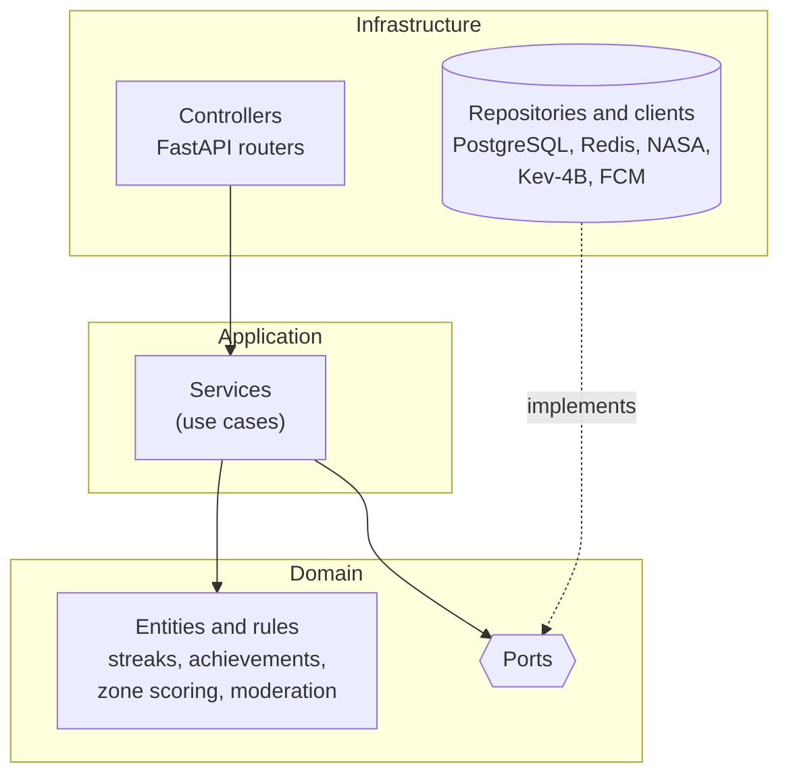

# Perseida · Backend

**English** | [Català](README.ca.md) | [Español](README.es.md)

> 🚧 **Under construction.** The project is in its first sprint. The `health` module is the reference example, and asynchronous PostgreSQL persistence infrastructure is now implemented. Most other modules (auth, chat) are still pending.

Backend of **Perseida**, a multiplatform mobile app for astronomy outreach, exploration and tracking of astronomical events, built as a PES project (UPC-FIB). It exposes the REST API and real-time chat used by the mobile app and the admin panel, and integrates NASA Open APIs and other external providers.

## Responsibilities

A single FastAPI process integrates three responsibilities:

- **REST API** for the mobile app and the admin panel (Swagger/OpenAPI always in sync with the code).
- **WebSocket** for real-time chat (event rooms and 1-to-1), with Redis pub/sub.
- **Scheduler (APScheduler, in-process)** for periodic jobs: scheduled notifications, daily streak resets, and purge of expired content (24 h media posts).

Main functional areas: astronomical events (catalog, filters, map, subscriptions, `.ics` export), daily NASA content (APOD), gamification (streaks, achievements, daily quiz), community (follow, event chats, direct chats, photo voting), observation-zone recommendation (weather + light pollution + PostGIS), notifications (FCM), moderation and administration.

## Tech stack

| Area | Technology |
|---|---|
| Language | Python 3.14 |
| Framework | FastAPI (async) |
| ORM / migrations | SQLModel (SQLAlchemy) · Alembic (run automatically at container entrypoint) |
| Database | PostgreSQL 18 + PostGIS (source of truth) |
| Cache / pub-sub | Redis 8 (lazy cache with TTL; nothing persisted only here) |
| Scheduler | APScheduler |
| Auth | Google OAuth2 + PKCE · Google token validation via JWKS · own backend session (JWT) |
| Moderation | Kev-4B microservice (local model, synchronous call) |
| Dependencies | `uv` (`uv.lock` committed) |
| Quality | `ruff` (lint + format, max complexity 10), `mypy` strict, SonarQube Cloud |
| Tests | `pytest`, `pytest-asyncio`, `pytest-cov`, `httpx`, `respx` |

## Architecture: hexagonal



- `domain`: business logic with no dependency on frameworks, DB or external services (the only external library allowed is Pydantic). It holds the entities, value objects, domain errors and the **ports** (`Protocol`) describing what the business needs from the outside ([ADR-0016](../obsidian_vault/decisions/0016-ports-i-entitats-riques-al-domini.md)).
- `application`: **services** (use cases) that orchestrate entities through ports. No business rules of their own and no FastAPI, SQLModel, Redis or httpx.
- `infrastructure`: everything that touches the outside world: **controllers** (FastAPI routers), **repositories** and external clients that implement the ports, and the composition root (`dependencies.py`, `@lru_cache` + `Depends`, [ADR-0017](../obsidian_vault/decisions/0017-injeccio-de-dependencies-i-services-singleton.md)).

**Dependency rule:** `domain` imports only the standard library, Pydantic and `app.domain`; `application` only those plus `app.application`; `infrastructure` may import any layer. It is enforced by `tests/architecture/test_layer_dependencies.py`.

Pattern for external data (e.g. APOD): the first request calls the external API and stores the result in Redis (and PostgreSQL where needed); later requests are served from cache. If the external API is down, cached data is returned instead of a 500.

## Structure

```text
backend/
├── app/
│   ├── main.py            # FastAPI app factory and lifespan
│   ├── domain/            # entities, value objects, ports
│   │   ├── shared/        # DomainError hierarchy
│   │   └── health/        # models and ports
│   ├── application/       # services
│   │   ├── shared/        # ApplicationError hierarchy
│   │   └── health/        # use case
│   └── infrastructure/    # routers, persistence, redis, clients
│       ├── api/           # error handlers (RFC 9457) and correlation id
│       ├── health/        # adapters, router and wiring
│       └── persistence/   # database settings, async sessions and metadata
├── tests/
│   ├── unit/              # domain, application and persistence tests
│   ├── integration/       # API and PostgreSQL integration tests
│   ├── architecture/      # layer dependency rules
│   ├── fakes/             # in-memory ports for the tests
│   ├── fixtures/          # recorded NASA/weather responses, geo data
│   ├── factories/         # users, events, messages, achievements
│   └── moderation_dataset/# labeled Kev-4B evaluation set (ca/es/en)
├── .env.example
├── pyproject.toml
└── uv.lock
```

### Database migrations

Alembic migrations are managed from the `backend/` directory. The container entrypoint runs `alembic upgrade head` before starting the API and stops if the migration fails.

```bash
# Create a migration after changing SQLModel metadata
uv run alembic revision --autogenerate -m "describe_change"

# Review the generated migration before committing it.
# Apply all pending migrations
uv run alembic upgrade head

# Roll back all migrations
uv run alembic downgrade base

# Check migration heads
uv run alembic heads

### Adding a feature

The `health` module is the reference example. For a new module `<name>`:

1. **Domain** (`app/domain/<name>/`): entities/value objects in `models.py` and the ports in `ports.py` (e.g. `HealthReport` and the `HealthCheck` protocol).
2. **Application** (`app/application/<name>/`): the service that uses the ports (`HealthService`), with no FastAPI.
3. **Infrastructure** (`app/infrastructure/<name>/`): the adapters implementing the ports (`checks.py`), the provider `get_<name>_service` with `@lru_cache` and `<Name>ServiceDep` (`dependencies.py`), and the router with its response model (`router.py`).
4. Register the router in `create_app()` (`app/main.py`).
5. **Tests**, after the code: unit tests with fakes (`tests/fakes/`), API integration tests with `dependency_overrides`; the architecture test keeps checking the layers.

## Errors

Single error contract ([ADR-0018](../obsidian_vault/decisions/0018-errors-rfc-9457-amb-codis-estables.md)). Business and application code raises typed errors with a stable `code` (`SCREAMING_SNAKE`, e.g. `EVENT_NOT_FOUND`); only `infrastructure` knows HTTP, so there is no `HTTPException` outside it.

| Error | Layer | Status |
|---|---|---|
| `NotFoundError` | `domain/shared/errors.py` | 404 |
| `ConflictError` | `domain/shared/errors.py` | 409 |
| `ValidationError`, `BusinessRuleViolation` | `domain/shared/errors.py` | 422 |
| `UnauthorizedError` | `application/shared/errors.py` | 401 |
| `ForbiddenError` | `application/shared/errors.py` | 403 |
| `ExternalServiceError` (external provider down, no cache) | `application/shared/errors.py` | 503 |
| Other `DomainError` / `ApplicationError` | | 400 |

```python
raise NotFoundError("EVENT_NOT_FOUND", "Event 42 does not exist")
raise UnauthorizedError("INVALID_SESSION")  # message defaults to the code
```

`DomainError(code, message=None)` and `ApplicationError(code, message=None)` share the signature; `message` is technical (logs and `detail`), never shown to end users: the frontend translates by `code`. The status is resolved in `infrastructure/api/error_handlers.py` (`STATUS_BY_ERROR`, walking the class MRO), so a new subclass inherits its parent's status.

Every error is answered as `application/problem+json` (RFC 9457):

```json
{
  "type": "about:blank",
  "title": "Not Found",
  "status": 404,
  "detail": "Event 42 does not exist",
  "instance": "/api/events/42",
  "code": "EVENT_NOT_FOUND",
  "correlation_id": "5c0e0b8e-6d57-4f7b-9d0e-0d6a1f6f4c11"
}
```

- `title` is the standard HTTP phrase; `type` is always `about:blank`.
- Request validation errors: 422, `code` `VALIDATION_ERROR` and `errors[]` with one `{field, message, type}` per field (Pydantic union branches such as `x.int` are trimmed to `x`). 5xx errors are logged at `warning`.
- Unknown routes and other HTTP errors keep their status with `NOT_FOUND`, `METHOD_NOT_ALLOWED` or `HTTP_<status>`.
- Unexpected exceptions: 500 `INTERNAL_ERROR` with a generic `detail`; no trace or class name leaves the server (it goes to the log with the `correlation_id`).
- **Correlation id:** the `X-Correlation-ID` header is added to every response. An incoming value is reused only if it matches `[A-Za-z0-9._-]{1,128}`; otherwise a `uuid4` is generated. The same id is in the body as `correlation_id`.

Adding a code: raise the existing class with the new `code` from `domain`/`application`, register it in the [error code catalogue](../.agents/skills/gestio-errors/references/cataleg-codis.md) and add its ca/es/en texts in the frontend. Never rename a published `code`.

## Scheduler

APScheduler (`AsyncIOScheduler`) runs inside the API process: it starts in the FastAPI lifespan and is stopped on shutdown. There is no job store: jobs are registered at startup.

| Variable | Default | Meaning |
|---|---|---|
| `SCHEDULER_ENABLED` | `true` | `false` neither starts the scheduler nor reports it in `/api/health` |
| `SCHEDULER_TIMEZONE` | `UTC` | IANA time zone of the scheduler |

**Registering a job** (the only place): add a line to `register_jobs` in `app/infrastructure/scheduler/jobs.py`, using the `JobScheduler` port (`app/domain/scheduler/ports.py`):

```python
def register_jobs(scheduler: JobScheduler) -> None:
    scheduler.add_interval_job("purge-expired-posts", purge_service.run, seconds=3600)
```

- The job is an `async def` without arguments (build its service with the same providers as the API, [ADR-0017](../obsidian_vault/decisions/0017-injeccio-de-dependencies-i-services-singleton.md)); it runs on the event loop, so it must not block.
- Each job runs with `max_instances=1` and `coalesce=True`: a slow job never overlaps itself and missed runs are merged.
- An exception is logged (JSON, `job` field with the name) and does not stop the scheduler or the API.
- `/api/health` reports the `scheduler` component while it is enabled.
- A single API process is assumed; with several replicas a distributed lock would be needed.

Logs (including uvicorn's) are written to stderr as one JSON object per line, with `correlation_id` when there is one (`app/infrastructure/logging.py`). An unknown `SCHEDULER_TIMEZONE` fails at startup with a configuration error.

## Service contracts (Spotwise, group 21B)

- **Provided:** `GET /api/events/active` and `GET /api/events/upcoming` return relevant astronomical events (title, short description, category such as `lunar`, `solar`, `meteor_shower`).
- **Consumed:** Spotwise's space search (libraries and cafés in Barcelona) to suggest meeting points for events.

## Run and test

Prerequisite: [`uv`](https://docs.astral.sh/uv/). The Python version (3.14) is pinned by `.python-version` and `uv` installs it if needed.

```bash
cd backend                    # from the repository root
uv sync                       # install dependencies (virtual env in .venv)
uv lock --check               # verify uv.lock is up to date with pyproject.toml
uv run ruff check .           # lint
uv run ruff format --check .   # check formatting without modifying files
uv run mypy .                 # strict type checking
uv run pytest                 # tests (with coverage)
uv run uvicorn app.main:app --reload  # start the API (http://127.0.0.1:8000/api/docs)
```

- Dependencies are managed with `uv add` / `uv add --dev`; `uv.lock` is committed to keep installations reproducible. `pip` is not used.
- All configuration (ruff, mypy, pytest, coverage) lives in `pyproject.toml`.

The full stack (API, PostgreSQL/PostGIS, Redis, moderation) is started with Docker Compose from [`../infra`](../infra/README.md). Copy `.env.example` to `.env`; real secrets are never committed.

## Continuous integration

The [`.github/workflows/ci.yml`](../.github/workflows/ci.yml) workflow runs the `backend` job on every pull request to `develop` or `main` and on every push to `develop` or `main`. In a PR it only runs if `backend/**` or the workflow itself changed; otherwise the job shows as *skipped* and does not block the PR. A new push to the same PR cancels the previous run.

Exact commands (from `backend/`, the same ones as the workflow):

```bash
cd backend                                 # from the repository root
uv sync --locked                           # fails if uv.lock is out of date
uv run ruff check .                        # lint
uv run ruff format --check .               # formatting
uv run mypy .                              # strict type checking
uv run pytest --cov-report=xml:coverage.xml  # tests + coverage report
```

- **Coverage:** the report is published as the `backend-coverage` artifact (`coverage.xml`). To download it: GitHub → **Actions** tab → the run → **Artifacts** section at the bottom of the summary page.
- **Services:** PostgreSQL (PostGIS 18) and Redis 8 start by themselves as service containers in the CI. No Docker Compose or `.env` is needed.
## PostgreSQL

The asynchronous PostgreSQL connection is configured through environment variables:

- `POSTGRES_DB`: database name.
- `POSTGRES_USER`: database user.
- `POSTGRES_PASSWORD`: database password.
- `POSTGRES_HOST`: database host.
- `POSTGRES_PORT`: database port.

See `.env.example` for example values. Do not commit real credentials.

To run a local PostgreSQL:

```bash
docker run --name perseida-postgres   -e POSTGRES_DB=perseida   -e POSTGRES_USER=postgres   -e POSTGRES_PASSWORD=change_me   -p 5432:5432   -d postgres:18
```

This starts PostgreSQL only (no PostGIS); use a PostGIS-enabled image for geospatial work. Then copy `.env.example` to `.env` with the same values and `POSTGRES_HOST=localhost`.

Database settings are validated during application startup. The asynchronous engine and session factory are created in FastAPI's lifespan and the engine is disposed when the application shuts down. A session is provided per request; successful requests commit, while exceptions trigger a rollback.

`persistence/models.py` sets the SQLModel naming convention (imported by `app.main`). The `ck` convention uses `%(constraint_name)s`, so every `CheckConstraint` must have an explicit `name`, otherwise Alembic migrations (TG-41) will fail.

The engine uses lazy connections: creating it does not immediately establish a connection to PostgreSQL. The first database operation opens the connection.

## Redis

Redis is only a TTL cache and the pub/sub bus for the WebSocket chat; nothing that must survive lives here (PostgreSQL is the source of truth). The asynchronous client is created in FastAPI's lifespan and closed on shutdown. Configuration (see `.env.example`):

- `REDIS_HOST`, `REDIS_PORT`: server address (`redis://host:port`).
- `CACHE_DEFAULT_TTL_SECONDS`: default TTL in seconds (3600 if unset).
- `REDIS_SOCKET_TIMEOUT_SECONDS`: connect and socket timeout in seconds (2 if unset), so a hung Redis behaves as a cache miss.

To run a local Redis: `docker run -d --name perseida-redis -p 6379:6379 redis:8`, then set `REDIS_HOST=localhost`.

**Ports** (`app/domain/shared/ports.py`): `Cache` (`get`, `set` with an optional per-key `ttl_seconds`) and `PubSub` (`publish`, `subscribe`). Redis adapters live in `app/infrastructure/cache/`; inject them with `CacheDep` and `PubSubDep` (they also work in WebSocket endpoints).

**Lazy cache:** `get_or_load(cache, key, load, adapter, ttl_seconds=None)` (`app/application/shared/cache.py`) returns the cached value or calls `load`, stores the result and returns it. If Redis is down, `RedisCache` logs a warning and behaves as a miss, so the data still comes from the source (no HTTP 500).

**Key convention:** callers use `<domain>:<id>` and the adapter stores it as `cache:<domain>:<id>`, e.g. `cache:apod:2026-10-05`. Each feature chooses its own TTL.

**Pub/sub:** `async with pubsub.subscribe(channel) as messages:` yields the messages published after entering the block; every subscriber of the channel receives each message and other channels do not. A Redis failure raises `ExternalServiceError` (`PUBSUB_UNAVAILABLE`, HTTP 503).

Integration tests (`tests/integration/test_redis.py`) run when `REDIS_HOST` is set; the CI provides Redis 8.

## Testing and quality

- Test pyramid: ~70 % unit, ~30 % integration (ephemeral PostgreSQL/PostGIS and Redis, API with `httpx.AsyncClient`, external APIs mocked with `respx`). No end-to-end tests on the mobile app.
- Coverage targets: domain ≥ 80 %, application ≥ 70 %, new code in each PR ≥ 70 % (enforced by the SonarQube Cloud Quality Gate).
- NFR thresholds verified by tests: cached resources ≤ 200 ms, proximity queries ≤ 150 ms, private endpoints reject requests without a valid session (401/403).

## Conventions

- GitFlow: `main` (production, triggers CD), `develop` (integration, CI), `feature/*`, `release/*`, `hotfix/*`. No direct push to `main`/`develop`.
- Every PR to `develop` needs green CI and approval from someone other than the author.
- Definition of Done: acceptance criteria met, subtasks closed, merged to `develop` via a reviewed PR with passing checks.

## Related

[Frontend](../frontend/README.md) · [Infrastructure](../infra/README.md) · [Obsidian vault](../obsidian_vault/README.md)

## Team

Manel Alaminos · Simona Duelt · Alex Garcia · Oriol Orbea · Javier Pascual · Raquel Rubio
