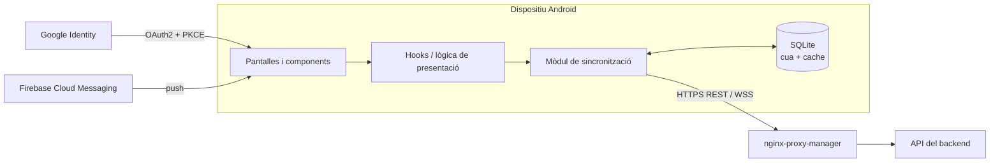

# Perseida · Frontend

[English](README.md) | **Català** | [Español](README.es.md)

> 🚧 **En construcció.** El projecte és en fase d'incepció/primer sprint. L'estructura i les ordres següents descriuen l'estat **previst** segons la documentació del projecte i poden canviar.

App mòbil i panell d'administració de **Perseida**, una aplicació multiplataforma de divulgació, exploració i seguiment de fenòmens astronòmics, desenvolupada com a projecte de PES (UPC-FIB). Construïda amb **React Native + Expo** i TypeScript. Pensada per a Android i iOS; de moment només es desplega la versió **Android** (APK).

## Què ofereix l'app

- **Mapa** interactiu i **llistat** filtrable d'esdeveniments astronòmics actius i futurs; creació, subscripció i detall d'esdeveniments.
- **APOD**: imatge astronòmica del dia de la NASA.
- **Gamificació**: ràtxa diària, fites desbloquejables (compartibles), quiz diari d'astrofísica, minijoc d'astronomia per reptar amics.
- **Comunitat**: seguiment d'usuaris, sales de xat d'esdeveniment, xats 1-a-1 amb històric persistent, compartició i votació de fotografies, publicacions efímeres de 24 h.
- **Zones d'observació** recomanades segons meteorologia, contaminació lumínica i ubicació de l'esdeveniment.
- **Notificacions** (FCM) configurables per tipus, data i proximitat; **exportació al calendari** (`.ics`).
- **Mode offline**: cua SQLite local i cache de lectura, sincronitzades més tard (last-write-wins).
- **Multiidioma**: català, castellà i anglès (detecció de l'idioma del dispositiu + selector).
- **Panell d'administració** (SPA amb React Native Web): gestió i suspensió d'usuaris, supervisió d'esdeveniments publicats, mètriques d'ús, cua de revisió de denúncies. Accés per rol.
- Aspecte «Cel viu» (Frutiger Cosmo): temes clar, fosc i de posta que segueixen el cel, i un mode vermell nocturn per observar; modes: Clar, Fosc, Seguir sistema, Seguir Sol.

## Stack tecnològic

| Àmbit                | Tecnologia                                                                |
| -------------------- | ------------------------------------------------------------------------- |
| Framework            | React Native + **Expo**                                                   |
| Llenguatge           | TypeScript (`strict`), motor Hermes                                       |
| Estils               | Tailwind                                                                  |
| i18n                 | i18next                                                                   |
| Emmagatzematge local | SQLite (cua + cache offline)                                              |
| Autenticació         | Google OAuth2 + PKCE                                                      |
| Push                 | Firebase Cloud Messaging                                                  |
| Tipus d'API          | Generats a partir de l'esquema OpenAPI del backend (`openapi-typescript`; còpia de `/api/openapi.json` a `openapi/openapi.json`, i després `pnpm api:generate`) |
| Web d'administració  | React Native Web (bundle estàtic servit per nginx-proxy-manager)          |
| Dependències         | `pnpm`                                                                    |
| Qualitat             | ESLint (TS, React, React Hooks), Prettier, SonarQube Cloud                |
| Tests                | Jest + React Native Testing Library                                       |

## Arquitectura



## Estructura prevista

```
frontend/
├── app/ o src/        # pantalles, components, hooks, serveis (Expo)
├── assets/
├── locales/           # traduccions ca / es / en
├── __mocks__/         # respostes simulades de l'API per als tests
├── app.json           # configuració d'Expo
├── package.json
└── tsconfig.json
```

## Autenticació i sessió (TG-43)

- **Emmagatzematge de tokens (`features/auth/tokenStorage.ts`)**: `saveTokens`, `getTokens`, `clearTokens`. Utilitza `expo-secure-store` a nativa (clauer/keystore) i `sessionStorage` a web (aïllat per pestanya, ADR-0008). Mai AsyncStorage.
- **Neteja de sessió (`features/auth/session.ts`)**: `clearSession()` esborra tant els tokens desats com la memòria cau en memòria de TanStack Query. Utilitzada per `useLogout` i per la renovació de token davant 401 `INVALID_SESSION`.
- **Renovació de sessió (`features/auth/api/refreshToken.ts`)**: `refreshSession()` renova els tokens mitjançant `POST /api/auth/refresh`. Serialitza les crides concurrents per garantir que els refresh tokens d'un sol ús no es cremin dues vegades.
- **Guard de ruta (`app/(app)/_layout.tsx`)**: Redirigeix usuaris sense sessió a `/login`; `/login` redirigeix usuaris autenticats cap a l'aplicació (`/(app)`).

## Executar i testejar

```bash
cd frontend                       # des de l'arrel del repositori
pnpm install --frozen-lockfile    # instal·la les dependències exactament com a pnpm-lock.yaml
pnpm expo start                   # arrenca el servidor de desenvolupament d'Expo (emulador Android / dispositiu; Expo Go ha de ser de l'SDK 58)
pnpm web                          # la mateixa app al navegador (React Native Web)
pnpm lint                         # ESLint + Prettier (també comprova el format)
pnpm typecheck                    # comprovació de tipus estricta (tsc --noEmit)
pnpm test                         # Jest (preset jest-expo)
pnpm test --coverage              # tests + informe de cobertura (coverage/lcov.info)
```

L'script de comprovació de tipus es diu `typecheck` i no `tsc`: `expo-doctor` (que EAS Build executa primer) avisa quan un script de `package.json` té el mateix nom que un binari de `node_modules/.bin`, i `tsc` és el binari de TypeScript. `pnpm tsc` continua funcionant perquè pnpm recorre al binari i dona el mateix resultat aquí (`expo/tsconfig.base` ja fixa `noEmit`), però fes servir `pnpm typecheck`, que és l'ordre documentada.

Releases: a cada release fusionada a `main`, GitHub Actions publica l'**APK** en una release de GitHub.

## Provar al mòbil (login amb Google)

El login amb Google **no** funciona a Expo Go (l'app mostra un missatge específic): necessita una build nativa amb package `app.perseida`. Hi ha dues maneres d'aconseguir-la:

- **EAS Build (recomanada).** L'organització d'Expo `perseida-fib-upc` compila l'APK al núvol. No necessita Android Studio i funciona a Windows.
- **Build local.** `pnpm expo run:android` necessita Android Studio i l'SDK d'Android. A Windows pot fallar al pas de C++ perquè algunes rutes superen els 260 caràcters (`ninja: error: manifest 'build.ninja' still dirty` o `mkdir(...)`), així que allà és preferible EAS.

### Preparació (una sola vegada, EAS Build)

1. Crea un compte a [expo.dev](https://expo.dev) **amb el mateix correu** al qual es va enviar la invitació.
2. Accepta la invitació a l'organització `perseida-fib-upc` (correu d'Expo). Les invitacions les envia un propietari de l'organització des d'expo.dev → `perseida-fib-upc` → *Settings* → *Members* → *Invite member*, amb el rol *Developer*, que pot compilar però no gestionar membres.
3. Inicia sessió des del terminal i comprova que veus l'organització:

   ```bash
   npx eas-cli@latest login
   npx eas-cli@latest whoami      # ha de llistar perseida-fib-upc
   ```

### Compilar i instal·lar

```bash
cd frontend
npx eas-cli@latest build -p android --profile preview
```

1. El perfil `preview` és a `eas.json`: un APK instal·lable amb els valors públics `EXPO_PUBLIC_*` (backend de producció, client ids de Google, esquema `app.perseida`). En aquest fitxer no hi va cap secret.
2. Si el CLI avisa de canvis sense commitejar, comprova amb `git status` que són teus i continua.
3. Triga entre 10 i 20 minuts. En acabar imprimeix un enllaç; totes les builds són també a `https://expo.dev/accounts/perseida-fib-upc/projects/frontend/builds`.
4. Obre l'enllaç al mòbil, descarrega l'APK i permet que el navegador instal·li apps quan Android ho demani.

**No** executis `eas init` (el projecte ja està enllaçat amb `extra.eas.projectId` i `owner` a `app.json`; no els canviïs) i **no** generis un keystore nou si el CLI ho ofereix: el compartit viu a Expo, i un de nou té un altre SHA-1, de manera que el login amb Google deixaria de funcionar fins a registrar-lo de nou.

### Què necessiten Google i el backend

- **Google Cloud (ho fa un cop un administrador):** un client Android amb package `app.perseida`, el SHA-1 del keystore d'EAS (`npx eas-cli@latest credentials -p android` el mostra, de manera interactiva) i *Enable custom URI scheme* marcat. Els canvis poden trigar de 5 minuts a unes hores.
- **Backend de producció:** la seva variable `GOOGLE_CLIENT_IDS` ha d'incloure aquest client id i el CD l'ha d'haver desplegat.
- **App de Google en *Testing*:** només hi entren els usuaris de prova llistats fins que es publiqui la pantalla de consentiment.

### Si alguna cosa falla

| Símptoma | Causa probable |
|---|---|
| `whoami` no llista `perseida-fib-upc`, o la build diu que no tens accés | La invitació encara no està acceptada, o has fet servir un altre correu. |
| Google mostra `invalid_request`, `redirect_uri_mismatch` o client no vàlid | El SHA-1 o el package no estan registrats al client Android, o el canvi encara no s'ha propagat. |
| Google diu que l'app no està verificada o que no tens accés | L'app és a *Testing* i el teu compte no és usuari de prova. |
| L'app diu que el login amb Google no funciona a Expo Go | L'has oberta a Expo Go; instal·la l'APK. |
| El login arriba al backend però hi falla | El client id encara no és al `GOOGLE_CLIENT_IDS` de producció. |

## Traduccions (i18n)

L'app parla català (`ca`), castellà (`es`) i anglès (`en`). Arrenca en el primer d'aquests idiomes que el dispositiu tingui a la seva llista d'idiomes, i en català si no n'hi ha cap. Cap text s'escriu al codi: surt de `locales/<idioma>.json` mitjançant [i18next](https://www.i18next.com) (`src/shared/i18n`).

**Afegir un text**

1. Afegeix la mateixa clau a `locales/ca.json`, `locales/es.json` i `locales/en.json` (agrupada per funcionalitat, p. ex. `apod.retry`).
2. Fes-la servir al component: `const { t } = useTranslation();` i `t('apod.retry')`.
3. `pnpm test` falla si una clau existeix en un idioma i falta en un altre (`src/shared/i18n/locales.test.ts`).

**Afegir el text d'un codi d'error**: afegeix `errors.<CODE>` als tres fitxers i mostra'l amb `errorMessage(t, error.code, error.retryable)` (`src/shared/errors`). Un codi sense text mostra el missatge genèric, mai el `detail` del servidor.

**Afegir un idioma** (p. ex. `fr`)

1. Crea `locales/fr.json` amb exactament les mateixes claus que `ca.json`.
2. Afegeix-lo a `SUPPORTED_LANGUAGES` (`src/shared/i18n/detectLanguage.ts`) i a `resources` (`src/shared/i18n/index.ts`).
3. Afegeix-lo a `locales` a `src/shared/i18n/locales.test.ts`.

## Integració contínua

El workflow [`.github/workflows/ci.yml`](../.github/workflows/ci.yml) executa el job `frontend` a cada pull request cap a `develop` o `main` i a cada push a `develop` o `main`. En una PR només s'executa si han canviat `frontend/**` o el propi workflow; si no, el job queda com a omès (*skipped*) i no bloqueja la PR. Un push nou a la mateixa PR cancel·la l'execució anterior.

Ordres exactes (des de `frontend/`, les mateixes que el workflow, cada una en un pas separat perquè es vegi quina falla):

```bash
cd frontend                       # des de l'arrel del repositori
pnpm install --frozen-lockfile    # falla si pnpm-lock.yaml no està al dia
pnpm lint                         # ESLint + Prettier
pnpm typecheck                    # comprovació de tipus estricta
pnpm test --coverage --ci         # Jest + informe de cobertura
```

- **Versions:** la CI fa servir Node 24.22.1 (fixat al workflow) i pnpm 12.15.0 (fixat a `packageManager` de `package.json`, que el workflow llegeix); fes servir les mateixes en local per reproduir un error. Per actualitzar pnpm: `pnpm self-update` (`pnpm add -g pnpm` es rebutja des de pnpm 11.10).
- **Cobertura:** l'informe es publica com a artefacte `frontend-coverage` (`lcov.info`). Per descarregar-lo: GitHub → pestanya **Actions** → l'execució → secció **Artifacts** al final de la pàgina de resum.
- **Requisits:** el job no necessita secrets ni serveis.

## Testing i qualitat

- Jest s'executa amb el preset `jest-expo` (`jest.config.js`) i hi ha un test de fum a `__tests__/`. React Native Testing Library ja s'usa per als hooks; els tests de components i els mocks de l'API arriben amb la US #83.
- Prioritat per als custom hooks i la lògica de presentació (estats de càrrega / error / llista buida, validació de formularis), components principals (targetes d'esdeveniment, pantalla APOD, ràtxa, formulari de denúncia, pantalles d'admin) i la comprovació que tots els textos de la UI tenen traducció en ca/es/en. El client de l'API se simula.
- El feedback de validació dels formularis ha d'aparèixer en < 100 ms sense crida a la xarxa.
- Codi nou de cada PR: cobertura ≥ 70 % i Quality Gate de SonarQube Cloud. Els components purament visuals queden exclosos de la cobertura.
- Els criteris d'acceptació dependents de la UI es verifiquen manualment a la branca release abans de cada sprint review. No hi ha proves end-to-end automatitzades.

## Convencions

- GitFlow amb branques `feature/*` des de `develop`; PR aprovada per una persona diferent de l'autora i amb CI en verd.
- Mateixes regles de TypeScript estricte i lint per a tot l'equip (fitxers de configuració versionats).
- El codi generat amb assistents d'IA passa exactament per la mateixa revisió i portes de qualitat.

## Relacionat

[Backend](../backend/README.ca.md) · [Infraestructura](../infra/README.ca.md) · [Obsidian vault](../obsidian_vault/README.ca.md)

## Equip

Manel Alaminos · Simona Duelt · Alex Garcia · Oriol Orbea · Javier Pascual · Raquel Rubio
