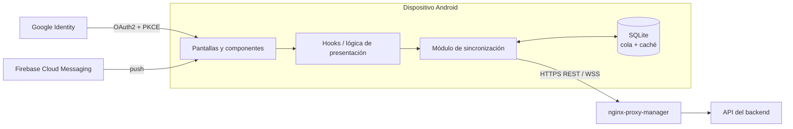

# Perseida · Frontend

[English](README.md) | [Català](README.ca.md) | **Español**

> 🚧 **En construcción.** El proyecto está en fase de inception/primer sprint. La estructura y los comandos siguientes describen el estado **previsto** según la documentación del proyecto y pueden cambiar.

App móvil y panel de administración de **Perseida**, una aplicación multiplataforma de divulgación, exploración y seguimiento de fenómenos astronómicos, desarrollada como proyecto de PES (UPC-FIB). Construida con **React Native + Expo** y TypeScript. Pensada para Android e iOS; de momento solo se despliega la versión **Android** (APK).

## Qué ofrece la app

- **Mapa** interactivo y **listado** filtrable de eventos astronómicos activos y futuros; creación, suscripción y detalle de eventos.
- **APOD**: imagen astronómica del día de la NASA.
- **Gamificación**: racha diaria, logros desbloqueables (compartibles), quiz diario de astrofísica, minijuego de astronomía para retar a amigos.
- **Comunidad**: seguimiento de usuarios, salas de chat de evento, chats 1-a-1 con histórico persistente, compartición y votación de fotografías, publicaciones efímeras de 24 h.
- **Zonas de observación** recomendadas según meteorología, contaminación lumínica y ubicación del evento.
- **Notificaciones** (FCM) configurables por tipo, fecha y proximidad; **exportación al calendario** (`.ics`).
- **Modo offline**: cola SQLite local y caché de lectura, sincronizadas más tarde (last-write-wins).
- **Multiidioma**: catalán, castellano e inglés (detección del idioma del dispositivo + selector).
- **Panel de administración** (SPA con React Native Web): gestión y suspensión de usuarios, supervisión de eventos publicados, métricas de uso, cola de revisión de denuncias. Acceso por rol.
- Aspecto «Cielo vivo» (Frutiger Cosmo): temas claro, oscuro y de atardecer que siguen el cielo, y un modo rojo nocturno para observar; modos: Claro, Oscuro, Seguir sistema, Seguir Sol.

## Stack tecnológico

| Ámbito                | Tecnología                                                                |
| --------------------- | ------------------------------------------------------------------------- |
| Framework             | React Native + **Expo**                                                   |
| Lenguaje              | TypeScript (`strict`), motor Hermes                                       |
| Estilos               | Tailwind                                                                  |
| i18n                  | i18next                                                                   |
| Almacenamiento local  | SQLite (cola + caché offline)                                             |
| Autenticación         | Google OAuth2 + PKCE                                                      |
| Push                  | Firebase Cloud Messaging                                                  |
| Tipos de API          | Generados a partir del esquema OpenAPI del backend (`openapi-typescript`; copia de `/api/openapi.json` en `openapi/openapi.json`, y luego `pnpm api:generate`) |
| Web de administración | React Native Web (bundle estático servido por nginx-proxy-manager)        |
| Dependencias          | `pnpm`                                                                    |
| Calidad               | ESLint (TS, React, React Hooks), Prettier, SonarQube Cloud                |
| Tests                 | Jest + React Native Testing Library                                       |

## Arquitectura



## Estructura prevista

```
frontend/
├── app/ o src/        # pantallas, componentes, hooks, servicios (Expo)
├── assets/
├── locales/           # traducciones ca / es / en
├── __mocks__/         # respuestas simuladas de la API para los tests
├── app.json           # configuración de Expo
├── package.json
└── tsconfig.json
```

## Autenticación y sesión (TG-43)

- **Almacenamiento de tokens (`features/auth/tokenStorage.ts`)**: `saveTokens`, `getTokens`, `clearTokens`. Utiliza `expo-secure-store` en nativo (llavero/keystore) y `sessionStorage` en web (aislado por pestaña, ADR-0008). Nunca AsyncStorage.
- **Limpieza de sesión (`features/auth/session.ts`)**: `clearSession()` borra tanto los tokens guardados como la caché en memoria de TanStack Query. Utilizada por `useLogout` y por la renovación de token ante 401 `INVALID_SESSION`.
- **Renovación de sesión (`features/auth/api/refreshToken.ts`)**: `refreshSession()` renueva los tokens mediante `POST /api/auth/refresh`. Serializa las llamadas concurrentes para garantizar que los refresh tokens de un solo uso no se gasten dos veces.
- **Guard de ruta (`app/(app)/_layout.tsx`)**: Redirige a usuarios sin sesión a `/login`; `/login` redirige a usuarios autenticados hacia la aplicación (`/(app)`).

## Ejecutar y testear

```bash
cd frontend                       # desde la raíz del repositorio
pnpm install --frozen-lockfile    # instala las dependencias exactamente como en pnpm-lock.yaml
pnpm expo start                   # arranca el servidor de desarrollo de Expo (emulador Android / dispositivo; Expo Go debe ser del SDK 58)
pnpm web                          # la misma app en el navegador (React Native Web)
pnpm lint                         # ESLint + Prettier (también comprueba el formato)
pnpm typecheck                    # comprobación de tipos estricta (tsc --noEmit)
pnpm test                         # Jest (preset jest-expo)
pnpm test --coverage              # tests + informe de cobertura (coverage/lcov.info)
```

El script de comprobación de tipos se llama `typecheck` y no `tsc`: `expo-doctor` (que EAS Build ejecuta primero) avisa cuando un script de `package.json` tiene el mismo nombre que un binario de `node_modules/.bin`, y `tsc` es el binario de TypeScript. `pnpm tsc` sigue funcionando porque pnpm recurre al binario y da el mismo resultado aquí (`expo/tsconfig.base` ya fija `noEmit`), pero usa `pnpm typecheck`, que es el comando documentado.

Releases: en cada release fusionada en `main`, GitHub Actions publica el **APK** en una release de GitHub.

## Probar en el móvil (login con Google)

El login con Google **no** funciona en Expo Go (la app muestra un mensaje específico): necesita una build nativa con package `app.perseida`. Hay dos maneras de conseguirla:

- **EAS Build (recomendada).** La organización de Expo `perseida-fib-upc` compila el APK en la nube. No necesita Android Studio y funciona en Windows.
- **Build local.** `pnpm expo run:android` necesita Android Studio y el SDK de Android. En Windows puede fallar en el paso de C++ porque algunas rutas superan los 260 caracteres (`ninja: error: manifest 'build.ninja' still dirty` o `mkdir(...)`), así que allí es preferible EAS.

### Preparación (una sola vez, EAS Build)

1. Crea una cuenta en [expo.dev](https://expo.dev) **con el mismo email** al que se envió la invitación.
2. Acepta la invitación a la organización `perseida-fib-upc` (correo de Expo). Las invitaciones las envía un propietario de la organización desde expo.dev → `perseida-fib-upc` → *Settings* → *Members* → *Invite member*, con el rol *Developer*, que puede compilar pero no gestionar miembros.
3. Inicia sesión desde el terminal y comprueba que ves la organización:

   ```bash
   npx eas-cli@latest login
   npx eas-cli@latest whoami      # debe listar perseida-fib-upc
   ```

### Compilar e instalar

```bash
cd frontend
npx eas-cli@latest build -p android --profile preview
```

1. El perfil `preview` está en `eas.json`: un APK instalable con los valores públicos `EXPO_PUBLIC_*` (backend de producción, client ids de Google, esquema `app.perseida`). En ese fichero no va ningún secreto.
2. Si el CLI avisa de cambios sin commitear, comprueba con `git status` que son tuyos y continúa.
3. Tarda entre 10 y 20 minutos. Al acabar imprime un enlace; todas las builds están también en `https://expo.dev/accounts/perseida-fib-upc/projects/frontend/builds`.
4. Abre el enlace en el móvil, descarga el APK y permite que el navegador instale apps cuando Android lo pida.

**No** ejecutes `eas init` (el proyecto ya está enlazado con `extra.eas.projectId` y `owner` en `app.json`; no los cambies) y **no** generes un keystore nuevo si el CLI lo ofrece: el compartido vive en Expo, y uno nuevo tiene otro SHA-1, con lo que el login con Google dejaría de funcionar hasta registrarlo de nuevo.

### Qué necesitan Google y el backend

- **Google Cloud (lo hace una vez un administrador):** un cliente Android con package `app.perseida`, el SHA-1 del keystore de EAS (`npx eas-cli@latest credentials -p android` lo muestra, de forma interactiva) y *Enable custom URI scheme* marcado. Los cambios pueden tardar de 5 minutos a unas horas.
- **Backend de producción:** su variable `GOOGLE_CLIENT_IDS` debe incluir ese client id y el CD debe haberla desplegado.
- **App de Google en *Testing*:** solo entran los usuarios de prueba listados hasta que se publique la pantalla de consentimiento.

### Si algo falla

| Síntoma | Causa probable |
|---|---|
| `whoami` no lista `perseida-fib-upc`, o la build dice que no tienes acceso | La invitación aún no está aceptada, o usaste otro email. |
| Google muestra `invalid_request`, `redirect_uri_mismatch` o cliente no válido | El SHA-1 o el package no están registrados en el cliente Android, o el cambio aún no se ha propagado. |
| Google dice que la app no está verificada o que no tienes acceso | La app está en *Testing* y tu cuenta no es usuario de prueba. |
| La app dice que el login con Google no funciona en Expo Go | La abriste en Expo Go; instala el APK. |
| El login llega al backend pero falla allí | El client id aún no está en el `GOOGLE_CLIENT_IDS` de producción. |

## Traducciones (i18n)

La app habla catalán (`ca`), castellano (`es`) e inglés (`en`). Arranca en el primero de estos idiomas que el dispositivo tenga en su lista de idiomas, y en catalán si no hay ninguno. Ningún texto se escribe en el código: sale de `locales/<idioma>.json` mediante [i18next](https://www.i18next.com) (`src/shared/i18n`).

**Añadir un texto**

1. Añade la misma clave a `locales/ca.json`, `locales/es.json` y `locales/en.json` (agrupada por funcionalidad, p. ej. `apod.retry`).
2. Úsala en el componente: `const { t } = useTranslation();` y `t('apod.retry')`.
3. `pnpm test` falla si una clave existe en un idioma y falta en otro (`src/shared/i18n/locales.test.ts`).

**Añadir el texto de un código de error**: añade `errors.<CODE>` a los tres ficheros y muéstralo con `errorMessage(t, error.code, error.retryable)` (`src/shared/errors`). Un código sin texto muestra el mensaje genérico, nunca el `detail` del servidor.

**Añadir un idioma** (p. ej. `fr`)

1. Crea `locales/fr.json` con exactamente las mismas claves que `ca.json`.
2. Añádelo a `SUPPORTED_LANGUAGES` (`src/shared/i18n/detectLanguage.ts`) y a `resources` (`src/shared/i18n/index.ts`).
3. Añádelo a `locales` en `src/shared/i18n/locales.test.ts`.

## Integración continua

El workflow [`.github/workflows/ci.yml`](../.github/workflows/ci.yml) ejecuta el job `frontend` en cada pull request hacia `develop` o `main` y en cada push a `develop` o `main`. En una PR solo se ejecuta si han cambiado `frontend/**` o el propio workflow; si no, el job queda como omitido (*skipped*) y no bloquea la PR. Un push nuevo a la misma PR cancela la ejecución anterior.

Comandos exactos (desde `frontend/`, los mismos que el workflow, cada uno en un paso separado para que se vea cuál falla):

```bash
cd frontend                       # desde la raíz del repositorio
pnpm install --frozen-lockfile    # falla si pnpm-lock.yaml no está al día
pnpm lint                         # ESLint + Prettier
pnpm typecheck                    # comprobación de tipos estricta
pnpm test --coverage --ci         # Jest + informe de cobertura
```

- **Versiones:** la CI usa Node 24.22.1 (fijado en el workflow) y pnpm 12.15.0 (fijado en `packageManager` de `package.json`, que el workflow lee); usa las mismas en local para reproducir un error. Para actualizar pnpm: `pnpm self-update` (`pnpm add -g pnpm` se rechaza desde pnpm 11.10).
- **Cobertura:** el informe se publica como artefacto `frontend-coverage` (`lcov.info`). Para descargarlo: GitHub → pestaña **Actions** → la ejecución → sección **Artifacts** al final de la página de resumen.
- **Requisitos:** el job no necesita secretos ni servicios.

## Testing y calidad

- Jest se ejecuta con el preset `jest-expo` (`jest.config.js`) y hay un test de humo en `__tests__/`. React Native Testing Library ya se usa para los hooks; los tests de componentes y los mocks de la API llegan con la US #83.
- Prioridad para los custom hooks y la lógica de presentación (estados de carga / error / lista vacía, validación de formularios), componentes principales (tarjetas de evento, pantalla APOD, racha, formulario de denuncia, pantallas de admin) y la comprobación de que todos los textos de la UI tienen traducción en ca/es/en. El cliente de la API se simula.
- El feedback de validación de los formularios debe aparecer en < 100 ms sin llamada a red.
- Código nuevo de cada PR: cobertura ≥ 70 % y Quality Gate de SonarQube Cloud. Los componentes puramente visuales quedan excluidos de la cobertura.
- Los criterios de aceptación dependientes de la UI se verifican manualmente en la rama release antes de cada sprint review. No hay pruebas end-to-end automatizadas.

## Convenciones

- GitFlow con ramas `feature/*` desde `develop`; PR aprobada por una persona distinta de la autora y con CI en verde.
- Mismas reglas de TypeScript estricto y lint para todo el equipo (ficheros de configuración versionados).
- El código generado con asistentes de IA pasa exactamente por la misma revisión y puertas de calidad.

## Relacionado

[Backend](../backend/README.es.md) · [Infraestructura](../infra/README.es.md) · [Obsidian vault](../obsidian_vault/README.es.md)

## Equipo

Manel Alaminos · Simona Duelt · Alex Garcia · Oriol Orbea · Javier Pascual · Raquel Rubio
