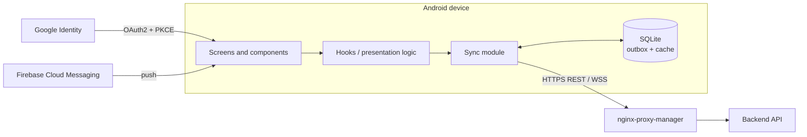

# Perseida · Frontend

**English** | [Català](README.ca.md) | [Español](README.es.md)

> 🚧 **Under construction.** The project is in its inception/first-sprint phase. Structure and commands below describe the **planned** state defined in the project documentation and may change.

Mobile app and admin panel of **Perseida**, a multiplatform app for astronomy outreach, exploration and tracking of astronomical events, built as a PES project (UPC-FIB). Built with **React Native + Expo** and TypeScript. It is designed for Android and iOS; for now only the **Android** version (APK) is deployed.

## What the app offers

- Interactive **map** and filterable **list** of active and upcoming astronomical events; event creation, subscription and details.
- **APOD**: NASA Astronomy Picture of the Day.
- **Gamification**: daily streak, unlockable achievements (shareable), daily astrophysics quiz, astronomy minigame to challenge friends.
- **Community**: follow users, event chat rooms, 1-to-1 chats with persistent history, photo sharing and voting, 24 h ephemeral posts.
- **Observation zones** recommended from weather, light pollution and event location.
- **Notifications** (FCM) configurable by type, date and proximity; **calendar export** (`.ics`).
- **Offline mode**: local SQLite outbox and read cache, synchronized later (last-write-wins).
- **Multi-language**: Catalan, Spanish and English (device language detection + selector).
- **Admin panel** (SPA with React Native Web): user management and suspension, published-event supervision, usage metrics, report review queue. Access by role.
- "Living sky" look (Frutiger Cosmo): light, dark and sunset themes that follow the sky, plus a red night mode for stargazing; modes: Light, Dark, Follow system, Follow Sun.

## Tech stack

| Area          | Technology                                                       |
| ------------- | ---------------------------------------------------------------- |
| Framework     | React Native + **Expo**                                          |
| Language      | TypeScript (`strict`), Hermes engine                             |
| Styling       | Tailwind                                                         |
| i18n          | i18next                                                          |
| Local storage | SQLite (outbox + offline cache)                                  |
| Auth          | Google OAuth2 + PKCE                                             |
| Push          | Firebase Cloud Messaging                                         |
| API types     | Generated from the backend OpenAPI schema (`openapi-typescript`; copy of `/api/openapi.json` in `openapi/openapi.json`, then `pnpm api:generate`) |
| Admin web     | React Native Web (static bundle served by nginx-proxy-manager)   |
| Dependencies  | `pnpm`                                                           |
| Quality       | ESLint (TS, React, React Hooks), Prettier, SonarQube Cloud       |
| Tests         | Jest + React Native Testing Library                              |

## Architecture



## Planned structure

```
frontend/
├── app/ or src/       # screens, components, hooks, services (Expo)
├── assets/
├── locales/           # ca / es / en translations
├── __mocks__/         # simulated API responses for tests
├── app.json           # Expo configuration
├── package.json
└── tsconfig.json
```

## Authentication and Session (TG-43)

- **Token Storage (`features/auth/tokenStorage.ts`)**: `saveTokens`, `getTokens`, `clearTokens`. Uses `expo-secure-store` on native (keychain/keystore) and `sessionStorage` on web (isolated per tab, ADR-0008). Never AsyncStorage.
- **Session Cleanup (`features/auth/session.ts`)**: `clearSession()` purges both stored tokens and the in-memory TanStack Query cache. Used by `useLogout` and by token renewal on 401 `INVALID_SESSION`.
- **Session Renewal (`features/auth/api/refreshToken.ts`)**: `refreshSession()` renews tokens via `POST /api/auth/refresh`. Serializes concurrent calls to ensure single-use refresh tokens are never burned.
- **Route Guard (`app/(app)/_layout.tsx`)**: Redirects unauthenticated users to `/login`; `/login` redirects authenticated users into the app (`/(app)`).

## Run and test

```bash
cd frontend                       # from the repository root
pnpm install --frozen-lockfile    # install dependencies exactly as in pnpm-lock.yaml
pnpm expo start                   # start the Expo dev server (Android emulator / device; Expo Go must match SDK 58)
pnpm web                          # same app in the browser (React Native Web)
pnpm lint                         # ESLint + Prettier (also checks formatting)
pnpm typecheck                    # strict type check (tsc --noEmit)
pnpm test                         # Jest (jest-expo preset)
pnpm test --coverage              # tests + coverage report (coverage/lcov.info)
```

The type-check script is called `typecheck`, not `tsc`: `expo-doctor` (which EAS Build runs first) warns when a `package.json` script has the same name as a binary in `node_modules/.bin`, and `tsc` is the TypeScript binary. Running `pnpm tsc` still works because pnpm falls back to the binary and gives the same result here (`expo/tsconfig.base` already sets `noEmit`), but use `pnpm typecheck`, which is the documented command.

Releases: on each release merged into `main`, GitHub Actions publishes the **APK** as a GitHub release.

## Test on a phone (Google sign-in)

Google sign-in does **not** work in Expo Go (the app shows a specific message): it needs a native build with package `app.perseida`. There are two ways to get one:

- **EAS Build (recommended).** The Expo organisation `perseida-fib-upc` builds the APK in the cloud. It needs no Android Studio and works on Windows.
- **Local build.** `pnpm expo run:android` needs Android Studio and the Android SDK. On Windows it can fail in the C++ step because some paths exceed 260 characters (`ninja: error: manifest 'build.ninja' still dirty` or `mkdir(...)`), so prefer EAS there.

### One-time setup (EAS Build)

1. Create an account at [expo.dev](https://expo.dev) **with the same email** the invitation was sent to.
2. Accept the invitation to the organisation `perseida-fib-upc` (email from Expo). Invitations are sent by an organisation owner from expo.dev → `perseida-fib-upc` → *Settings* → *Members* → *Invite member*, with the *Developer* role, which can build but not manage members.
3. Sign in from the terminal and check that you see the organisation:

   ```bash
   npx eas-cli@latest login
   npx eas-cli@latest whoami      # must list perseida-fib-upc
   ```

### Build and install

```bash
cd frontend
npx eas-cli@latest build -p android --profile preview
```

1. The profile `preview` is in `eas.json`: an installable APK with the public `EXPO_PUBLIC_*` values (production backend, Google client ids, `app.perseida` scheme). No secret goes in that file.
2. If the CLI warns about uncommitted changes, check with `git status` that they are yours and continue.
3. It takes 10-20 minutes. When it ends it prints a link; all builds are also at `https://expo.dev/accounts/perseida-fib-upc/projects/frontend/builds`.
4. Open the link on the phone, download the APK and allow the browser to install apps when Android asks.

Do **not** run `eas init` (the project is already linked through `extra.eas.projectId` and `owner` in `app.json`; do not change them) and do **not** generate a new keystore if the CLI offers it: the shared one lives in Expo, and a new one has another SHA-1, so Google sign-in stops working until it is registered again.

### What Google and the backend need

- **Google Cloud (an administrator does this once):** an Android client with package `app.perseida`, the SHA-1 of the EAS keystore (`npx eas-cli@latest credentials -p android` shows it, interactively) and *Enable custom URI scheme* ticked. Changes can take from 5 minutes to a few hours.
- **Production backend:** its `GOOGLE_CLIENT_IDS` variable must include that client id, and the CD must have deployed it.
- **Google app in *Testing*:** only the listed test users can sign in until the consent screen is published.

### If something fails

| Symptom | Likely cause |
|---|---|
| `whoami` does not list `perseida-fib-upc`, or the build says you have no access | The invitation is not accepted yet, or you used another email. |
| Google shows `invalid_request`, `redirect_uri_mismatch` or an invalid client | The SHA-1 or the package is not registered in the Android client, or the change has not propagated yet. |
| Google says the app is not verified or you have no access | The app is in *Testing* and your account is not a test user. |
| The app says Google sign-in does not work in Expo Go | You opened it in Expo Go; install the APK instead. |
| Sign-in reaches the backend but fails there | The client id is not in the production `GOOGLE_CLIENT_IDS` yet. |

## Translations (i18n)

The app speaks Catalan (`ca`), Spanish (`es`) and English (`en`). It starts in the first of these that the device has in its language list, and in Catalan if none is. No text is written in the code: it comes from `locales/<language>.json` through [i18next](https://www.i18next.com) (`src/shared/i18n`).

**Add a text**

1. Add the same key to `locales/ca.json`, `locales/es.json` and `locales/en.json` (grouped by feature, e.g. `apod.retry`).
2. Use it in the component: `const { t } = useTranslation();` and `t('apod.retry')`.
3. `pnpm test` fails if a key exists in one language and not in another (`src/shared/i18n/locales.test.ts`).

**Add a text for an error code**: add `errors.<CODE>` to the three files and show it with `errorMessage(t, error.code, error.retryable)` (`src/shared/errors`). A code without text shows the generic message, never the server `detail`.

**Add a language** (e.g. `fr`)

1. Create `locales/fr.json` with exactly the same keys as `ca.json`.
2. Add it to `SUPPORTED_LANGUAGES` (`src/shared/i18n/detectLanguage.ts`) and to `resources` (`src/shared/i18n/index.ts`).
3. Add it to `locales` in `src/shared/i18n/locales.test.ts`.

## Continuous integration

The [`.github/workflows/ci.yml`](../.github/workflows/ci.yml) workflow runs the `frontend` job on every pull request to `develop` or `main` and on every push to `develop` or `main`. In a PR it only runs if `frontend/**` or the workflow itself changed; otherwise the job shows as *skipped* and does not block the PR. A new push to the same PR cancels the previous run.

Exact commands (from `frontend/`, the same ones as the workflow, each one a separate step so you can see which fails):

```bash
cd frontend                       # from the repository root
pnpm install --frozen-lockfile    # fails if pnpm-lock.yaml is out of date
pnpm lint                         # ESLint + Prettier
pnpm typecheck                    # strict type check
pnpm test --coverage --ci         # Jest + coverage report
```

- **Versions:** the CI uses Node 24.22.1 (pinned in the workflow) and pnpm 12.15.0 (pinned in `packageManager` in `package.json`, which the workflow reads); use the same locally to reproduce a failure. To update pnpm run `pnpm self-update` (`pnpm add -g pnpm` is rejected since pnpm 11.10).
- **Coverage:** the report is published as the `frontend-coverage` artifact (`lcov.info`). To download it: GitHub → **Actions** tab → the run → **Artifacts** section at the bottom of the summary page.
- **Requirements:** the job needs no secrets and no services.

## Testing and quality

- Jest runs with the `jest-expo` preset (`jest.config.js`) and there is a smoke test in `__tests__/`. React Native Testing Library is already used for hooks; the component tests and API mocks arrive with US #83.
- Priority on custom hooks and presentation logic (loading / error / empty states, form validation), main components (event cards, APOD screen, streak, report form, admin screens) and checking that every UI text has ca/es/en translation. The API client is mocked.
- Form validation feedback must appear in < 100 ms without a network call.
- New code of each PR: coverage ≥ 70 % and SonarQube Cloud Quality Gate. Purely visual components are excluded from coverage.
- UI-dependent acceptance criteria are checked manually on the release branch before each sprint review. No automated end-to-end tests.

## Conventions

- GitFlow with `feature/*` branches from `develop`; PR approved by someone other than the author, with passing CI.
- Same strict TypeScript and lint rules for the whole team (versioned config files).
- Code generated with AI assistants goes through exactly the same review and quality gates.

## Related

[Backend](../backend/README.md) · [Infrastructure](../infra/README.md) · [Obsidian vault](../obsidian_vault/README.md)

## Team

Manel Alaminos · Simona Duelt · Alex Garcia · Oriol Orbea · Javier Pascual · Raquel Rubio
