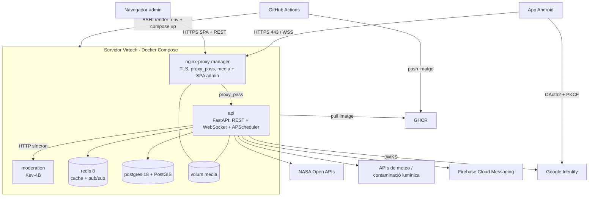

# Perseida · Infraestructura

[English](README.md) | **Català** | [Español](README.es.md)

> 🚧 **En construcció.** El projecte és en fase d'incepció/primer sprint. El contingut següent descriu l'estat **previst** segons la documentació del projecte i pot canviar.

Configuració de Docker i de desplegament de **Perseida**, una aplicació multiplataforma de divulgació i seguiment de fenòmens astronòmics (projecte de PES, UPC-FIB). Defineix com s'executa tot el sistema en local i en producció.

## Visió general del desplegament

Tot s'executa en **un únic servidor proporcionat per Virtech**, orquestrat amb **Docker Compose** (Kubernetes s'ha descartat explícitament: amb un sol host físic només afegeix overhead de control plane i el punt únic de fallada continua sent el servidor).



## Serveis (Docker Compose)

| Servei | Rol |
|---|---|
| `nginx-proxy-manager` | Punt d'entrada únic: HTTPS/TLS (certificats gestionats), proxy cap a l'API, upgrade de WebSocket, serveix els fitxers multimèdia dels usuaris des del volum compartit i el bundle estàtic del panell d'administració. |
| `api` | Imatge del backend `perseida-api:<git-sha>`. Un sol procés: REST + WebSocket + APScheduler. Executa les migracions d'Alembic a l'entrypoint abans d'arrencar. |
| `postgres` | PostgreSQL 18 + PostGIS, volum `pgdata` (font de veritat). |
| `redis` | Redis 8, cache amb TTL i pub/sub. Res essencial viu només aquí. |
| `moderation` | Servei del model Kev-4B, versió fixada, límits de recursos i healthcheck; accessible només des de la xarxa interna de Docker. |

## CI/CD (GitHub Actions)

- **CI** a cada PR cap a `develop`/`main`, amb filtres per ruta i cache de dependències `uv`/`pnpm`: format, linters i tipus → tests amb cobertura → SonarQube Cloud → Quality Gate. Obligatori per fusionar.
- **CD** a cada push a `main` (fusió de release o hotfix):
  1. Construeix la imatge del backend (el job `image` reutilitza `backend-docker.yml`), l'etiqueta amb el `git-sha` (`sha-<7 caràcters>`) i la puja a **GHCR**, encara que no hagi canviat cap fitxer del backend.
  2. Es connecta al servidor de Virtech per **SSH**, copia `docker-compose.yml` i `deploy.sh`, renderitza el `.env` des dels secrets i variables de GitHub (`chmod 600`) i executa `deploy.sh`: baixa la imatge, fa `docker compose up` i comprova el healthcheck amb un temps d'espera.
  3. Si el healthcheck falla, fa rollback automàtic a la versió anterior i el job acaba en error.
  4. Publica l'**APK** del frontend en una release de GitHub.
- Versionat: SemVer a partir de `0.1.0`, una release per sprint, automatitzat pel pipeline.
- Rollback: automàtic quan falla el healthcheck, manual amb `deploy.sh --rollback <tag>` (vegeu *Desplegament a producció (CD)* més avall).
- El repositori també conté una automatització que desbloqueja tasques de Taiga (`.github/workflows/taiga-unblock.yml`).

## GHCR — Permisos i visibilitat del paquet

La imatge del backend es publica a **GitHub Container Registry** (`ghcr.io`) sota el namespace de l'organització:

```
ghcr.io/pes2627q1-21-gei-upc/perseida-api:<tag>
```

### Permisos automàtics (GITHUB_TOKEN)

El workflow de CI/CD utilitza el token natiu `GITHUB_TOKEN` — sense necessitat de PAT ni secrets manuals:

| Àmbit | Motiu |
|---|---|
| `contents: read` | Clonar el repositori al runner |
| `packages: write` | Publicar la imatge a GHCR i actualitzar-ne les metadades |

GitHub redueix automàticament els permisos de `packages` a `read` en pull requests provinents de forks externs per seguretat.

### Descarregar i executar la imatge (docker pull i run)

Per descarregar la imatge des de GHCR:

```bash
docker pull ghcr.io/pes2627q1-21-gei-upc/perseida-api:latest
# o per tag de commit o branca:
docker pull ghcr.io/pes2627q1-21-gei-upc/perseida-api:sha-a1b2c3d
docker pull ghcr.io/pes2627q1-21-gei-upc/perseida-api:develop
```

Per arrencar el contenidor de l'API de forma independent (fora de Docker Compose), cal injectar les variables d'entorn requerides pel backend:

```bash
docker run -d \
  --name perseida-api \
  -p 8000:8000 \
  -e POSTGRES_DB=perseida \
  -e POSTGRES_USER=perseida \
  -e POSTGRES_PASSWORD=secret \
  -e POSTGRES_HOST=localhost \
  -e POSTGRES_PORT=5432 \
  -e REDIS_HOST=localhost \
  -e REDIS_PORT=6379 \
  ghcr.io/pes2627q1-21-gei-upc/perseida-api:latest
```

### Variables d'entorn del backend

El servei FastAPI (`perseida-api`) utilitza les següents variables d'entorn per a la connexió i configuració:

| Variable | Requerida | Descripció | Exemple |
|---|---|---|---|
| `POSTGRES_DB` | Sí | Nom de la base de dades PostgreSQL | `perseida` |
| `POSTGRES_USER` | Sí | Usuari de la base de dades | `perseida` |
| `POSTGRES_PASSWORD` | Sí | Contrasenya de la base de dades | `secret` |
| `POSTGRES_HOST` | Sí | Host o nom de servei de PostgreSQL | `postgres` o `localhost` |
| `POSTGRES_PORT` | Sí | Port de PostgreSQL | `5432` |
| `REDIS_HOST` | No | Host o nom de servei de Redis | `cache` o `localhost` |
| `REDIS_PORT` | No | Port del servei Redis | `6379` |
| `APP_ENV` | No | Entorn d'execució (`local`, `production`) | `production` |
| `API_IMAGE_TAG` | No | Etiqueta o SHA de commit de la imatge a GHCR (usat per a rollbacks) | `latest` o `sha-a1b2c3d` |
| `GOOGLE_CLIENT_IDS` | Sí | Audiències acceptades dels tokens d'identitat de Google: clients OAuth (web, Android, iOS), separats per comes | `1234-web.apps.googleusercontent.com,5678-ios.apps.googleusercontent.com` |
| `JWT_SECRET` | Sí | Secret per a signatures JWT de sessió (com a mínim 32 caràcters) | `<sortida d'openssl rand -hex 32>` |
| `NASA_API_KEY` | Sí | Clau de l'API de la NASA per a l'APOD (l'API no arrenca sense); en local val `DEMO_KEY`, amb límit de peticions | `<clau d'https://api.nasa.gov>` |
| `ACCESS_TOKEN_MINUTES` | No | Temps d'expiració dels access tokens en minuts (per defecte: 15) | `15` |
| `REFRESH_TOKEN_DAYS` | No | Temps d'expiració dels refresh tokens en dies (per defecte: 30) | `30` |

### Configuració inicial: fer el paquet públic (un sol cop, manual)

Quan la imatge es puja per primer cop, GitHub crea el paquet com a **privat** per defecte. Per a un projecte acadèmic obert, es recomana canviar-lo a **públic** a través de la interfície web de GitHub:

1. Vés al repositori a GitHub: `https://github.com/pes2627q1-21-gei-upc/perseida`.
2. Fes clic a **Packages** (a la barra lateral dreta) → `perseida-api`.
3. Fes clic a **Package settings** (a la barra lateral de configuració del paquet).
4. A la secció **Danger Zone**, fes clic a **Change visibility** i selecciona **Public**.

### Vinculació del paquet al repositori

En el primer push, GitHub vincula el paquet al repositori mitjançant l'etiqueta `org.opencontainers.image.source`, que `docker/metadata-action` fixa automàticament a la URL del repositori. `github.repository_owner` només decideix quin compte és propietari del paquet.

## Desplegament a producció (CD)

`.github/workflows/cd.yml` s'executa a cada push a `main` (i a mà des de `main`). Un push o PR a `develop` o a una branca `feature/*` no el dispara mai. Jobs, en ordre: `verify-config` (comprova tots els secrets i variables, abans de tocar el servidor) → `image` (construeix i puja a GHCR) → `deploy` (entorn `production`).

> **Cap secret no entra mai al repositori.** Els secrets i variables viuen només a GitHub (**Settings → Secrets and variables → Actions**); aquest README en llista els *noms*, mai els valors. El `.env` es genera al servidor i està ignorat per git. Crea'ls com a secrets i variables **de repositori**, no com a secrets de l'entorn `production`: `verify-config` no fa servir aquest entorn i els donaria per absents.

### Secrets i variables requerits

`verify-config` llista tots els noms que falten i falla abans de tocar el servidor. Els noms surten d'`infra/.env.example` (menys els de sota que es defineixen en un altre lloc) més els `SSH_*`. Els noms marcats com a Secret han de ser secrets: `verify-config` també falla si algun existeix només com a variable, perquè una variable es veu sense emmascarar als logs públics. La resta poden ser una cosa o l'altra. Els valors no poden tenir salts de línia ni cometes simples.

| Nom | Tipus | Què és |
|---|---|---|
| `SSH_HOST` | Secret | Host al qual es connecta el runner (el nom públic del NAT de la VM de Virtech) |
| `SSH_PORT` | Secret | Port SSH (ara el port NAT que arriba al `8089` de la VM) |
| `SSH_USER` | Secret | Usuari SSH de la VM |
| `SSH_PRIVATE_KEY` | Secret | Part privada de la clau de desplegament dedicada (ed25519) |
| `SSH_KNOWN_HOSTS` | Secret | Línia(es) de la clau del servidor, p. ex. de `ssh-keyscan -p <port> <host>`; la connexió mai desactiva la verificació de la clau |
| `POSTGRES_PASSWORD` | Secret | Contrasenya de la base de dades de producció (aleatòria, només per a producció) |
| `POSTGRES_DB`, `POSTGRES_USER` | Secret | Nom i usuari de la base de dades de producció |
| `JWT_SECRET` | Secret | Clau dels JWT de sessió, com a mínim 32 caràcters (`openssl rand -hex 32`) |
| `NASA_API_KEY` | Secret | Clau de l'API de la NASA per a l'APOD (<https://api.nasa.gov>) |
| `POSTGRES_PORT` | Variable | Port de la base de dades |
| `POSTGRES_HOST` | Variable | `postgres` (àlies de xarxa del servei de base de dades) |
| `REDIS_HOST` | Variable | `redis` (àlies de xarxa del servei de cache) |
| `REDIS_PORT`, `CACHE_DEFAULT_TTL_SECONDS` | Variable | Port de Redis i TTL per defecte de la cache |
| `SCHEDULER_ENABLED`, `SCHEDULER_TIMEZONE` | Variable | Interruptor del planificador i fus horari IANA |
| `APP_ENV` | Variable | `production` |
| `GOOGLE_CLIENT_IDS` | Variable | Client ids OAuth (web, Android, iOS), separats per comes; valors públics |
| `ACCESS_TOKEN_MINUTES`, `REFRESH_TOKEN_DAYS` | Variable | Durades de la sessió (`15` i `30`) |
| `HTTP_PORT`, `HTTPS_PORT` | Variable | Ports que publica nginx-proxy-manager a la VM (`8080` i `8081`; només el `8080`–`8088` és accessible des de fora) |

No es defineixen a GitHub: `API_IMAGE_TAG` (`deploy.sh` hi posa la imatge del commit), `NPM_ADMIN_PORT` (per defecte `81`, només a `127.0.0.1`), `PORT` (només desenvolupament local) i `GITHUB_TOKEN` (automàtic).

Requisits del servidor: Docker Engine amb Compose 2.22 o superior (`pull --policy`), `flock` (de `util-linux`), l'usuari SSH al grup `docker` i `/opt/perseida` amb permís d'escriptura per a aquest usuari.

### Com es genera el `.env`

`infra/scripts/render_env.py` el construeix amb els secrets i variables de l'execució:

1. `check` falla, indicant quines en falten, si algun nom d'`infra/.env.example` (o algun `SSH_*`) no té secret ni variable.
2. `mask` registra cada valor secret amb `::add-mask::`, de manera que als logs surt com a `***`.
3. `render` escriu línies `NOM='valor'` per la sortida estàndard. El runner les passa per SSH a un fitxer temporal del servidor creat amb `umask 077`; es comprova que no sigui buit, es posa `chmod 600` i es mou a `/opt/perseida/.env` d'un sol cop, així un render fallit no trepitja mai un bon `.env`. El `.env` no toca mai el disc del runner, el repositori ni els logs.

El servidor baixa la imatge de GHCR amb el `GITHUB_TOKEN` temporal del job (`docker login` per stdin i `docker logout` al final), de manera que el paquet pot continuar privat.

### Rollback automàtic

`deploy.sh <tag>` baixa la imatge si falta, executa `docker compose up -d` i espera fins a `HEALTH_TIMEOUT` segons (120 per defecte) que `GET /api/health` respongui 200 amb `status: ok` (el mateix Compose pot rendir-se abans, quan s'hi rendeix el healthcheck del contenidor, uns 65 s amb la configuració actual; el resultat és el mateix). Quan ho fa, el tag es desa a `/opt/perseida/.deployed-tag`. Quan no:

1. S'atura l'API.
2. **Sonda:** s'arrenca la imatge anterior (el tag de `.deployed-tag`) **sense migracions** i amb el mateix `.env`, en un contenidor temporal.
   - Si no respon, la causa és la configuració o la infraestructura, no el codi nou: **no es desfà res** (les dades es conserven), l'API queda aturada i el job falla dient-te que corregeixis el secret o la variable i tornis a executar el CD.
   - Si respon, la causa és el codi nou o les seves migracions i el rollback continua.
   - Encara que respongui, si els noms de variable del `.env` difereixen dels del darrer desplegament bo (`.deployed-env`, només noms), tampoc es desfà res: una variable nova que falta o és errònia fa fallar la versió nova però no la sonda. L'API queda aturada i el job falla dient que revisis els secrets i les variables. Sense `.deployed-env` (primer desplegament després d'aquesta comprovació) es considera que han canviat, que és el cas segur.
3. Es desfan les migracions d'Alembic fins a la revisió de la imatge anterior (`alembic downgrade`, executat amb la imatge nova, que és la que té les migracions noves).
4. S'arrenca la imatge anterior amb normalitat i es torna a comprovar el healthcheck.
5. El job **sempre acaba en error**, encara que el rollback hagi funcionat.

La sonda corre en un contenidor temporal anomenat `perseida-probe`, amb el planificador desactivat (`SCHEDULER_ENABLED=false`), i espera fins a `PROBE_TIMEOUT` segons (60 per defecte); acaba abans si el contenidor surt. Si la sonda ni tan sols es pot crear (per exemple, la imatge anterior ja no és al servidor i no es pot baixar), tampoc es desfà res i el job falla dient-ho. Un bloqueig (`/opt/perseida/.deploy.lock`, amb `flock`) evita que un `--rollback` manual coincideixi amb un desplegament; sense `flock` l'script només avisa i continua. Abans d'arrencar una versió nova, el script en desa el tag a `.attempted-tag`; s'esborra quan un desplegament o un rollback acaben bé. Si el CD deixa l'API aturada sense desfer res (configuració, sonda que no es pot crear o noms de variable canviats), l'esquema pot ser més nou que `.deployed-tag`, perquè la imatge nova ja ha aplicat les seves migracions. Tens dues sortides: corregir el secret o la variable i tornar a executar el CD, o tornar a la versió anterior amb `./deploy.sh --rollback <tag-anterior>`, que desfà les migracions amb la imatge de `.attempted-tag` (la que les coneix) i, per tant, n'esborra les dades.

El rollback restaura la imatge i l'esquema de la base de dades, **no el `.env`**: ja s'ha reescrit amb els secrets i variables actuals (per tant, el primer desplegament després que `GOOGLE_CLIENT_ID` passés a `GOOGLE_CLIENT_IDS` tampoc pot fer rollback a una imatge anterior a aquest canvi). Si un desplegament falla per un valor erroni (per exemple una clau), la sonda ho detecta, perquè la imatge anterior falla igual: no es desfà res; cal corregir el secret o la variable i tornar a executar el CD. La sonda no pot distingir una base de dades caiguda, perquè el healthcheck no la consulta. El primer desplegament no té versió anterior, així que només falla. Els logs dels contenidors no es mostren al workflow (són públics); es llegeixen al servidor amb `docker compose logs api`.

### Rollback manual a una versió concreta

```bash
ssh -p <port> <usuari>@<host>
cd /opt/perseida
cat .deployed-tag                                          # versió que corre ara
docker images ghcr.io/pes2627q1-21-gei-upc/perseida-api    # versions que encara són al servidor
./deploy.sh --rollback sha-a1b2c3d
```

Si la imatge de destí ja no és al servidor, cal fer abans `docker login ghcr.io -u <usuari-github>` amb un token amb `read:packages`. L'script desfà les migracions fins a la revisió d'aquella versió amb la imatge de l'últim intent fallit (`.attempted-tag`) si n'hi ha, i si no amb la de `.deployed-tag`; l'arrenca, comprova el healthcheck, actualitza `.deployed-tag` i esborra `.attempted-tag`.

> **Avís sobre les dades:** desfer una migració elimina les taules i columnes que havia creat, amb les seves dades. No hi ha còpies de seguretat. Tornar a una versió molt antiga només s'ha de fer sabent-ho.

### Accés SSH de l'equip

La VM només accepta claus (l'accés per contrasenya està desactivat). Qui ja hi té accés afegeix la clau **pública** d'un company amb `infra/scripts/add-team-key.sh`: demana un nom i la clau pública, rebutja claus privades i claus RSA de menys de 3072 bits i l'afegeix a `authorized_keys` sense duplicar. La clau de desplegament (`SSH_PRIVATE_KEY`) és independent de les claus personals.

## Configuració i secrets

- Els secrets i variables viuen a **Secrets and variables** de GitHub; el job de CD genera el `.env` al servidor. El `.env` **mai** es versiona; un `.env.example` sense valors fa de plantilla.
- Versions fixades: PostgreSQL 18 (+ PostGIS), Redis 8, imatge de Kev-4B.
- Només dos entorns: **local** (el mateix Docker Compose) i **producció** (Virtech). Sense staging.

## Estructura prevista

```
infra/
├── docker-compose.yml          # definicions base dels serveis i desplegament a producció
├── docker-compose.override.yml # override per a desenvolupament local (bind mount, ports dev)
├── .env.example
├── nginx-proxy-manager/        # configuració del proxy
├── moderation/                 # imatge/configuració del servei Kev-4B
└── scripts/
    ├── deploy.sh                # s'executa al servidor: pull, up, healthcheck, rollback
    ├── render_env.py            # CD: comprova secrets/variables i renderitza el .env
    ├── add-team-key.sh          # afegeix la clau SSH pública d'un company a la VM
    └── test-backend-docker.sh   # validació local i smoke test de perseida-api
```

> **Estructura de Compose:** S'utilitza `docker-compose.override.yml` per a desenvolupament local (que Docker Compose fusiona automàticament) perquè a producció s'executi exclusivament `docker-compose.yml` (amb imatges de GHCR i sense ports interns exposats), evitant duplicar definicions de serveis.

## Validació i proves locals (imatge Docker del backend)

Per validar la construcció de la imatge, la seguretat del contenidor i l'estat funcional en local abans de pujar canvis:

```bash
# Suite completa: Hadolint + actionlint + build + seguretat + smoke test
./infra/scripts/test-backend-docker.sh

# O reutilitzant una imatge ja construïda (ex. perseida-api:local)
./infra/scripts/test-backend-docker.sh --image=perseida-api:local --skip-build
```

## Executar en local

```bash
cd infra
cp .env.example .env          # omple valors locals, mai facis commit del .env
docker compose up -d --build  # arrenca db, cache, api i reverse-proxy
docker compose ps             # comprova que estiguin en estat healthy
docker compose logs -f api    # segueix els logs de l'API amb recàrrega en calent
docker compose down           # atura els contenidors preservant els volums de dades
```

## Limitacions conegudes (assumides en un projecte acadèmic)

Sense escalat horitzontal ni còpies de seguretat automàtiques; el servidor és un punt únic de fallada.

## Relacionat

[Backend](../backend/README.ca.md) · [Frontend](../frontend/README.ca.md) · [Obsidian vault](../obsidian_vault/README.ca.md)

## nginx-proxy-manager

nginx-proxy-manager (NPM) desa els *proxy hosts* i els certificats a la seva pròpia base de dades (el volum `npm_data`), així que no es poden versionar: aquests passos serveixen per recrear-los. La configuració avançada de nginx sí que es versiona, a `nginx-proxy-manager/`.

Un sol *proxy host* ho serveix tot des del mateix origen:

| Camí | Qui el serveix |
|---|---|
| `/api/...` | `api:8000` (API REST; comprovació de salut a `/api/health`) |
| `/api/ws` | `api:8000` amb l'upgrade de WebSocket (xat, TG-63) |
| `/media/` | El mateix NPM, des del volum `media_data` (multimèdia dels usuaris) |
| `/admin/` | El mateix NPM, des del volum `admin_dist` (SPA del panell d'administració) |

### Ports i panell

| | Local | Producció (Virtech) |
|---|---|---|
| HTTP / HTTPS | `80` / `443` | `HTTP_PORT=8080` / `HTTPS_PORT=8081`, accessibles des de fora com a `40430` / `40431` pel NAT de la UPC |
| URL pública | `https://localhost` | `https://perseida.duckdns.org:40431` |
| Panell (port `81`) | `http://127.0.0.1:81` | Túnel SSH: `ssh -L 8181:localhost:81 -p <SSH_PORT> <SSH_USER>@<SSH_HOST>` i després `http://localhost:8181` |

El panell només escolta a `127.0.0.1`, mai des de fora. El primer cop que hi entris, canvia el correu i la contrasenya d'administrador per defecte; la contrasenya no s'escriu mai al repositori. Les variables de ports són a [Desplegament a producció (CD)](#desplegament-a-producció-cd); aquesta configuració no n'afegeix cap de nova.

> A producció, *Force SSL* redirigeix `http://…:40430` a `https://…` pel port 443, que el NAT no obre. Fes servir directament la URL HTTPS amb el port `40431`.

### Certificat

- **Producció:** *SSL Certificates → Add SSL Certificate → Let's Encrypt*, domini `perseida.duckdns.org`, *Use a DNS Challenge*, proveïdor *DuckDNS*, credencials `dns_duckdns_token=<token>`. El token només s'escriu al panell, mai al repositori, a Taiga ni a GitHub. Cal el repte DNS perquè Let's Encrypt no arriba al port 80 a través del NAT.
- **Local:** NPM no pot crear un certificat autosignat. Genera'n un fora del repositori i puja'l com a *Custom*:

  ```bash
  openssl req -x509 -newkey rsa:2048 -nodes -days 365 -subj "/CN=localhost" -keyout localhost.key -out localhost.crt
  ```

### Proxy host

*Hosts → Proxy Hosts → Add Proxy Host*:

1. **Details:** domini `perseida.duckdns.org` (en local, `localhost`), esquema `http`, *forward hostname* `api`, *forward port* `8000`. Activa *Block Common Exploits* i *Websockets Support*.
2. **SSL:** el certificat d'abans, amb *Force SSL* i *HTTP/2 Support*. Deixa desactivada l'opció *HSTS* d'NPM, perquè ja l'envia `security-headers.conf`.
3. **Advanced:** enganxa-hi `nginx-proxy-manager/security-headers.conf`, `nginx-proxy-manager/static.conf` i `nginx-proxy-manager/websocket.conf`, un darrere l'altre.
4. **Comprova-ho** (en local, amb `-k` perquè el certificat és autosignat):

   ```bash
   curl -kI http://localhost/            # 301 cap a https
   curl -k https://localhost/api/health  # 200 de l'API
   curl -kI https://localhost/admin/     # index.html de la SPA, amb la seva CSP
   curl -kI https://localhost/media/<fitxer>
   ```

   Un client de WebSocket (p. ex. `wscat -n -c wss://localhost/api/ws`) ha de rebre `101 Switching Protocols` quan existeixi l'endpoint del xat.

### Volums

- `media_data` és compartit: `api` hi escriu la multimèdia dels usuaris i NPM el munta en lectura a `/media`.
- `admin_dist` conté el panell d'administració compilat (TG-77), muntat en lectura a `/admin`. Com `media_data`, és un volum nomenat: sobreviu a `docker compose down` i als redesplegaments, no depèn d'on sigui el repositori al servidor i NPM només el pot llegir.

## Capçaleres de seguretat

L'API envia les seves pròpies capçaleres de seguretat (`nosniff`, una `Content-Security-Policy` de `default-src 'none'`, `X-Frame-Options`, `Referrer-Policy`, `no-store` als endpoints d'autenticació i d'usuari, i HSTS quan la petició arriba per HTTPS). El TLS acaba a nginx-proxy-manager, així que el proxy afegeix HSTS i les polítiques de les dues coses que l'API no serveix: el panell d'administració (CSP estricta: cap script en línia ni de tercers) i els fitxers dels usuaris (`sandbox` i `nosniff`, perquè un fitxer pujat no pugui executar-se mai com a pàgina). Els blocs per enganxar, amb els motius, són a `nginx-proxy-manager/static.conf` (panell d'administració i fitxers dels usuaris, dins de les seves `location`) i `nginx-proxy-manager/security-headers.conf` (HSTS de l'API). Comprova'ls després de cada canvi amb `curl -sI https://<host>/` i la consola del navegador (una violació de la CSP hi queda registrada).

## Equip

Manel Alaminos · Simona Duelt · Alex Garcia · Oriol Orbea · Javier Pascual · Raquel Rubio
