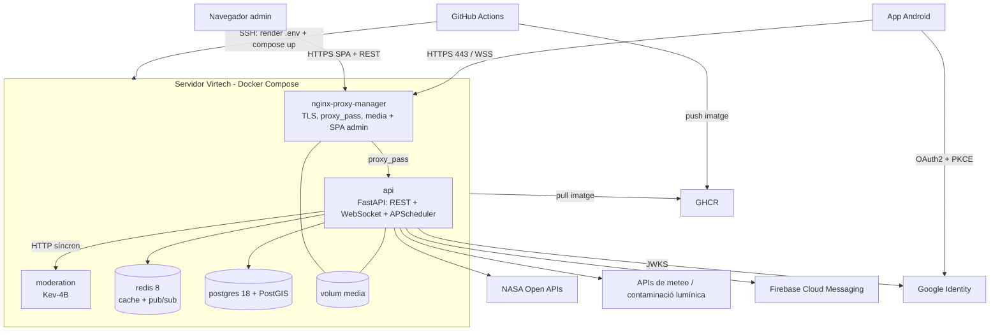

# Perseida · Infraestructura

[English](README.md) | **Català** | [Español](README.es.md)

> 🚧 **En construcció.** El projecte és en fase d'incepció/primer sprint. El contingut següent descriu l'estat **previst** segons la documentació del projecte i pot canviar.

Configuració de Docker i de desplegament de **Perseida**, una aplicació multiplataforma de divulgació i seguiment de fenòmens astronòmics (projecte de PES, UPC-FIB). Defineix com s'executa tot el sistema en local i en producció.

## Visió general del desplegament

Tot s'executa en **un únic servidor proporcionat per Virtech**, orquestrat amb **Docker Compose** (Kubernetes s'ha descartat explícitament: amb un sol host físic només afegeix overhead de control plane i el punt únic de fallada continua sent el servidor).



## Serveis (Docker Compose)

| Servei | Rol |
|---|---|
| `nginx-proxy-manager` | Punt d'entrada únic: HTTPS/TLS (certificats gestionats), proxy cap a l'API, upgrade de WebSocket, serveix els fitxers multimèdia dels usuaris des del volum compartit i el bundle estàtic del panell d'administració. |
| `api` | Imatge del backend `perseida-api:<git-sha>`. Un sol procés: REST + WebSocket + APScheduler. Executa les migracions d'Alembic a l'entrypoint abans d'arrencar. |
| `postgres` | PostgreSQL 18 + PostGIS, volum `pgdata` (font de veritat). |
| `redis` | Redis 8, cache amb TTL i pub/sub. Res essencial viu només aquí. |
| `moderation` | Servei del model Kev-4B, versió fixada, límits de recursos i healthcheck; accessible només des de la xarxa interna de Docker. |

## CI/CD (GitHub Actions)

- **CI** a cada PR cap a `develop`/`main`, amb filtres per ruta i cache de dependències `uv`/`pnpm`: format, linters i tipus → tests amb cobertura → SonarQube Cloud → Quality Gate. Obligatori per fusionar.
- **CD** a cada push a `main` (fusió de release o hotfix):
  1. Construeix la imatge del backend, l'etiqueta amb el `git-sha` i la puja a **GHCR**.
  2. Es connecta al servidor de Virtech per **SSH**, renderitza el `.env` des dels secrets de GitHub (`chmod 600`) i executa `docker compose up`.
  3. Publica l'**APK** del frontend en una release de GitHub.
- Versionat: SemVer a partir de `0.1.0`, una release per sprint, automatitzat pel pipeline.
- Rollback: redesplegar la imatge anterior pel seu `git-sha`.
- El repositori també conté una automatització que desbloqueja tasques de Taiga (`.github/workflows/taiga-unblock.yml`).

## GHCR — Permisos i visibilitat del paquet

La imatge del backend es publica a **GitHub Container Registry** (`ghcr.io`) sota el namespace de l'organització:

```
ghcr.io/pes2627q1-21-gei-upc/perseida-api:<tag>
```

### Permisos automàtics (GITHUB_TOKEN)

El workflow de CI/CD utilitza el token natiu `GITHUB_TOKEN` — sense necessitat de PAT ni secrets manuals:

| Àmbit | Motiu |
|---|---|
| `contents: read` | Clonar el repositori al runner |
| `packages: write` | Publicar la imatge a GHCR i actualitzar-ne les metadades |

GitHub redueix automàticament els permisos de `packages` a `read` en pull requests provinents de forks externs per seguretat.

### Descarregar i executar la imatge (docker pull i run)

Per descarregar la imatge des de GHCR:

```bash
docker pull ghcr.io/pes2627q1-21-gei-upc/perseida-api:latest
# o per tag de commit o branca:
docker pull ghcr.io/pes2627q1-21-gei-upc/perseida-api:sha-a1b2c3d
docker pull ghcr.io/pes2627q1-21-gei-upc/perseida-api:develop
```

Per arrencar el contenidor de l'API de forma independent (fora de Docker Compose), cal injectar les variables d'entorn requerides pel backend:

```bash
docker run -d \
  --name perseida-api \
  -p 8000:8000 \
  -e POSTGRES_DB=perseida \
  -e POSTGRES_USER=perseida \
  -e POSTGRES_PASSWORD=secret \
  -e POSTGRES_HOST=localhost \
  -e POSTGRES_PORT=5432 \
  -e REDIS_HOST=localhost \
  -e REDIS_PORT=6379 \
  ghcr.io/pes2627q1-21-gei-upc/perseida-api:latest
```

### Variables d'entorn del backend

El servei FastAPI (`perseida-api`) utilitza les següents variables d'entorn per a la connexió i configuració:

| Variable | Requerida | Descripció | Exemple |
|---|---|---|---|
| `POSTGRES_DB` | Sí | Nom de la base de dades PostgreSQL | `perseida` |
| `POSTGRES_USER` | Sí | Usuari de la base de dades | `perseida` |
| `POSTGRES_PASSWORD` | Sí | Contrasenya de la base de dades | `secret` |
| `POSTGRES_HOST` | Sí | Host o nom de servei de PostgreSQL | `postgres` o `localhost` |
| `POSTGRES_PORT` | Sí | Port de PostgreSQL | `5432` |
| `REDIS_HOST` | No | Host o nom de servei de Redis | `redis` o `localhost` |
| `REDIS_PORT` | No | Port del servei Redis | `6379` |
| `APP_ENV` | No | Entorn d'execució (`local`, `production`) | `production` |
| `API_IMAGE_TAG` | No | Etiqueta o SHA de commit de la imatge a GHCR (usat per a rollbacks) | `latest` o `sha-a1b2c3d` |
| `GOOGLE_CLIENT_ID` | Sí | Audiència esperada dels tokens d'identitat de Google | `1234-abc.apps.googleusercontent.com` |
| `JWT_SECRET` | Sí | Secret per a signatures JWT de sessió (com a mínim 32 caràcters) | `<sortida d'openssl rand -hex 32>` |

### Configuració inicial: fer el paquet públic (un sol cop, manual)

Quan la imatge es puja per primer cop, GitHub crea el paquet com a **privat** per defecte. Per a un projecte acadèmic obert, es recomana canviar-lo a **públic** a través de la interfície web de GitHub:

1. Vés al repositori a GitHub: `https://github.com/pes2627q1-21-gei-upc/perseida`.
2. Fes clic a **Packages** (a la barra lateral dreta) → `perseida-api`.
3. Fes clic a **Package settings** (a la barra lateral de configuració del paquet).
4. A la secció **Danger Zone**, fes clic a **Change visibility** i selecciona **Public**.

### Vinculació del paquet al repositori

En el primer push, GitHub vincula el paquet al repositori mitjançant l'etiqueta `org.opencontainers.image.source`, que `docker/metadata-action` fixa automàticament a la URL del repositori. `github.repository_owner` només decideix quin compte és propietari del paquet.

## Configuració i secrets

- Els secrets i variables viuen a **Secrets and variables** de GitHub; el job de CD genera el `.env` al servidor. El `.env` **mai** es versiona; un `.env.example` sense valors fa de plantilla.
- Versions fixades: PostgreSQL 18 (+ PostGIS), Redis 8, imatge de Kev-4B.
- Només dos entorns: **local** (el mateix Docker Compose) i **producció** (Virtech). Sense staging.

## Estructura prevista

```
infra/
├── docker-compose.yml          # definicions base dels serveis i desplegament a producció
├── docker-compose.override.yml # override per a desenvolupament local (bind mount, ports dev)
├── .env.example
├── nginx-proxy-manager/        # configuració del proxy
├── moderation/                 # imatge/configuració del servei Kev-4B
└── scripts/
    └── test-backend-docker.sh   # validació local i smoke test de perseida-api
```

> **Estructura de Compose:** S'utilitza `docker-compose.override.yml` per a desenvolupament local (que Docker Compose fusiona automàticament) perquè a producció s'executi exclusivament `docker-compose.yml` (amb imatges de GHCR i sense ports interns exposats), evitant duplicar definicions de serveis.

## Validació i proves locals (imatge Docker del backend)

Per validar la construcció de la imatge, la seguretat del contenidor i l'estat funcional en local abans de pujar canvis:

```bash
# Suite completa: Hadolint + actionlint + build + seguretat + smoke test
./infra/scripts/test-backend-docker.sh

# O reutilitzant una imatge ja construïda (ex. perseida-api:local)
./infra/scripts/test-backend-docker.sh --image=perseida-api:local --skip-build
```

## Executar en local

```bash
cd infra
cp .env.example .env          # omple valors locals, mai facis commit del .env
docker compose up -d --build  # arrenca db, cache, api i reverse-proxy
docker compose ps             # comprova que estiguin en estat healthy
docker compose logs -f api    # segueix els logs de l'API amb recàrrega en calent
docker compose down           # atura els contenidors preservant els volums de dades
```

## Limitacions conegudes (assumides en un projecte acadèmic)

Sense escalat horitzontal ni còpies de seguretat automàtiques; el servidor és un punt únic de fallada.

## Relacionat

[Backend](../backend/README.ca.md) · [Frontend](../frontend/README.ca.md) · [Obsidian vault](../obsidian_vault/README.ca.md)

## Equip

Manel Alaminos · Simona Duelt · Alex Garcia · Oriol Orbea · Javier Pascual · Raquel Rubio
