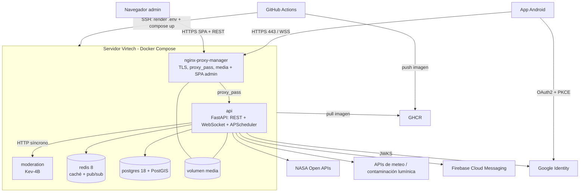

# Perseida · Infraestructura

[English](README.md) | [Català](README.ca.md) | **Español**

> 🚧 **En construcción.** El proyecto está en fase de inception/primer sprint. El contenido siguiente describe el estado **previsto** según la documentación del proyecto y puede cambiar.

Configuración de Docker y de despliegue de **Perseida**, una aplicación multiplataforma de divulgación y seguimiento de fenómenos astronómicos (proyecto de PES, UPC-FIB). Define cómo se ejecuta todo el sistema en local y en producción.

## Visión general del despliegue

Todo se ejecuta en **un único servidor proporcionado por Virtech**, orquestado con **Docker Compose** (Kubernetes se descartó explícitamente: con un solo host físico solo añade overhead de control plane y el punto único de fallo sigue siendo el servidor).



## Servicios (Docker Compose)

| Servicio | Rol |
|---|---|
| `nginx-proxy-manager` | Punto de entrada único: HTTPS/TLS (certificados gestionados), proxy hacia la API, upgrade de WebSocket, sirve los ficheros multimedia de los usuarios desde el volumen compartido y el bundle estático del panel de administración. |
| `api` | Imagen del backend `perseida-api:<git-sha>`. Un solo proceso: REST + WebSocket + APScheduler. Ejecuta las migraciones de Alembic en el entrypoint antes de arrancar. |
| `postgres` | PostgreSQL 18 + PostGIS, volumen `pgdata` (fuente de verdad). |
| `redis` | Redis 8, caché con TTL y pub/sub. Nada esencial vive solo aquí. |
| `moderation` | Servicio del modelo Kev-4B, versión fijada, límites de recursos y healthcheck; accesible solo desde la red interna de Docker. |

## CI/CD (GitHub Actions)

- **CI** en cada PR hacia `develop`/`main`, con filtros por ruta y caché de dependencias `uv`/`pnpm`: formato, linters y tipos → tests con cobertura → SonarQube Cloud → Quality Gate. Obligatorio para fusionar.
- **CD** en cada push a `main` (fusión de release o hotfix):
  1. Construye la imagen del backend, la etiqueta con el `git-sha` y la sube a **GHCR**.
  2. Se conecta al servidor de Virtech por **SSH**, renderiza el `.env` desde los secretos de GitHub (`chmod 600`) y ejecuta `docker compose up`.
  3. Publica el **APK** del frontend en una release de GitHub.
- Versionado: SemVer a partir de `0.1.0`, una release por sprint, automatizado por el pipeline.
- Rollback: redesplegar la imagen anterior por su `git-sha`.
- El repositorio también contiene una automatización que desbloquea tareas de Taiga (`.github/workflows/taiga-unblock.yml`).

## GHCR — Permisos y visibilidad del paquete

La imagen del backend se publica en **GitHub Container Registry** (`ghcr.io`) bajo el namespace de la organización:

```
ghcr.io/pes2627q1-21-gei-upc/perseida-api:<tag>
```

### Permisos automáticos (GITHUB_TOKEN)

El workflow de CI/CD utiliza el token nativo `GITHUB_TOKEN` — sin necesidad de PAT ni secretos manuales:

| Ámbito | Motivo |
|---|---|
| `contents: read` | Clonar el repositorio en el runner |
| `packages: write` | Publicar la imagen en GHCR y actualizar sus metadatos |

GitHub reduce automáticamente los permisos de `packages` a `read` en pull requests provenientes de forks externos por seguridad.

### Descargar y ejecutar la imagen (docker pull y run)

Para descargar la imagen desde GHCR:

```bash
docker pull ghcr.io/pes2627q1-21-gei-upc/perseida-api:latest
# o por tag de commit o rama:
docker pull ghcr.io/pes2627q1-21-gei-upc/perseida-api:sha-a1b2c3d
docker pull ghcr.io/pes2627q1-21-gei-upc/perseida-api:develop
```

Para arrancar el contenedor de la API de forma independiente (fuera de Docker Compose), es necesario inyectar las variables de entorno requeridas por el backend:

```bash
docker run -d \
  --name perseida-api \
  -p 8000:8000 \
  -e POSTGRES_DB=perseida \
  -e POSTGRES_USER=perseida \
  -e POSTGRES_PASSWORD=secret \
  -e POSTGRES_HOST=localhost \
  -e POSTGRES_PORT=5432 \
  -e REDIS_HOST=localhost \
  -e REDIS_PORT=6379 \
  ghcr.io/pes2627q1-21-gei-upc/perseida-api:latest
```

### Variables de entorno del backend

El servicio FastAPI (`perseida-api`) utiliza las siguientes variables de entorno para su conexión y configuración:

| Variable | Requerida | Descripción | Ejemplo |
|---|---|---|---|
| `POSTGRES_DB` | Sí | Nombre de la base de datos PostgreSQL | `perseida` |
| `POSTGRES_USER` | Sí | Usuario de la base de datos | `perseida` |
| `POSTGRES_PASSWORD` | Sí | Contraseña de la base de datos | `secret` |
| `POSTGRES_HOST` | Sí | Host o nombre de servicio de PostgreSQL | `postgres` o `localhost` |
| `POSTGRES_PORT` | Sí | Puerto de PostgreSQL | `5432` |
| `REDIS_HOST` | No | Host o nombre de servicio de Redis | `redis` o `localhost` |
| `REDIS_PORT` | No | Puerto del servicio Redis | `6379` |
| `APP_ENV` | No | Entorno de ejecución (`local`, `production`) | `production` |
| `API_IMAGE_TAG` | No | Etiqueta o SHA de commit de la imagen en GHCR (usado para rollbacks) | `latest` o `sha-a1b2c3d` |
| `GOOGLE_CLIENT_ID` | Sí | Audiencia esperada de los tokens de identidad de Google | `1234-abc.apps.googleusercontent.com` |
| `JWT_SECRET` | Sí | Secreto para firmas JWT de sesión (al menos 32 caracteres) | `<salida de openssl rand -hex 32>` |
| `ACCESS_TOKEN_MINUTES` | No | Tiempo de expiración de los access tokens en minutos (por defecto: 15) | `15` |
| `REFRESH_TOKEN_DAYS` | No | Tiempo de expiración de los refresh tokens en días (por defecto: 30) | `30` |

### Configuración inicial: hacer el paquete público (una sola vez, manual)

Cuando la imagen se sube por primera vez, GitHub crea el paquete como **privado** por defecto. Para un proyecto académico abierto, se recomienda cambiarlo a **público** a través de la interfaz web de GitHub:

1. Ve al repositorio en GitHub: `https://github.com/pes2627q1-21-gei-upc/perseida`.
2. Haz clic en **Packages** (en la barra lateral derecha) → `perseida-api`.
3. Haz clic en **Package settings** (en la barra lateral de configuración del paquete).
4. En la sección **Danger Zone**, haz clic en **Change visibility** y selecciona **Public**.

### Vinculación del paquete al repositorio

En el primer push, GitHub vincula el paquete al repositorio mediante la etiqueta `org.opencontainers.image.source`, que `docker/metadata-action` fija automáticamente a la URL del repositorio. `github.repository_owner` solo decide qué cuenta es propietaria del paquete.

## Configuración y secretos

- Los secretos y variables viven en **Secrets and variables** de GitHub; el job de CD genera el `.env` en el servidor. El `.env` **nunca** se versiona; un `.env.example` sin valores hace de plantilla.
- Versiones fijadas: PostgreSQL 18 (+ PostGIS), Redis 8, imagen de Kev-4B.
- Solo dos entornos: **local** (el mismo Docker Compose) y **producción** (Virtech). Sin staging.

## Estructura prevista

```
infra/
├── docker-compose.yml          # definiciones base de los servicios y despliegue en producción
├── docker-compose.override.yml # override para desarrollo local (bind mount, puertos dev)
├── .env.example
├── nginx-proxy-manager/        # configuración del proxy
├── moderation/                 # imagen/configuración del servicio Kev-4B
└── scripts/
    └── test-backend-docker.sh   # validación local y smoke test de perseida-api
```

> **Estructura de Compose:** Se utiliza `docker-compose.override.yml` para desarrollo local (que Docker Compose fusiona automáticamente) para que en producción se ejecute exclusivamente `docker-compose.yml` (con imágenes de GHCR y sin puertos internos expuestos), evitando duplicar definiciones de servicios.

## Validación y pruebas locales (imagen Docker del backend)

Para validar la construcción de la imagen, la seguridad del contenedor y el estado funcional en local antes de subir cambios:

```bash
# Suite completa: Hadolint + actionlint + build + seguridad + smoke test
./infra/scripts/test-backend-docker.sh

# O reutilizando una imagen ya construida (ej. perseida-api:local)
./infra/scripts/test-backend-docker.sh --image=perseida-api:local --skip-build
```

## Ejecutar en local

```bash
cd infra
cp .env.example .env          # rellena valores locales, nunca hagas commit del .env
docker compose up -d --build  # arranca db, cache, api y reverse-proxy
docker compose ps             # comprueba que estén en estado healthy
docker compose logs -f api    # sigue los logs de la API con recarga en caliente
docker compose down           # detiene los contenedores preservando los volúmenes de datos
```

## Limitaciones conocidas (asumidas en un proyecto académico)

Sin escalado horizontal ni copias de seguridad automáticas; el servidor es un punto único de fallo.

## Relacionado

[Backend](../backend/README.es.md) · [Frontend](../frontend/README.es.md) · [Obsidian vault](../obsidian_vault/README.es.md)

## Cabeceras de seguridad

La API envía sus propias cabeceras de seguridad (`nosniff`, una `Content-Security-Policy` de `default-src 'none'`, `X-Frame-Options`, `Referrer-Policy`, `no-store` en los endpoints de autenticación y de usuario, y HSTS cuando la petición llega por HTTPS). El TLS termina en nginx-proxy-manager, así que el proxy añade HSTS y las políticas de las dos cosas que la API no sirve: el panel de administración (CSP estricta: ningún script en línea ni de terceros) y los ficheros de los usuarios (`sandbox` y `nosniff`, para que un fichero subido nunca pueda ejecutarse como página). Los bloques para pegar, con los motivos, están en `nginx-proxy-manager/security-headers.conf`. Compruébalos tras cada cambio con `curl -sI https://<host>/` y la consola del navegador (una violación de la CSP queda registrada ahí).

## Equipo

Manel Alaminos · Simona Duelt · Alex Garcia · Oriol Orbea · Javier Pascual · Raquel Rubio
