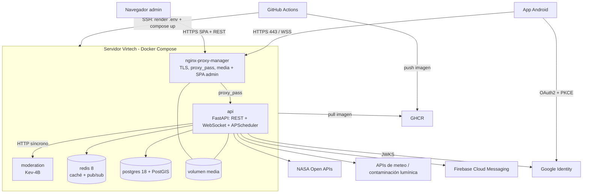

# Perseida · Infraestructura

[English](README.md) | [Català](README.ca.md) | **Español**

> 🚧 **En construcción.** El proyecto está en fase de inception/primer sprint. El contenido siguiente describe el estado **previsto** según la documentación del proyecto y puede cambiar.

Configuración de Docker y de despliegue de **Perseida**, una aplicación multiplataforma de divulgación y seguimiento de fenómenos astronómicos (proyecto de PES, UPC-FIB). Define cómo se ejecuta todo el sistema en local y en producción.

## Visión general del despliegue

Todo se ejecuta en **un único servidor proporcionado por Virtech**, orquestado con **Docker Compose** (Kubernetes se descartó explícitamente: con un solo host físico solo añade overhead de control plane y el punto único de fallo sigue siendo el servidor).



## Servicios (Docker Compose)

| Servicio | Rol |
|---|---|
| `nginx-proxy-manager` | Punto de entrada único: HTTPS/TLS (certificados gestionados), proxy hacia la API, upgrade de WebSocket, sirve los ficheros multimedia de los usuarios desde el volumen compartido y el bundle estático del panel de administración. |
| `api` | Imagen del backend `perseida-api:<git-sha>`. Un solo proceso: REST + WebSocket + APScheduler. Ejecuta las migraciones de Alembic en el entrypoint antes de arrancar. |
| `postgres` | PostgreSQL 18 + PostGIS, volumen `pgdata` (fuente de verdad). |
| `redis` | Redis 8, caché con TTL y pub/sub. Nada esencial vive solo aquí. |
| `moderation` | Servicio del modelo Kev-4B, versión fijada, límites de recursos y healthcheck; accesible solo desde la red interna de Docker. |

## CI/CD (GitHub Actions)

- **CI** en cada PR hacia `develop`/`main`, con filtros por ruta y caché de dependencias `uv`/`pnpm`: formato, linters y tipos → tests con cobertura → SonarQube Cloud → Quality Gate. Obligatorio para fusionar.
- **CD** en cada push a `main` (fusión de release o hotfix):
  1. Construye la imagen del backend (el job `image` reutiliza `backend-docker.yml`), la etiqueta con el `git-sha` (`sha-<7 caracteres>`) y la sube a **GHCR**, aunque no haya cambiado ningún fichero del backend.
  2. Se conecta al servidor de Virtech por **SSH**, copia `docker-compose.yml` y `deploy.sh`, renderiza el `.env` desde los secretos y variables de GitHub (`chmod 600`) y ejecuta `deploy.sh`: descarga la imagen, hace `docker compose up` y comprueba el healthcheck con un tiempo de espera.
  3. Si el healthcheck falla, hace rollback automático a la versión anterior y el job termina en error.
  4. Publica el **APK** del frontend en una release de GitHub.
- Versionado: SemVer a partir de `0.1.0`, una release por sprint, automatizado por el pipeline.
- Rollback: automático cuando falla el healthcheck, manual con `deploy.sh --rollback <tag>` (véase *Despliegue en producción (CD)* más abajo).
- El repositorio también contiene una automatización que desbloquea tareas de Taiga (`.github/workflows/taiga-unblock.yml`).

## GHCR — Permisos y visibilidad del paquete

La imagen del backend se publica en **GitHub Container Registry** (`ghcr.io`) bajo el namespace de la organización:

```
ghcr.io/pes2627q1-21-gei-upc/perseida-api:<tag>
```

### Permisos automáticos (GITHUB_TOKEN)

El workflow de CI/CD utiliza el token nativo `GITHUB_TOKEN` — sin necesidad de PAT ni secretos manuales:

| Ámbito | Motivo |
|---|---|
| `contents: read` | Clonar el repositorio en el runner |
| `packages: write` | Publicar la imagen en GHCR y actualizar sus metadatos |

GitHub reduce automáticamente los permisos de `packages` a `read` en pull requests provenientes de forks externos por seguridad.

### Descargar y ejecutar la imagen (docker pull y run)

Para descargar la imagen desde GHCR:

```bash
docker pull ghcr.io/pes2627q1-21-gei-upc/perseida-api:latest
# o por tag de commit o rama:
docker pull ghcr.io/pes2627q1-21-gei-upc/perseida-api:sha-a1b2c3d
docker pull ghcr.io/pes2627q1-21-gei-upc/perseida-api:develop
```

Para arrancar el contenedor de la API de forma independiente (fuera de Docker Compose), es necesario inyectar las variables de entorno requeridas por el backend:

```bash
docker run -d \
  --name perseida-api \
  -p 8000:8000 \
  -e POSTGRES_DB=perseida \
  -e POSTGRES_USER=perseida \
  -e POSTGRES_PASSWORD=secret \
  -e POSTGRES_HOST=localhost \
  -e POSTGRES_PORT=5432 \
  -e REDIS_HOST=localhost \
  -e REDIS_PORT=6379 \
  ghcr.io/pes2627q1-21-gei-upc/perseida-api:latest
```

### Variables de entorno del backend

El servicio FastAPI (`perseida-api`) utiliza las siguientes variables de entorno para su conexión y configuración:

| Variable | Requerida | Descripción | Ejemplo |
|---|---|---|---|
| `POSTGRES_DB` | Sí | Nombre de la base de datos PostgreSQL | `perseida` |
| `POSTGRES_USER` | Sí | Usuario de la base de datos | `perseida` |
| `POSTGRES_PASSWORD` | Sí | Contraseña de la base de datos | `secret` |
| `POSTGRES_HOST` | Sí | Host o nombre de servicio de PostgreSQL | `postgres` o `localhost` |
| `POSTGRES_PORT` | Sí | Puerto de PostgreSQL | `5432` |
| `REDIS_HOST` | No | Host o nombre de servicio de Redis | `redis` o `localhost` |
| `REDIS_PORT` | No | Puerto del servicio Redis | `6379` |
| `APP_ENV` | No | Entorno de ejecución (`local`, `production`) | `production` |
| `API_IMAGE_TAG` | No | Etiqueta o SHA de commit de la imagen en GHCR (usado para rollbacks) | `latest` o `sha-a1b2c3d` |
| `GOOGLE_CLIENT_IDS` | Sí | Audiencias aceptadas de los tokens de identidad de Google: clientes OAuth (web, Android, iOS), separados por comas | `1234-web.apps.googleusercontent.com,5678-ios.apps.googleusercontent.com` |
| `JWT_SECRET` | Sí | Secreto para firmas JWT de sesión (al menos 32 caracteres) | `<salida de openssl rand -hex 32>` |
| `ACCESS_TOKEN_MINUTES` | No | Tiempo de expiración de los access tokens en minutos (por defecto: 15) | `15` |
| `REFRESH_TOKEN_DAYS` | No | Tiempo de expiración de los refresh tokens en días (por defecto: 30) | `30` |

### Configuración inicial: hacer el paquete público (una sola vez, manual)

Cuando la imagen se sube por primera vez, GitHub crea el paquete como **privado** por defecto. Para un proyecto académico abierto, se recomienda cambiarlo a **público** a través de la interfaz web de GitHub:

1. Ve al repositorio en GitHub: `https://github.com/pes2627q1-21-gei-upc/perseida`.
2. Haz clic en **Packages** (en la barra lateral derecha) → `perseida-api`.
3. Haz clic en **Package settings** (en la barra lateral de configuración del paquete).
4. En la sección **Danger Zone**, haz clic en **Change visibility** y selecciona **Public**.

### Vinculación del paquete al repositorio

En el primer push, GitHub vincula el paquete al repositorio mediante la etiqueta `org.opencontainers.image.source`, que `docker/metadata-action` fija automáticamente a la URL del repositorio. `github.repository_owner` solo decide qué cuenta es propietaria del paquete.

## Despliegue en producción (CD)

`.github/workflows/cd.yml` se ejecuta en cada push a `main` (y a mano desde `main`). Un push o PR a `develop` o a una rama `feature/*` no lo dispara nunca. Jobs, en orden: `verify-config` (comprueba todos los secretos y variables, antes de tocar el servidor) → `image` (construye y sube a GHCR) → `deploy` (entorno `production`).

> **Ningún secreto entra nunca en el repositorio.** Los secretos y variables viven solo en GitHub (**Settings → Secrets and variables → Actions**); este README lista sus *nombres*, nunca sus valores. El `.env` se genera en el servidor y está ignorado por git.

### Secretos y variables requeridos

`verify-config` lista todos los nombres que faltan y falla antes de tocar el servidor. Los nombres salen de `infra/.env.example` (menos los de abajo que se definen en otro sitio) más los `SSH_*`. Los nombres marcados como Secreto deben ser secretos: `verify-config` también falla si alguno existe solo como variable, porque una variable se ve sin enmascarar en los logs públicos. El resto pueden ser una cosa u otra. Los valores no pueden llevar saltos de línea ni comillas simples.

| Nombre | Tipo | Qué es |
|---|---|---|
| `SSH_HOST` | Secreto | Host al que se conecta el runner (el nombre público del NAT de la VM de Virtech) |
| `SSH_PORT` | Secreto | Puerto SSH (ahora el puerto NAT que llega al `8089` de la VM) |
| `SSH_USER` | Secreto | Usuario SSH de la VM |
| `SSH_PRIVATE_KEY` | Secreto | Parte privada de la clave de despliegue dedicada (ed25519) |
| `SSH_KNOWN_HOSTS` | Secreto | Línea(s) de la clave del servidor, p. ej. de `ssh-keyscan -p <puerto> <host>`; la conexión nunca desactiva la verificación de la clave |
| `POSTGRES_PASSWORD` | Secreto | Contraseña de la base de datos de producción (aleatoria, solo para producción) |
| `POSTGRES_DB`, `POSTGRES_USER` | Secreto | Nombre y usuario de la base de datos de producción |
| `JWT_SECRET` | Secreto | Clave de los JWT de sesión, como mínimo 32 caracteres (`openssl rand -hex 32`) |
| `POSTGRES_PORT` | Variable | Puerto de la base de datos |
| `POSTGRES_HOST` | Variable | `postgres` (alias de red del servicio de base de datos) |
| `REDIS_HOST` | Variable | `redis` (alias de red del servicio de caché) |
| `REDIS_PORT`, `CACHE_DEFAULT_TTL_SECONDS` | Variable | Puerto de Redis y TTL por defecto de la caché |
| `SCHEDULER_ENABLED`, `SCHEDULER_TIMEZONE` | Variable | Interruptor del planificador y zona horaria IANA |
| `APP_ENV` | Variable | `production` |
| `GOOGLE_CLIENT_IDS` | Variable | Client ids OAuth (web, Android, iOS), separados por comas; valores públicos |
| `ACCESS_TOKEN_MINUTES`, `REFRESH_TOKEN_DAYS` | Variable | Duraciones de la sesión (`15` y `30`) |
| `HTTP_PORT`, `HTTPS_PORT` | Variable | Puertos que publica nginx-proxy-manager en la VM (`8080` y `8081`; solo el `8080`–`8088` es accesible desde fuera) |

No se definen en GitHub: `API_IMAGE_TAG` (`deploy.sh` pone la imagen del commit), `NPM_ADMIN_PORT` y `PORT` (solo desarrollo local) y `GITHUB_TOKEN` (automático).

Requisitos del servidor: Docker Engine con Compose 2.22 o superior (`pull --policy`), `flock` (de `util-linux`), el usuario SSH en el grupo `docker` y `/opt/perseida` con permiso de escritura para ese usuario.

### Cómo se genera el `.env`

`infra/scripts/render_env.py` lo construye con los secretos y variables de la ejecución:

1. `check` falla, indicando cuáles faltan, si algún nombre de `infra/.env.example` (o algún `SSH_*`) no tiene secreto ni variable.
2. `mask` registra cada valor secreto con `::add-mask::`, de modo que en los logs sale como `***`.
3. `render` escribe líneas `NOMBRE='valor'` por la salida estándar. El runner las pasa por SSH a un fichero temporal del servidor creado con `umask 077`; se comprueba que no esté vacío, se le pone `chmod 600` y se mueve a `/opt/perseida/.env` de golpe, así un render fallido nunca pisa un buen `.env`. El `.env` nunca toca el disco del runner, el repositorio ni los logs.

El servidor descarga la imagen de GHCR con el `GITHUB_TOKEN` temporal del job (`docker login` por stdin y `docker logout` al final), de modo que el paquete puede seguir siendo privado.

### Rollback automático

`deploy.sh <tag>` descarga la imagen si falta, ejecuta `docker compose up -d` y espera hasta `HEALTH_TIMEOUT` segundos (120 por defecto) a que `GET /api/health` responda 200 con `status: ok` (el propio Compose puede rendirse antes, cuando se rinde el healthcheck del contenedor, unos 65 s con la configuración actual; el resultado es el mismo). Cuando lo hace, el tag se guarda en `/opt/perseida/.deployed-tag`. Cuando no:

1. Se detiene la API.
2. **Sonda:** se arranca la imagen anterior (el tag de `.deployed-tag`) **sin migraciones** y con el mismo `.env`, en un contenedor temporal.
   - Si no responde, la causa es la configuración o la infraestructura, no el código nuevo: **no se deshace nada** (los datos se conservan), la API queda parada y el job falla diciéndote que corrijas el secreto o la variable y vuelvas a ejecutar el CD.
   - Si responde, la causa es el código nuevo o sus migraciones y el rollback continúa.
3. Se deshacen las migraciones de Alembic hasta la revisión de la imagen anterior (`alembic downgrade`, ejecutado con la imagen nueva, que es la que tiene las migraciones nuevas).
4. Se arranca la imagen anterior con normalidad y se vuelve a comprobar el healthcheck.
5. El job **siempre termina en error**, aunque el rollback haya funcionado.

La sonda corre en un contenedor temporal llamado `perseida-probe`, con el planificador desactivado (`SCHEDULER_ENABLED=false`), y espera hasta `PROBE_TIMEOUT` segundos (60 por defecto); termina antes si el contenedor sale. Si la sonda ni siquiera se puede crear (por ejemplo, la imagen anterior ya no está en el servidor y no se puede descargar), tampoco se deshace nada y el job falla diciéndolo. Un bloqueo (`/opt/perseida/.deploy.lock`, con `flock`) evita que un `--rollback` manual coincida con un despliegue; sin `flock` el script solo avisa y continúa. Cuando la sonda encuentra un problema de configuración, el esquema de la base de datos puede ser más nuevo que `.deployed-tag`: un `--rollback` manual posterior puede avisar de que no encuentra la revisión.

El rollback restaura la imagen y el esquema de la base de datos, **no el `.env`**: ya se ha reescrito con los secretos y variables actuales (por tanto, el primer despliegue tras pasar `GOOGLE_CLIENT_ID` a `GOOGLE_CLIENT_IDS` tampoco puede hacer rollback a una imagen anterior a ese cambio). Si un despliegue falla por un valor erróneo (por ejemplo una clave), la sonda lo detecta, porque la imagen anterior falla igual: no se deshace nada; hay que corregir el secreto o la variable y volver a ejecutar el CD. La sonda no puede distinguir una base de datos caída, porque el healthcheck no la consulta. El primer despliegue no tiene versión anterior, así que solo falla. Los logs de los contenedores no se muestran en el workflow (son públicos); se leen en el servidor con `docker compose logs api`.

### Rollback manual a una versión concreta

```bash
ssh -p <puerto> <usuario>@<host>
cd /opt/perseida
cat .deployed-tag                                          # versión que corre ahora
docker images ghcr.io/pes2627q1-21-gei-upc/perseida-api    # versiones que aún están en el servidor
./deploy.sh --rollback sha-a1b2c3d
```

Si la imagen de destino ya no está en el servidor, hay que hacer antes `docker login ghcr.io -u <usuario-github>` con un token con `read:packages`. El script deshace las migraciones hasta la revisión de esa versión, la arranca, comprueba el healthcheck y actualiza `.deployed-tag`.

> **Aviso sobre los datos:** deshacer una migración elimina las tablas y columnas que había creado, con sus datos. No hay copias de seguridad. Volver a una versión muy antigua solo debe hacerse sabiéndolo.

### Acceso SSH del equipo

La VM solo acepta claves (el acceso por contraseña está desactivado). Quien ya tiene acceso añade la clave **pública** de un compañero con `infra/scripts/add-team-key.sh`: pide un nombre y la clave pública, rechaza claves privadas y claves RSA de menos de 3072 bits y la añade a `authorized_keys` sin duplicar. La clave de despliegue (`SSH_PRIVATE_KEY`) es independiente de las claves personales.

## Configuración y secretos

- Los secretos y variables viven en **Secrets and variables** de GitHub; el job de CD genera el `.env` en el servidor. El `.env` **nunca** se versiona; un `.env.example` sin valores hace de plantilla.
- Versiones fijadas: PostgreSQL 18 (+ PostGIS), Redis 8, imagen de Kev-4B.
- Solo dos entornos: **local** (el mismo Docker Compose) y **producción** (Virtech). Sin staging.

## Estructura prevista

```
infra/
├── docker-compose.yml          # definiciones base de los servicios y despliegue en producción
├── docker-compose.override.yml # override para desarrollo local (bind mount, puertos dev)
├── .env.example
├── nginx-proxy-manager/        # configuración del proxy
├── moderation/                 # imagen/configuración del servicio Kev-4B
└── scripts/
    ├── deploy.sh                # se ejecuta en el servidor: pull, up, healthcheck, rollback
    ├── render_env.py            # CD: comprueba secretos/variables y renderiza el .env
    ├── add-team-key.sh          # añade la clave SSH pública de un compañero a la VM
    └── test-backend-docker.sh   # validación local y smoke test de perseida-api
```

> **Estructura de Compose:** Se utiliza `docker-compose.override.yml` para desarrollo local (que Docker Compose fusiona automáticamente) para que en producción se ejecute exclusivamente `docker-compose.yml` (con imágenes de GHCR y sin puertos internos expuestos), evitando duplicar definiciones de servicios.

## Validación y pruebas locales (imagen Docker del backend)

Para validar la construcción de la imagen, la seguridad del contenedor y el estado funcional en local antes de subir cambios:

```bash
# Suite completa: Hadolint + actionlint + build + seguridad + smoke test
./infra/scripts/test-backend-docker.sh

# O reutilizando una imagen ya construida (ej. perseida-api:local)
./infra/scripts/test-backend-docker.sh --image=perseida-api:local --skip-build
```

## Ejecutar en local

```bash
cd infra
cp .env.example .env          # rellena valores locales, nunca hagas commit del .env
docker compose up -d --build  # arranca db, cache, api y reverse-proxy
docker compose ps             # comprueba que estén en estado healthy
docker compose logs -f api    # sigue los logs de la API con recarga en caliente
docker compose down           # detiene los contenedores preservando los volúmenes de datos
```

## Limitaciones conocidas (asumidas en un proyecto académico)

Sin escalado horizontal ni copias de seguridad automáticas; el servidor es un punto único de fallo.

## Relacionado

[Backend](../backend/README.es.md) · [Frontend](../frontend/README.es.md) · [Obsidian vault](../obsidian_vault/README.es.md)

## Cabeceras de seguridad

La API envía sus propias cabeceras de seguridad (`nosniff`, una `Content-Security-Policy` de `default-src 'none'`, `X-Frame-Options`, `Referrer-Policy`, `no-store` en los endpoints de autenticación y de usuario, y HSTS cuando la petición llega por HTTPS). El TLS termina en nginx-proxy-manager, así que el proxy añade HSTS y las políticas de las dos cosas que la API no sirve: el panel de administración (CSP estricta: ningún script en línea ni de terceros) y los ficheros de los usuarios (`sandbox` y `nosniff`, para que un fichero subido nunca pueda ejecutarse como página). Los bloques para pegar, con los motivos, están en `nginx-proxy-manager/security-headers.conf`. Compruébalos tras cada cambio con `curl -sI https://<host>/` y la consola del navegador (una violación de la CSP queda registrada ahí).

## Equipo

Manel Alaminos · Simona Duelt · Alex Garcia · Oriol Orbea · Javier Pascual · Raquel Rubio
