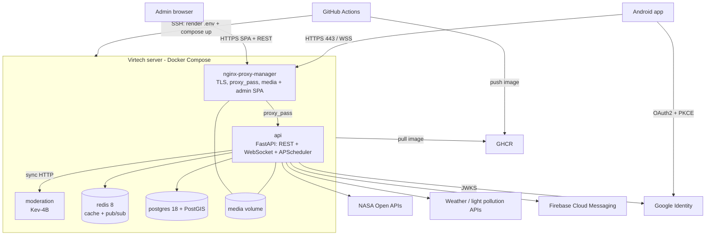

# Perseida · Infrastructure

**English** | [Català](README.ca.md) | [Español](README.es.md)

> 🚧 **Under construction.** The project is in its inception/first-sprint phase. Contents below describe the **planned** state defined in the project documentation and may change.

Docker and deployment configuration of **Perseida**, a multiplatform app for astronomy outreach and tracking of astronomical events (PES project, UPC-FIB). It defines how the whole system runs locally and in production.

## Deployment overview

Everything runs on **a single server provided by Virtech**, orchestrated with **Docker Compose** (Kubernetes was explicitly discarded: with one physical host it only adds control-plane overhead and the single point of failure remains the server).



## Services (Docker Compose)

| Service | Role |
|---|---|
| `nginx-proxy-manager` | Single entry point: HTTPS/TLS (managed certificates), proxy to the API, WebSocket upgrade, serves user media from the shared volume and the static admin panel bundle. |
| `api` | Backend image `perseida-api:<git-sha>`. One process: REST + WebSocket + APScheduler. Runs Alembic migrations at the entrypoint before starting. |
| `postgres` | PostgreSQL 18 + PostGIS, `pgdata` volume (source of truth). |
| `redis` | Redis 8, cache with TTL and pub/sub. Nothing essential lives only here. |
| `moderation` | Kev-4B model service, fixed version, resource limits and healthcheck; reachable only from the internal Docker network. |

## CI/CD (GitHub Actions)

- **CI** on every PR to `develop`/`main`, with path filters and cached `uv`/`pnpm` dependencies: format, linters and types → tests with coverage → SonarQube Cloud → Quality Gate. Required to merge.
- **CD** on every push to `main` (release or hotfix merge):
  1. Build the backend image (the `image` job reuses `backend-docker.yml`), tag it with the `git-sha` (`sha-<7 characters>`) and push it to **GHCR**, even if no backend file changed.
  2. Connect to the Virtech server over **SSH**, copy `docker-compose.yml` and `deploy.sh`, render `.env` from the GitHub secrets and variables (`chmod 600`) and run `deploy.sh`: pull the image, `docker compose up` and a healthcheck with a timeout.
  3. If the healthcheck fails, roll back automatically to the previous version and fail the job.
  4. Publish the frontend **APK** in a GitHub release.
- Versioning: SemVer starting at `0.1.0`, one release per sprint, automated by the pipeline.
- Rollback: automatic when the healthcheck fails, manual with `deploy.sh --rollback <tag>` (see *Production deployment (CD)* below).
- The repository also contains an automation that unblocks Taiga tasks (`.github/workflows/taiga-unblock.yml`).

## GHCR — Package permissions and visibility

The backend image is published to **GitHub Container Registry** (`ghcr.io`) under the organization's namespace:

```
ghcr.io/pes2627q1-21-gei-upc/perseida-api:<tag>
```

### Automatic permissions (GITHUB_TOKEN)

The CI/CD workflow uses the built-in `GITHUB_TOKEN` — no PAT or manual secret needed:

| Scope | Why |
|---|---|
| `contents: read` | Clone the repository in the runner |
| `packages: write` | Push image to GHCR and update package metadata |

GitHub automatically **downgrades** `packages` to `read` on pull requests from external forks, so no unauthorized fork can publish images.

### Pulling and running the image (docker pull and run)

To pull the image from GHCR:

```bash
docker pull ghcr.io/pes2627q1-21-gei-upc/perseida-api:latest
# or by commit SHA or branch tag:
docker pull ghcr.io/pes2627q1-21-gei-upc/perseida-api:sha-a1b2c3d
docker pull ghcr.io/pes2627q1-21-gei-upc/perseida-api:develop
```

To run the API container standalone (outside Docker Compose), pass the required environment variables:

```bash
docker run -d \
  --name perseida-api \
  -p 8000:8000 \
  -e POSTGRES_DB=perseida \
  -e POSTGRES_USER=perseida \
  -e POSTGRES_PASSWORD=secret \
  -e POSTGRES_HOST=localhost \
  -e POSTGRES_PORT=5432 \
  -e REDIS_HOST=localhost \
  -e REDIS_PORT=6379 \
  ghcr.io/pes2627q1-21-gei-upc/perseida-api:latest
```

### Backend environment variables

The FastAPI backend service (`perseida-api`) uses the following environment variables:

| Variable | Required | Description | Example |
|---|---|---|---|
| `POSTGRES_DB` | Yes | PostgreSQL database name | `perseida` |
| `POSTGRES_USER` | Yes | Database user | `perseida` |
| `POSTGRES_PASSWORD` | Yes | Database password | `secret` |
| `POSTGRES_HOST` | Yes | PostgreSQL host or service name | `postgres` or `localhost` |
| `POSTGRES_PORT` | Yes | PostgreSQL port | `5432` |
| `REDIS_HOST` | No | Redis host or service name | `redis` or `localhost` |
| `REDIS_PORT` | No | Redis port | `6379` |
| `APP_ENV` | No | Runtime environment (`local`, `production`) | `production` |
| `API_IMAGE_TAG` | No | Tag or commit SHA of backend image in GHCR (used for rollbacks) | `latest` or `sha-a1b2c3d` |
| `GOOGLE_CLIENT_IDS` | Yes | Accepted audiences of the Google ID tokens: OAuth clients (web, Android, iOS), comma-separated | `1234-web.apps.googleusercontent.com,5678-ios.apps.googleusercontent.com` |
| `JWT_SECRET` | Yes | Secret for session JWT signing (at least 32 characters) | `<output of openssl rand -hex 32>` |
| `NASA_API_KEY` | Yes | NASA API key for the APOD (the API does not start without it); `DEMO_KEY` works locally, rate-limited | `<key from https://api.nasa.gov>` |
| `ACCESS_TOKEN_MINUTES` | No | Expiration time for access tokens in minutes (default: 15) | `15` |
| `REFRESH_TOKEN_DAYS` | No | Expiration time for refresh tokens in days (default: 30) | `30` |

### First-time setup: make the package public (one-time, manual)

When the image is pushed for the first time, GitHub creates the package as **private** by default. For an open academic project, make it **public** using the GitHub web UI:

1. Go to the repository on GitHub: `https://github.com/pes2627q1-21-gei-upc/perseida`.
2. Click **Packages** (right sidebar) → `perseida-api`.
3. Click **Package settings** (package settings sidebar).
4. Under the **Danger Zone** section, click **Change visibility** and select **Public**.

### Link the package to the repository (one-time, automatic)

The first time the workflow pushes the image, GitHub links the package to the repository through the `org.opencontainers.image.source` label, which `docker/metadata-action` sets automatically to the repository URL. `github.repository_owner` only decides which account owns the package. No manual action needed.

## Production deployment (CD)

`.github/workflows/cd.yml` runs on every push to `main` (and manually from `main`). A push or PR to `develop` or to a `feature/*` branch never triggers it. Jobs, in order: `verify-config` (checks every secret and variable, before touching the server) → `image` (build and push to GHCR) → `deploy` (environment `production`).

> **No secret ever goes into the repository.** Secrets and variables live only in GitHub (**Settings → Secrets and variables → Actions**); this README lists their *names*, never their values. `.env` is generated on the server and is git-ignored. Create them as **repository** secrets and variables, not as secrets of the `production` environment: `verify-config` does not use that environment and would report them as missing.

### Required secrets and variables

`verify-config` lists every missing name and fails before touching the server. The names come from `infra/.env.example` (minus the ones below that are set elsewhere) plus the `SSH_*` ones. The names marked Secret must be secrets: `verify-config` also fails if one of them exists only as a variable, because a variable shows unmasked in the public logs. The rest can be either. Values cannot contain a line break or a single quote.

| Name | Type | What it is |
|---|---|---|
| `SSH_HOST` | Secret | Host the runner connects to (the public NAT name of the Virtech VM) |
| `SSH_PORT` | Secret | SSH port (currently the NAT port that reaches the VM's `8089`) |
| `SSH_USER` | Secret | SSH user on the VM |
| `SSH_PRIVATE_KEY` | Secret | Private half of the dedicated deploy key (ed25519) |
| `SSH_KNOWN_HOSTS` | Secret | Host key line(s) of the server, e.g. from `ssh-keyscan -p <port> <host>`; the connection never disables host key checking |
| `POSTGRES_PASSWORD` | Secret | Production database password (random, only for production) |
| `POSTGRES_DB`, `POSTGRES_USER` | Secret | Production database name and user |
| `JWT_SECRET` | Secret | Session JWT key, at least 32 characters (`openssl rand -hex 32`) |
| `POSTGRES_PORT` | Variable | Database port |
| `POSTGRES_HOST` | Variable | `postgres` (network alias of the database service) |
| `REDIS_HOST` | Variable | `redis` (network alias of the cache service) |
| `REDIS_PORT`, `CACHE_DEFAULT_TTL_SECONDS` | Variable | Redis port and default cache TTL |
| `SCHEDULER_ENABLED`, `SCHEDULER_TIMEZONE` | Variable | Scheduler switch and IANA time zone |
| `APP_ENV` | Variable | `production` |
| `GOOGLE_CLIENT_IDS` | Variable | OAuth client ids (web, Android, iOS), comma-separated; public values |
| `ACCESS_TOKEN_MINUTES`, `REFRESH_TOKEN_DAYS` | Variable | Session lifetimes (`15` and `30`) |
| `HTTP_PORT`, `HTTPS_PORT` | Variable | Ports nginx-proxy-manager publishes on the VM (`8080` and `8081`; only `8080`–`8088` are reachable from outside) |

Not set in GitHub: `API_IMAGE_TAG` (`deploy.sh` sets it to the commit's image), `NPM_ADMIN_PORT` and `PORT` (local development only) and `GITHUB_TOKEN` (automatic).

Server prerequisites: Docker Engine with Compose 2.22 or later (`pull --policy`), `flock` (from `util-linux`), the SSH user in the `docker` group and `/opt/perseida` writable by that user.

### How `.env` is generated

`infra/scripts/render_env.py` builds it from the secrets and variables of the run:

1. `check` fails, naming the missing variables, if any name of `infra/.env.example` (or any `SSH_*`) has no secret or variable.
2. `mask` registers every secret value with `::add-mask::`, so it appears as `***` in the logs.
3. `render` writes `NAME='value'` lines to the standard output. The runner pipes them over SSH to a temporary file on the server created with `umask 077`; the file is checked to be non-empty, set to `chmod 600` and moved to `/opt/perseida/.env` in one step, so a failed render never overwrites a good `.env`. The `.env` never touches the runner's disk, the repository or the logs.

The server pulls the image from GHCR with the job's temporary `GITHUB_TOKEN` (`docker login` over stdin, `docker logout` at the end), so the package can stay private.

### Automatic rollback

`deploy.sh <tag>` pulls the image if it is missing, runs `docker compose up -d` and waits up to `HEALTH_TIMEOUT` seconds (120 by default) for `GET /api/health` to answer 200 with `status: ok` (Compose itself may give up sooner, when the container's own healthcheck gives up, about 65 s with the current settings; the outcome is the same). When it does, the tag is saved in `/opt/perseida/.deployed-tag`. When it does not:

1. The API is stopped.
2. **Probe:** the previous image (the tag in `.deployed-tag`) is started **without migrations** and with the same `.env`, in a temporary container.
   - If it does not respond, the cause is the configuration or the infrastructure, not the new code: **nothing is undone** (the data is kept), the API stays stopped and the job fails telling you to fix the secret or variable and run the CD again.
   - If it responds, the cause is the new code or its migrations and the rollback goes on.
3. The Alembic migrations are undone down to the revision of the previous image (`alembic downgrade`, run with the new image, which is the one that has the new migrations).
4. The previous image is started normally and the healthcheck is checked again.
5. The job **always fails**, even if the rollback worked.

The probe runs in a temporary container named `perseida-probe`, with the scheduler disabled (`SCHEDULER_ENABLED=false`), and waits up to `PROBE_TIMEOUT` seconds (60 by default); it ends earlier if the container exits. If the probe cannot even be created (for example the previous image is no longer on the server and cannot be pulled), nothing is undone either and the job fails saying so. A lock (`/opt/perseida/.deploy.lock`, with `flock`) keeps a manual `--rollback` from running at the same time as a deployment; without `flock` the script only warns and goes on. When the probe finds a configuration problem, the database schema may be newer than `.deployed-tag`: a later manual `--rollback` can then warn that it does not find the revision.

The rollback restores the image and the database schema, **not the `.env`**: it has already been rewritten with the current secrets and variables (so the first deployment after `GOOGLE_CLIENT_ID` became `GOOGLE_CLIENT_IDS` cannot roll back to an image from before that change either). If a deployment fails because of a wrong value (for example a bad key), the probe detects it, because the previous image fails the same way: nothing is undone; fix the secret or variable and run the CD again. The probe cannot tell a database that is down, because the healthcheck does not query it. The very first deployment has no previous version, so it only fails. Container logs are not printed in the workflow (they are public); read them on the server with `docker compose logs api`.

### Manual rollback to a specific version

```bash
ssh -p <port> <user>@<host>
cd /opt/perseida
cat .deployed-tag                                          # version running now
docker images ghcr.io/pes2627q1-21-gei-upc/perseida-api    # versions still on the server
./deploy.sh --rollback sha-a1b2c3d
```

If the target image is no longer on the server, log in to GHCR first (`docker login ghcr.io -u <github-user>` with a token that has `read:packages`). The script undoes the migrations down to the revision of that version, starts it, checks the healthcheck and updates `.deployed-tag`.

> **Data warning:** undoing a migration drops the tables and columns it created, together with their data. There are no backups. Roll back to a version far behind only knowing that.

### SSH access for the team

The VM only accepts keys (password login is disabled). Everyone who has access adds a teammate's **public** key with `infra/scripts/add-team-key.sh`: it asks for a name and the public key, rejects private keys and RSA keys below 3072 bits and appends it to `authorized_keys` without duplicates. The deploy key (`SSH_PRIVATE_KEY`) is separate from personal keys.

## Configuration and secrets

- Secrets and variables live in GitHub **Secrets and variables**; the CD job generates `.env` on the server. `.env` is **never** committed; a value-free `.env.example` is the template.
- Pinned versions: PostgreSQL 18 (+ PostGIS), Redis 8, Kev-4B image.
- Two environments only: **local** (same Docker Compose) and **production** (Virtech). No staging.

## Planned structure

```
infra/
├── docker-compose.yml          # base service definitions and production deployment
├── docker-compose.override.yml # local development override (bind mount, dev ports)
├── .env.example
├── nginx-proxy-manager/        # proxy configuration
├── moderation/                 # Kev-4B service image/config
└── scripts/
    ├── deploy.sh                # runs on the server: pull, up, healthcheck, rollback
    ├── render_env.py            # CD: checks secrets/variables and renders .env
    ├── add-team-key.sh          # adds a teammate's public SSH key to the VM
    └── test-backend-docker.sh   # local validation and smoke test of perseida-api
```

> **Compose structure:** We use `docker-compose.override.yml` for local development (which Docker Compose merges automatically) so that production runs purely with `docker-compose.yml` (using GHCR images and without exposing internal ports), avoiding service duplication.

## Local validation and testing (backend Docker image)

To validate the Docker image build, container security, and runtime health locally before pushing:

```bash
# Full test suite: Hadolint + actionlint + build + security + smoke test
./infra/scripts/test-backend-docker.sh

# Or reuse an already-built image (e.g., perseida-api:local)
./infra/scripts/test-backend-docker.sh --image=perseida-api:local --skip-build
```

## Run locally

```bash
cd infra
cp .env.example .env          # fill in local values, never commit .env
docker compose up -d --build  # starts db, cache, api and reverse-proxy
docker compose ps             # verify health status (healthy)
docker compose logs -f api    # follow API logs with hot-reload
docker compose down           # stop containers preserving data volumes
```

## Known limitations (accepted for an academic project)

No horizontal scaling and no automatic backups; the server is a single point of failure.

## Related

[Backend](../backend/README.md) · [Frontend](../frontend/README.md) · [Obsidian vault](../obsidian_vault/README.md)

## Security headers

The API sends its own security headers (`nosniff`, a `Content-Security-Policy` of `default-src 'none'`, `X-Frame-Options`, `Referrer-Policy`, `no-store` on the authentication and user endpoints, and HSTS when the request arrives over HTTPS). TLS ends in nginx-proxy-manager, so the proxy adds HSTS and the policies of the two things the API does not serve: the admin panel (strict CSP: no inline script, no third-party script) and the user media (`sandbox` and `nosniff`, so an uploaded file can never run as a page). The ready-to-paste blocks, with the reasons, are in `nginx-proxy-manager/security-headers.conf`. Check them after each change with `curl -sI https://<host>/` and the browser console (a CSP violation is logged there).

## Team

Manel Alaminos · Simona Duelt · Alex Garcia · Oriol Orbea · Javier Pascual · Raquel Rubio
