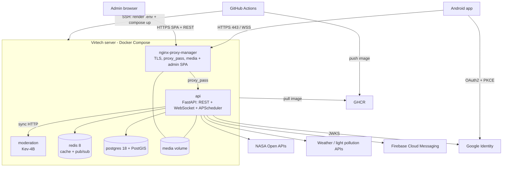

# Perseida · Infrastructure

**English** | [Català](README.ca.md) | [Español](README.es.md)

> 🚧 **Under construction.** The project is in its inception/first-sprint phase. Contents below describe the **planned** state defined in the project documentation and may change.

Docker and deployment configuration of **Perseida**, a multiplatform app for astronomy outreach and tracking of astronomical events (PES project, UPC-FIB). It defines how the whole system runs locally and in production.

## Deployment overview

Everything runs on **a single server provided by Virtech**, orchestrated with **Docker Compose** (Kubernetes was explicitly discarded: with one physical host it only adds control-plane overhead and the single point of failure remains the server).



## Services (Docker Compose)

| Service | Role |
|---|---|
| `nginx-proxy-manager` | Single entry point: HTTPS/TLS (managed certificates), proxy to the API, WebSocket upgrade, serves user media from the shared volume and the static admin panel bundle. |
| `api` | Backend image `perseida-api:<git-sha>`. One process: REST + WebSocket + APScheduler. Runs Alembic migrations at the entrypoint before starting. |
| `postgres` | PostgreSQL 18 + PostGIS, `pgdata` volume (source of truth). |
| `redis` | Redis 8, cache with TTL and pub/sub. Nothing essential lives only here. |
| `moderation` | Kev-4B model service, fixed version, resource limits and healthcheck; reachable only from the internal Docker network. |

## CI/CD (GitHub Actions)

- **CI** on every PR to `develop`/`main`, with path filters and cached `uv`/`pnpm` dependencies: format, linters and types → tests with coverage → SonarQube Cloud → Quality Gate. Required to merge.
- **CD** on every push to `main` (release or hotfix merge):
  1. Build the backend image, tag it with the `git-sha` and push it to **GHCR**.
  2. Connect to the Virtech server over **SSH**, render `.env` from GitHub secrets (`chmod 600`) and run `docker compose up`.
  3. Publish the frontend **APK** in a GitHub release.
- Versioning: SemVer starting at `0.1.0`, one release per sprint, automated by the pipeline.
- Rollback: redeploy the previous image by its `git-sha`.
- The repository also contains an automation that unblocks Taiga tasks (`.github/workflows/taiga-unblock.yml`).

## GHCR — Package permissions and visibility

The backend image is published to **GitHub Container Registry** (`ghcr.io`) under the organization's namespace:

```
ghcr.io/pes2627q1-21-gei-upc/perseida-api:<tag>
```

### Automatic permissions (GITHUB_TOKEN)

The CI/CD workflow uses the built-in `GITHUB_TOKEN` — no PAT or manual secret needed:

| Scope | Why |
|---|---|
| `contents: read` | Clone the repository in the runner |
| `packages: write` | Push image to GHCR and update package metadata |

GitHub automatically **downgrades** `packages` to `read` on pull requests from external forks, so no unauthorized fork can publish images.

### Pulling and running the image (docker pull and run)

To pull the image from GHCR:

```bash
docker pull ghcr.io/pes2627q1-21-gei-upc/perseida-api:latest
# or by commit SHA or branch tag:
docker pull ghcr.io/pes2627q1-21-gei-upc/perseida-api:sha-a1b2c3d
docker pull ghcr.io/pes2627q1-21-gei-upc/perseida-api:develop
```

To run the API container standalone (outside Docker Compose), pass the required environment variables:

```bash
docker run -d \
  --name perseida-api \
  -p 8000:8000 \
  -e POSTGRES_DB=perseida \
  -e POSTGRES_USER=perseida \
  -e POSTGRES_PASSWORD=secret \
  -e POSTGRES_HOST=localhost \
  -e POSTGRES_PORT=5432 \
  -e REDIS_HOST=localhost \
  -e REDIS_PORT=6379 \
  ghcr.io/pes2627q1-21-gei-upc/perseida-api:latest
```

### Backend environment variables

The FastAPI backend service (`perseida-api`) uses the following environment variables:

| Variable | Required | Description | Example |
|---|---|---|---|
| `POSTGRES_DB` | Yes | PostgreSQL database name | `perseida` |
| `POSTGRES_USER` | Yes | Database user | `perseida` |
| `POSTGRES_PASSWORD` | Yes | Database password | `secret` |
| `POSTGRES_HOST` | Yes | PostgreSQL host or service name | `postgres` or `localhost` |
| `POSTGRES_PORT` | Yes | PostgreSQL port | `5432` |
| `REDIS_HOST` | No | Redis host or service name | `redis` or `localhost` |
| `REDIS_PORT` | No | Redis port | `6379` |
| `APP_ENV` | No | Runtime environment (`local`, `production`) | `production` |
| `JWT_SECRET` | No | Secret for session JWT signing | `secret-token` |

### First-time setup: make the package public (one-time, manual)

When the image is pushed for the first time, GitHub creates the package as **private** by default. For an open academic project, make it **public** using the GitHub web UI:

1. Go to the repository on GitHub: `https://github.com/pes2627q1-21-gei-upc/perseida`.
2. Click **Packages** (right sidebar) → `perseida-api`.
3. Click **Package settings** (package settings sidebar).
4. Under the **Danger Zone** section, click **Change visibility** and select **Public**.

### Link the package to the repository (one-time, automatic)

The first time the workflow pushes the image, GitHub links the package to the repository through the `org.opencontainers.image.source` label, which `docker/metadata-action` sets automatically to the repository URL. `github.repository_owner` only decides which account owns the package. No manual action needed.

## Configuration and secrets

- Secrets and variables live in GitHub **Secrets and variables**; the CD job generates `.env` on the server. `.env` is **never** committed; a value-free `.env.example` is the template.
- Pinned versions: PostgreSQL 18 (+ PostGIS), Redis 8, Kev-4B image.
- Two environments only: **local** (same Docker Compose) and **production** (Virtech). No staging.

## Planned structure

```
infra/
├── docker-compose.yml        # the five services (local and production)
├── .env.example
├── nginx-proxy-manager/      # proxy configuration
├── moderation/               # Kev-4B service image/config
└── scripts/
    └── test-backend-docker.sh # local validation and smoke test of perseida-api
```

## Local validation and testing (backend Docker image)

To validate the Docker image build, container security, and runtime health locally before pushing:

```bash
# Full test suite: Hadolint + actionlint + build + security + smoke test
./infra/scripts/test-backend-docker.sh

# Or reuse an already-built image (e.g., perseida-api:local)
./infra/scripts/test-backend-docker.sh --image=perseida-api:local --skip-build
```

## Run locally (planned)

```bash
cp .env.example .env          # fill in local values, never commit .env
docker compose up -d --build
docker compose ps
docker compose logs -f api
docker compose down
```

## Known limitations (accepted for an academic project)

No horizontal scaling and no automatic backups; the server is a single point of failure.

## Related

[Backend](../backend/README.md) · [Frontend](../frontend/README.md) · [Obsidian vault](../obsidian_vault/README.md)

## Team

Manel Alaminos · Simona Duelt · Alex Garcia · Oriol Orbea · Javier Pascual · Raquel Rubio
