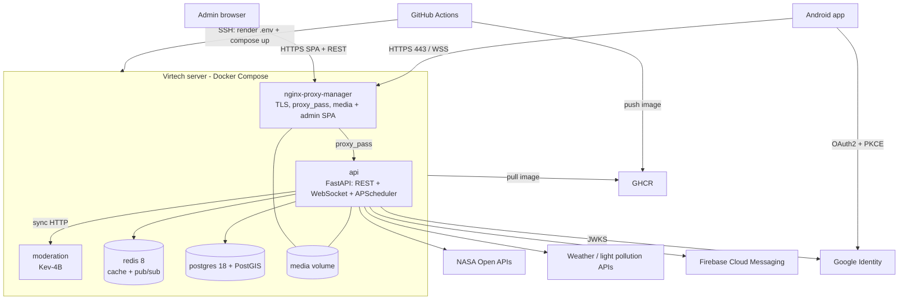

# Arquitectura física i desplegament

Perseida es desplega sobre **un únic servidor de Virtech** on Docker Compose orquestra **cinc contenidors**. Kubernetes es va descartar explícitament: amb un sol host físic només afegeix overhead de control plane i el punt únic de fallada continua sent el servidor ([[0002-docker-compose-en-lloc-de-kubernetes]]).

> [!warning] Estat
> Descripció de l'estat **planificat** tret de la CI del backend, que **ja existeix** (`.github/workflows/ci.yml`, TG-34). `infra/docker-compose.yml` encara no existeix (US TG-37) i la CD tampoc.

## Diagrama

## Serveis de Compose

| Servei | Rol | Nota |
|---|---|---|
| `nginx-proxy-manager` | Únic punt d'entrada: TLS, proxy a l'API, upgrade WebSocket, serveix media i la SPA d'admin | [[nginx-proxy-manager]] |
| `api` | Imatge `perseida-api:<git-sha>`; un sol procés; Alembic a l'entrypoint | [[api]] |
| `postgres` | PostgreSQL 18 + PostGIS, volum `pgdata` (font de veritat) | [[postgres]] |
| `redis` | Redis 8, cache amb TTL i pub/sub; res essencial | [[redis]] |
| `moderation` | Servei Kev-4B; només xarxa interna de Docker | [[moderation]] |

## Flux de desplegament (CI/CD)

- **CI del backend (implementada, TG-34)**: el workflow `.github/workflows/ci.yml` s'executa a cada PR i a cada push cap a `develop`/`main`. Té dos jobs:
  1. `changes` (`dorny/paths-filter`): detecta si ha canviat `backend/**` o el mateix workflow.
  2. `backend`: només s'executa si hi ha canvis al backend (en un push sempre). Executa `uv sync --locked`, `ruff check`, `ruff format --check`, `mypy` i `pytest` amb cobertura. PostgreSQL (PostGIS 18) i Redis 8 s'aixequen com a *service containers* amb *healthcheck*. Publica l'informe com a artefacte `backend-coverage`. Un push nou a la mateixa PR cancel·la l'execució anterior.
  - Les ordres per reproduir-ho en local són al README del backend, secció "Integració contínua".
- **CI pendent**: SonarQube Cloud i comprovació del Quality Gate arribaran amb la US [#194](https://tree.taiga.io/project/alexga03-astronomia-pes/t/194); la CI del frontend, amb TG-35. La CI és obligatòria per fusionar quan TG-33 en fixi el check requerit (`backend`).
- **CD** a cada push a `main` (merge de release o hotfix):
  1. Construeix la imatge del backend, l'etiqueta amb el `git-sha` i la puja a **GHCR**.
  2. Es connecta per **SSH** al servidor de Virtech, renderitza el `.env` des dels secrets de GitHub (`chmod 600`) i executa `docker compose up`.
  3. Publica l'**APK** del frontend en una release de GitHub.
- **Rollback**: tornar a desplegar la imatge anterior pel seu `git-sha`.
- Versionat SemVer des de `0.1.0`, una release per sprint.

## Servidor de Virtech (VM)

El «servidor» és una màquina virtual creada a mà al portal de cloud privat de la FIB (`virtech.fib.upc.edu`), no un servidor dedicat.

| Aspecte | Valor |
|---|---|
| Plantilla | Ubuntu 24.04 PES 1CPU 4GB sense VPN |
| Disc | 30 GB (`vda`), imatge no persistent; Docker Engine i Compose instal·lats; carpeta de desplegament `/opt/perseida` |
| Host públic | `nattech.fib.upc.edu` (NAT compartit; la VM és `172.16.4.43`) |
| Ports públics sense VPN | `40430`–`40439`, que apunten als ports `8080`–`8089` de la VM |

> [!warning] SSH des de fora de la UPC
> El port SSH oficial (`22043`) **no és accessible des d'Internet** sense VPN (comprovat: *timeout*). GitHub Actions s'hi connecta per un port públic NAT: `sshd` escolta també al `8089` de la VM (`/etc/ssh/sshd_config.d/10-perseida.conf`, amb `ssh.socket` desactivat) i s'hi arriba per `nattech.fib.upc.edu:40439`. Només amb clau (`PasswordAuthentication no`); la clau de desplegament és el secret `SSH_PRIVATE_KEY`. Cada membre de l'equip hi entra amb la seva clau pública, que s'afegeix amb `infra/scripts/add-team-key.sh`.

Conseqüències:

- El `8089` queda reservat a SSH; per a [[nginx-proxy-manager]] i la resta de serveis només es poden publicar els ports `8080`–`8088`. No hi ha ports 80/443 públics.

> [!warning] Pendent de decidir: HTTPS al port 443
> Els diagrames d'aquesta nota i de [[visio-general]], i [[nginx-proxy-manager]], parlen de «HTTPS 443», però a Virtech l'únic accés públic és per ports NAT (`40430`–`40439`). Cal decidir com s'exposa nginx-proxy-manager (port NAT amb la URL de l'API a l'app) i com s'obté el certificat TLS, ja que el repte HTTP-01 de Let's Encrypt necessita el port 80 i el TLS-ALPN-01 el 443; amb ports NAT caldria un repte DNS-01 o un altre mètode. Encara no hi ha decisió presa.
- La VM s'esborra al final del quadrimestre i no té còpia de seguretat (guia del servei Virtech).
- Secrets SSH al repositori: `SSH_HOST`, `SSH_PORT`, `SSH_USER`, `SSH_PRIVATE_KEY`, `SSH_KNOWN_HOSTS`. La resta de configuració del `.env` de producció (només el que usa el backend) va com a secrets i variables de GitHub.

## Entorns

Només dos: **local** (el mateix Docker Compose) i **producció** (Virtech). No hi ha staging.

## Configuració i secrets

Els secrets i variables viuen a GitHub *Secrets and variables*; el `.env` mai es versiona, només un `.env.example` sense valors.

> [!warning] Cada variable nova s'ha de donar d'alta a dos llocs
> Si el backend o el Compose necessiten una variable o un secret nous, cal afegir-lo **tant a `.env.example` com a GitHub Actions** (*Settings → Secrets and variables → Actions*; secret si és sensible, variable si no). Si falta a un dels dos, no funcionarà en producció:
>
> - Si és a `.env.example` però no a GitHub, el job `verify-config` del workflow `cd.yml` falla abans de tocar el servidor i llista les que falten. També hi comprova els `SSH_*` (`ENV_EXTRA_REQUIRED`) i que cap valor tingui un salt de línia o una cometa simple, que no es poden renderitzar.
> - Si és a GitHub però no a `.env.example`, el `.env` renderitzat no la porta, perquè `render_env.py` només escriu els noms que consten a la plantilla; la variable no arriba al servidor.
>
> Les variables que només usa un workflow (com les de Taiga) no van al servidor: es deixen fora amb `ENV_EXCLUDE` a `cd.yml`. Versions fixades: PostgreSQL 18 (+PostGIS), Redis 8 i la imatge de Kev-4B.

## Limitacions acceptades

Sense escalat horitzontal ni còpies de seguretat automàtiques; el servidor és un punt únic de fallada.

## Enllaços

- [[visio-general]], [[backend-hexagonal]], [[serveis-externs]]
- [[0002-docker-compose-en-lloc-de-kubernetes]], [[0009-nginx-proxy-manager-serveix-media-i-spa-admin]]
- [[gitflow]], [[qualitat]]
- [[testing]]
