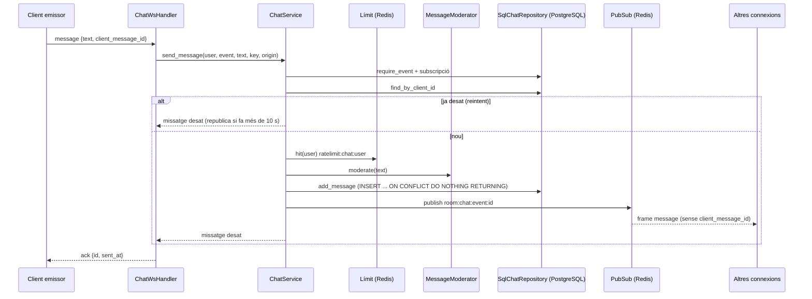

# chat

## Responsabilitat

Xat d'esdeveniment: una sala per esdeveniment astronòmic (0..1), només per a qui hi està subscrit, amb historial a [[postgres]] i difusió en temps real per WebSocket sobre el pub/sub de [[redis]]. Desa, modera i difon cada missatge, de manera idempotent; no fa xat directe entre usuaris (US #65) ni modera de debò encara (vegeu [[moderation]]). Decisions i regles a [[0033-xat-per-esdeveniment-sala-missatge-i-flux]]; protocol de frames a [[0030-protocol-websocket-i-revocacio-per-pub-sub]].

## Tecnologia i versió

Mòdul hexagonal ([[0004-arquitectura-hexagonal-i-tdd-al-domini]]) dins l'únic procés FastAPI ([[0003-un-sol-proces-fastapi]]):

| Capa | Ruta | Contingut |
|---|---|---|
| Domini | `app/domain/chat/` | `EventChatRoom`, `ChatMessage`, `ChatAuthor`, cursor i pàgines (`models.py`); ports `ChatRepository`, `MessageModerator`, `SendRateLimiter`, `RepublishGuard`, `EventSubscriptions` (`ports.py`); codis (`errors.py`) |
| Aplicació | `app/application/chat/` | `ChatService` (`chat_service.py`) |
| Infraestructura | `app/infrastructure/chat/` | `router.py` (REST), `ws_handler.py` (`ChatWsHandler`, sales `chat:event:<id>`), `repository.py` i `tables.py` (PostgreSQL), `rate_limiter.py` i `republish_guard.py` (Redis), `moderator.py` (provisional), `config.py` i `dependencies.py` |

## Interfícies

- Qui el crida: l'app, per REST (llistat, sala i historial) i pel WebSocket `/api/ws` (subscriure's i enviar). Tots els endpoints demanen sessió.
- A qui crida: [[postgres]] (sales i missatges), [[redis]] (límit de freqüència, guarda de republicació i pub/sub) i el moderador (port `MessageModerator`).

### Endpoints REST

| Endpoint | Què fa |
|---|---|
| `GET /api/chat/rooms` | Sales dels esdeveniments subscrits, amb el darrer missatge (o `null`), del més recent al més antic |
| `PUT /api/events/{event_id}/chat/room` | Obre la sala (la crea si cal); idempotent, sempre 200. 403 `FORBIDDEN` si no hi ha subscripció; 404 `EVENT_NOT_FOUND` |
| `GET /api/events/{event_id}/chat/messages?limit=&before=` | Pàgina d'historial, del més nou al més antic; `limit` 1 a 50 (50 per defecte), `before` és el `next_cursor` opac anterior. 422 `CHAT_INVALID_LIMIT` o `CHAT_INVALID_CURSOR` |

Enviar no és REST: va pel WebSocket. Els errors són `application/problem+json` amb `code` estable ([[0018-errors-rfc-9457-amb-codis-estables]]). Cada missatge porta `id`, `room_id`, `author {id, name}`, `text` i `sent_at`; `name` és el del perfil (pot ser `null`) i mai el correu.

### Frames WebSocket

La sala és `chat:event:<event_id>` (UUID en forma canònica).

| Frame del client | Resposta |
|---|---|
| `subscribe` | Eco amb `payload: {}`; `FORBIDDEN` si no hi ha subscripció |
| `message` amb `payload {text, client_message_id}` | Ack `{id, sent_at}` del missatge desat; la resta de subscriptors reben el missatge complet. Errors: `VALIDATION_ERROR` (falta text o `client_message_id` canònic), `NOT_SUBSCRIBED`, `FORBIDDEN`, `RATE_LIMITED`, `CHAT_MESSAGE_EMPTY`, `CHAT_MESSAGE_TOO_LONG`, `CHAT_MESSAGE_REJECTED`, `CHAT_IDEMPOTENCY_CONFLICT`, `PUBSUB_UNAVAILABLE` |
| `unsubscribe` | Eco |

Un `unsubscribe` enviat pel servidor (sense petició) vol dir que s'ha perdut la sala (baixa de l'esdeveniment).

## Flux d'un missatge

Cada pas s'atura al primer error i el client rep un frame `error` amb el `code`. Si la publicació falla, el missatge ja és desat i l'error és `PUBSUB_UNAVAILABLE`; el reintent amb la mateixa clau el torna a publicar.

## Configuració

Només els noms de les variables, mai els valors (valors per defecte al codi i a `backend/.env.example`):

- `CHAT_RATE_LIMIT_MESSAGES` (10) i `CHAT_RATE_LIMIT_WINDOW_SECONDS` (10): missatges permesos per usuari i finestra.
- `CHAT_MESSAGE_MAX_LENGTH` (1000, entre 1 i 1000).
- Les del WebSocket (`WS_*`) són a [[0030-protocol-websocket-i-revocacio-per-pub-sub]].

Claus i canals de Redis a [[redis]]; taules a [[postgres]] i [[model-de-domini#Persistència del xat]].

## Decisions relacionades

- [[0033-xat-per-esdeveniment-sala-missatge-i-flux]]
- [[0030-protocol-websocket-i-revocacio-per-pub-sub]]
- [[0007-moderacio-local-kev-4b-sincrona]]
- [[0005-redis-nomes-com-a-cache-lazy]]
- [[0006-postgresql-postgis-font-de-veritat]]
- [[0018-errors-rfc-9457-amb-codis-estables]]
- [[0023-convencions-del-model-de-dades]]
- [[0028-tdd-estricte-i-politica-de-testing-avancada]]

## US de Taiga relacionades

- TG-64 (xat d'esdeveniment)
- TG-654 (idempotència i reintents)
- TG-469 (pantalles del xat i autor als missatges)
- TG-470 (documentació)

## Repositori i mutation testing (TG-469)

- `page` no consulta els autors (`users`) si la pàgina és buida; si no, fa una sola consulta addicional pels autors distints.
- `add_message` fa `INSERT … ON CONFLICT DO NOTHING RETURNING`: si l'`INSERT` guanya, retorna la fila amb el nom d'autor que ja té el missatge, sense rellegir-la; només en cas de conflicte (reenviament idempotent o reintent concurrent) rellegeix la fila desada amb el `JOIN` a `users`.
- **Mutation (mesurat amb Docker, no amb l'script de CI):** domini del xat 100 % i `chat_service.py` 79,57 %. S'ha executat `mutmut` sobre una còpia amb la configuració apuntant a `app/application/chat`; l'script de CI (`scripts/run_mutmut_diff.py`) només muta `app/domain`, de manera que la capa d'aplicació no la cobreix la CI.

## Estat d'implementació

en curs: backend implementat (REST, WebSocket, persistència, límit de freqüència, idempotència), amb un moderador provisional que aprova tot fins que #81 el substitueixi. El client és a [[frontend#Xat d'esdeveniment: API i hooks (TG-64)]].

## Enllaços

- [[api]], [[redis]], [[postgres]], [[moderation]], [[backend-hexagonal]]
