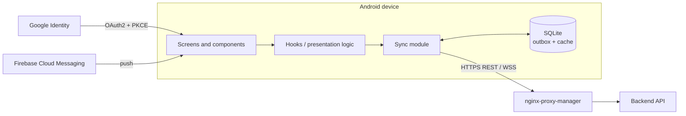

# Frontend: app mòbil i panell d'administració

App i panell d'administració de Perseida amb **React Native + Expo** i TypeScript. Pensada per a Android i iOS; de moment només es desplega la versió **Android** (APK).

> [!warning] Estat
> Descripció de l'estat **planificat**. El codi existent és mínim: configuració, client d'API, errors, el servei de l'APOD (TG-117) i, des de TG-118, Expo Router (`src/app`, grup `(app)` amb un inici temporal i la ruta `/apod`), els tokens de tema (`src/shared/theme`) i els components `SkyBackground`, `GlassPanel` i `GelButton` (`src/shared/ui`). Des de TG-119 i TG-120, la pantalla `/apod` mostra la imatge o el vídeo i els estats de càrrega i d'error amb reintent. Des de TG-43, la pantalla `/login` connecta el flux d'autenticació amb Google OAuth2 (PKCE S256 a natiu i OIDC amb nonce criptogràfic d'`expo-crypto` a web), desa els tokens segurament, mostra els errors per codi (sense Toast encara, excepció d'ADR-0018; textos en català fins a la US #93), suporta accessibilitat (`busy`/`disabled` segons WCAG 4.1.2) i implementa guards de ruta (`login.tsx` i `(app)/_layout.tsx`); el tancament de sessió amb `useLogout` i `LogoutButton`, i l'emmagatzematge de tokens (`src/features/auth`: `expo-secure-store` al mòbil i `sessionStorage` a web, `tokenStorage.web.ts`, amb memòria com a reserva) provenen de TG-45; el logotip de Google és l'asset oficial sense modificar (`assets/google`, amb el seu origen i un test de SHA-256); les accions secundàries fan servir `QuietButton` (`src/shared/ui`), no gel ni vidre; el fons `SkyBackground` és l'escena de Cel viu: cel, sol o lluna entre turons i un llac ovalat amb prat al voltant, nenúfars, joncs, flors, ones, centelleig i bombolles (`src/shared/ui/Lake.tsx`; la geometria, amb llavor fixa, a `lakeLayout.ts`); la pluja de Perseides de `/login` passa per darrere dels turons i de l'herba i és aleatòria dins de límits (mida, color, angle, velocitat, posició, ritme i quants n'hi ha alhora) i pren els colors de les variants `meteors` de cada tema; els tipus de l'API es generen ara de l'OpenAPI real del backend (`openapi/openapi.json`). Des de TG-91 hi ha i18n (català, castellà i anglès; vegeu «Internacionalització»): la pantalla `/apod` i els errors per codi estan traduïts a `frontend/locales/`; el login i el tancament de sessió (`features/auth/strings.ts`) continuen en català fins a la US #93. Encara no hi ha ajustos de tema ni escena viva completa (només l'estàtica de `SkyBackground` i la pluja de Perseides del login). Sí que hi ha Jest (preset `jest-expo`) i la CI del frontend (TG-35).

## Stack

| Àrea | Tecnologia |
|---|---|
| Framework | React Native 0.88 + **Expo SDK 58** (les versions es fixen a `package.json` segons `bundledNativeModules` d'`expo`) |
| Llenguatge | TypeScript 6.0 (`strict`), motor Hermes. Es manté a la 6.x: `typescript-eslint` encara no admet TypeScript 7 (peer `<6.1`) |
| Estils | NativeWind + *tokens* de tema propis; estètica «Frutiger Cosmo · Cel viu» amb quatre temes (`dia`, `posta`, `nit`, `vermell`) i quatre modes ([[0020-frontend-expo-router-i-estetica-frutiger-cosmo]]) |
| Tipografia | M PLUS Rounded 1c (títols i xifres) + Open Sans (cos), amb `expo-font` |
| i18n | `i18next` 26.4.7 + `react-i18next` 17.1.0 + `expo-localization` 58.0.5 (català, castellà i anglès; detecció d'idioma del dispositiu; el selector és la US #92) |
| Emmagatzematge local | SQLite (outbox + cache offline) |
| Auth | Google OAuth2 + PKCE; tokens a `expo-secure-store` |
| Animació i icones | `react-native-reanimated` (+ `react-native-worklets`), `react-native-svg`, `phosphor-react-native` |
| Push | Firebase Cloud Messaging |
| Vídeo incrustat | Mòbil: `react-native-webview` (`ApodVideo.tsx`). Web: `<iframe>` amb *sandbox* (`ApodVideo.web.tsx`); només es emmarquen `www.youtube.com` i `apod.nasa.gov` (llista a `ApodVideo.web.tsx`, alineada amb `frame-src` del CSP) |
| Tipus d'API | Generats de l'esquema OpenAPI del backend (`openapi-typescript`) |
| Admin web | React Native Web (bundle estàtic servit per nginx-proxy-manager) |
| Dependències | `pnpm` |
| Qualitat i tests | ESLint, Prettier, SonarQube Cloud; Jest + React Native Testing Library |

## Arquitectura



## Versions i execució

- **Expo Go** de les botigues només admet l'SDK actual: si Expo Go no carrega l'app, primer s'ha de mirar que l'SDK del projecte coincideixi (TG-327: el salt a l'SDK 58 va deixar l'SDK 57 sense Expo Go).
- Node 24.22.1 (LTS) i pnpm 12.15.0 (`packageManager`; s'actualitza amb `pnpm self-update`, no amb `pnpm add -g pnpm`). Amb pnpm 12 els scripts de build de dependències s'aproven a `allowBuilds` de `pnpm-workspace.yaml` (ara `@parcel/watcher` i `unrs-resolver` denegats).
- `react-native-css-interop@0.2.7` (motor de NativeWind) té un patch de pnpm que treu el registre d'`ImageBackground` (obsolet a RN 0.88); es retira quan NativeWind ho corregeixi.
- Web: `pnpm web` serveix la mateixa app amb React Native Web; NativeWind necessita `darkMode: 'class'` a `tailwind.config.js` (amb `media` la web queda en blanc).

## Mode offline

SQLite local com a outbox i cache de lectura, sincronitzats més tard amb política **last-write-wins** ([[0011-client-offline-sqlite-last-write-wins]]).

## Panell d'administració

SPA amb React Native Web: gestió i suspensió d'usuaris, supervisió d'esdeveniments publicats, mètriques d'ús i cua de revisió d'informes. Accés per rol. El bundle estàtic el serveix [[nginx-proxy-manager]] ([[0009-nginx-proxy-manager-serveix-media-i-spa-admin]]).

## Estructura planificada

```
frontend/
├── src/               # app/ (Expo Router), features/, shared/{ui,theme,api,errors,i18n} (ADR-0020)
├── assets/            # includes sounds/ with LICENSES.md
├── locales/           # ca / es / en translations
├── __mocks__/         # simulated API responses for tests
├── app.json           # Expo configuration
├── package.json
└── tsconfig.json
```

## Internacionalització (TG-91)

L'app arrenca en català, castellà o anglès segons l'idioma del dispositiu, sense configurar res. Cap text d'interfície s'escriu al codi: surt de `frontend/locales/{ca,es,en}.json` per clau (p. ex. `apod.retry`, `errors.NETWORK_ERROR`).

- **Detecció** (`src/shared/i18n/detectLanguage.ts`): `expo-localization` (`getLocales()`) dona els idiomes del dispositiu per ordre de preferència; s'usa el primer que sigui `ca`, `es` o `en`, i el català si no n'hi ha cap. `expo-localization` cal perquè `Intl` no diu quin és l'idioma actual del dispositiu (guia d'Expo).
- **Inicialització** (`src/shared/i18n/index.ts`): els textos van dins de l'app i `i18next` s'inicialitza de manera síncrona (`initAsync: false`) en importar el mòdul des de `src/app/_layout.tsx`, abans de pintar res; per això `t()` no mostra mai claus sense traduir. `fallbackLng` és `ca`.
- **Errors per codi** (`src/shared/errors/errorMessage.ts`): `errorMessage(t, code, retryable)` busca `errors.<CODE>`; si no hi és, mostra `errors.INTERNAL_ERROR` (reintentable) o `errors.GENERIC_FINAL` (no reintentable). El `detail` del servidor no hi participa mai i un codi que no segueix `SCREAMING_SNAKE` (p. ex. `constructor`) va directe al genèric ([[0018-errors-rfc-9457-amb-codis-estables]]). Encara no hi ha component Toast: l'APOD mostra l'error al seu quadre amb reintent.
- **Dates:** `formatApodDate` rep l'idioma de l'app (`i18n.language`), no el del dispositiu.
- **Proves:** `src/shared/i18n/locales.test.ts` falla si una clau existeix en un idioma i falta en un altre; `i18n.test.ts` comprova la detecció i el fallback. `jest.setup.js` fixa el català als tests.

**Afegir un text:** la mateixa clau als tres `locales/*.json` i `t('clau')` amb `useTranslation()`. **Afegir un idioma:** `locales/<codi>.json` amb les mateixes claus, afegir-lo a `SUPPORTED_LANGUAGES` i a `resources`, i al test de claus. Pas a pas als README del frontend (ca/es/en).

Fora d'abast de TG-91: el selector d'idioma i la preferència d'usuari (US #92), la resta de l'app i l'admin, inclòs el login (US #93), i la localització d'errors del backend.

## Seguretat (TG-45)

L'app mai tracta una cadena externa com a codi ni com a enllaç de confiança: `safeHttpsUrl` (`src/shared/security`) filtra les URL de l'API abans d'`<Image>`, `WebView` i `Linking`; el reproductor de l'APOD té una configuració de `WebView` restrictiva; ESLint prohibeix `eval`, `innerHTML`, `dangerouslySetInnerHTML` i `javascript:`. Detall a [[seguretat]] i [[0024-defensa-en-profunditat-contra-injeccio-sql-i-xss]].

## Proves i qualitat

- Prioritat: hooks propis i lògica de presentació (estats de càrrega/error/buit, validació de formularis), components principals i que cada text de la UI tingui traducció ca/es/en. El client d'API es simula.
- El feedback de validació de formularis ha d'aparèixer en < 100 ms sense crida de xarxa.
- Codi nou de cada PR: cobertura ≥ 70 % i Quality Gate de SonarQube Cloud. Els components purament visuals queden fora de la cobertura.
- Els criteris d'acceptació dependents de la UI es comproven manualment a la branca de release abans de cada sprint review. No hi ha tests end-to-end automàtics.
- **CI (TG-35):** el job `frontend` de `.github/workflows/ci.yml` executa a cada PR i push cap a `develop`/`main` `pnpm lint` (ESLint i Prettier), `pnpm tsc` i `pnpm test --coverage --ci`, i publica `lcov.info` com a artefacte `frontend-coverage`. Detalls a [[arquitectura-fisica]] i [[qualitat]].
- **Cap test a `src/app`:** Expo Router converteix cada fitxer d'aquesta carpeta en una ruta i l'empaqueta; un test allà arrossega Jest i Testing Library al paquet de l'app i el *bundler* respon 500 (va trencar la primera execució al mòbil). Els tests de pantalles van al costat de la feature (p. ex. `features/auth/components/LoginScreen.test.tsx`); `__tests__/routes.test.ts` ho vigila.
- Jest fa servir el preset `jest-expo` (`jest.config.js`); hi ha un test de fum a `frontend/__tests__/smoke.test.ts` que també comprova la resolució de mòduls important codi de `src/`. Els tests de components i els mocks de l'API arriben amb la US #83.
- En cada release fusionada a `main`, GitHub Actions publica l'**APK** com a release de GitHub.

## Enllaços

- [[visio-general]], [[backend-hexagonal]], [[serveis-externs]]
- [[0011-client-offline-sqlite-last-write-wins]], [[0008-google-oauth2-pkce-jwks-i-sessio-propia]]
- [[testing]], [[qualitat]]
