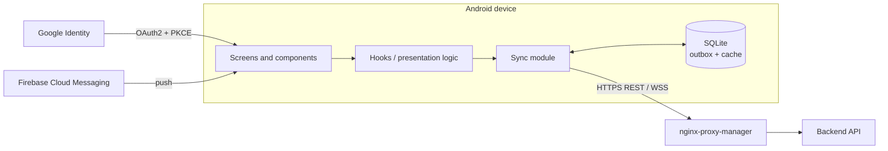

# Frontend: app mòbil i panell d'administració

App i panell d'administració de Perseida amb **React Native + Expo** i TypeScript. Pensada per a Android i iOS; de moment només es desplega la versió **Android** (APK).

> [!warning] Estat
> Descripció de l'estat **planificat**. El codi existent és mínim: configuració, client d'API, errors, el servei de l'APOD (TG-117) i, des de TG-118, Expo Router (`src/app`, grup `(app)` amb un inici temporal i la ruta `/apod`), els tokens de tema (`src/shared/theme`) i els components `SkyBackground`, `GlassPanel` i `GelButton` (`src/shared/ui`). Des de TG-119 i TG-120, la pantalla `/apod` mostra la imatge o el vídeo i els estats de càrrega i d'error amb reintent. Des de TG-45 hi ha la pantalla `/login` (només UI: encara no fa el flux de Google, que és TG-43), el tancament de sessió amb `useLogout` i `LogoutButton`, i l'emmagatzematge de tokens (`src/features/auth`: `expo-secure-store` al mòbil i `sessionStorage` a web, `tokenStorage.web.ts`, amb memòria com a reserva); el logotip de Google és l'asset oficial sense modificar (`assets/google`, amb el seu origen i un test de SHA-256); les accions secundàries fan servir `QuietButton` (`src/shared/ui`), no gel ni vidre; la pluja de Perseides de `/login` pren els colors dels tokens `meteor.*` de cada tema; els tipus de l'API es generen ara de l'OpenAPI real del backend (`openapi/openapi.json`). Encara no hi ha i18n, ajustos de tema ni escena viva completa (només l'estàtica de `SkyBackground` i la pluja de Perseides del login). Sí que hi ha Jest (preset `jest-expo`) i la CI del frontend (TG-35).

## Stack

| Àrea | Tecnologia |
|---|---|
| Framework | React Native + Expo |
| Llenguatge | TypeScript (`strict`), motor Hermes |
| Estils | NativeWind + *tokens* de tema propis; estètica «Frutiger Cosmo · Cel viu» amb quatre temes (`dia`, `posta`, `nit`, `vermell`) i quatre modes ([[0020-frontend-expo-router-i-estetica-frutiger-cosmo]]) |
| Tipografia | M PLUS Rounded 1c (títols i xifres) + Open Sans (cos), amb `expo-font` |
| i18n | i18next (català, castellà i anglès; detecció d'idioma del dispositiu + selector) |
| Emmagatzematge local | SQLite (outbox + cache offline) |
| Auth | Google OAuth2 + PKCE; tokens a `expo-secure-store` |
| Animació i icones | `react-native-reanimated` (+ `react-native-worklets`), `react-native-svg`, `phosphor-react-native` |
| Push | Firebase Cloud Messaging |
| Vídeo incrustat | `react-native-webview` (reproductor de l'APOD; no funciona a la web) |
| Tipus d'API | Generats de l'esquema OpenAPI del backend (`openapi-typescript`) |
| Admin web | React Native Web (bundle estàtic servit per nginx-proxy-manager) |
| Dependències | `pnpm` |
| Qualitat i tests | ESLint, Prettier, SonarQube Cloud; Jest + React Native Testing Library |

## Arquitectura



## Mode offline

SQLite local com a outbox i cache de lectura, sincronitzats més tard amb política **last-write-wins** ([[0011-client-offline-sqlite-last-write-wins]]).

## Panell d'administració

SPA amb React Native Web: gestió i suspensió d'usuaris, supervisió d'esdeveniments publicats, mètriques d'ús i cua de revisió d'informes. Accés per rol. El bundle estàtic el serveix [[nginx-proxy-manager]] ([[0009-nginx-proxy-manager-serveix-media-i-spa-admin]]).

## Estructura planificada

```
frontend/
├── src/               # app/ (Expo Router), features/, shared/{ui,theme,api,errors,i18n} (ADR-0020)
├── assets/            # includes sounds/ with LICENSES.md
├── locales/           # ca / es / en translations
├── __mocks__/         # simulated API responses for tests
├── app.json           # Expo configuration
├── package.json
└── tsconfig.json
```

## Proves i qualitat

- Prioritat: hooks propis i lògica de presentació (estats de càrrega/error/buit, validació de formularis), components principals i que cada text de la UI tingui traducció ca/es/en. El client d'API es simula.
- El feedback de validació de formularis ha d'aparèixer en < 100 ms sense crida de xarxa.
- Codi nou de cada PR: cobertura ≥ 70 % i Quality Gate de SonarQube Cloud. Els components purament visuals queden fora de la cobertura.
- Els criteris d'acceptació dependents de la UI es comproven manualment a la branca de release abans de cada sprint review. No hi ha tests end-to-end automàtics.
- **CI (TG-35):** el job `frontend` de `.github/workflows/ci.yml` executa a cada PR i push cap a `develop`/`main` `pnpm lint` (ESLint i Prettier), `pnpm tsc` i `pnpm test --coverage --ci`, i publica `lcov.info` com a artefacte `frontend-coverage`. Detalls a [[arquitectura-fisica]] i [[qualitat]].
- Jest fa servir el preset `jest-expo` (`jest.config.js`); hi ha un test de fum a `frontend/__tests__/smoke.test.ts` que també comprova la resolució de mòduls important codi de `src/`. Els tests de components i els mocks de l'API arriben amb la US #83.
- En cada release fusionada a `main`, GitHub Actions publica l'**APK** com a release de GitHub.

## Enllaços

- [[visio-general]], [[backend-hexagonal]], [[serveis-externs]]
- [[0011-client-offline-sqlite-last-write-wins]], [[0008-google-oauth2-pkce-jwks-i-sessio-propia]]
- [[testing]], [[qualitat]]
