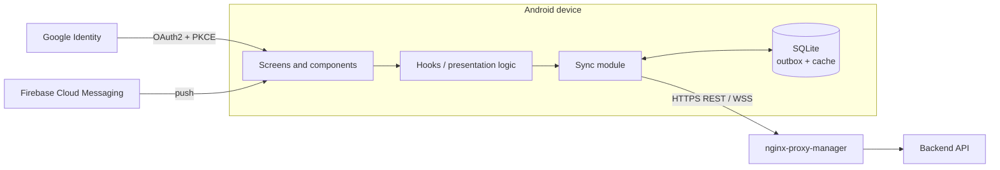

# Frontend: app mòbil i panell d'administració

App i panell d'administració de Perseida amb **React Native + Expo** i TypeScript. Pensada per a Android i iOS; de moment només es desplega la versió **Android** (APK).

> [!warning] Estat
> Descripció de l'estat **planificat**. El codi existent és mínim: configuració, client d'API, errors, el servei de l'APOD (TG-117) i, des de TG-118, Expo Router (`src/app`, grup `(app)` amb un inici temporal i la ruta `/apod`), els tokens de tema (`src/shared/theme`) i els components `SkyBackground`, `GlassPanel` i `GelButton` (`src/shared/ui`). Des de TG-119 i TG-120, la pantalla `/apod` mostra la imatge o el vídeo i els estats de càrrega i d'error amb reintent. Des de TG-43, la pantalla `/login` connecta el flux d'autenticació amb Google OAuth2 (PKCE S256 a natiu i OIDC amb nonce criptogràfic d'`expo-crypto` a web), desa els tokens segurament, mostra els errors per codi (sense Toast encara, excepció d'ADR-0018; textos traduïts des de la US #93), suporta accessibilitat (`busy`/`disabled` segons WCAG 4.1.2) i implementa guards de ruta (`login.tsx` i `(app)/_layout.tsx`); el tancament de sessió amb `useLogout` i `LogoutButton`, i l'emmagatzematge de tokens (`src/features/auth`: `expo-secure-store` al mòbil i `sessionStorage` a web, `tokenStorage.web.ts`, amb memòria com a reserva) provenen de TG-45; el logotip de Google és l'asset oficial sense modificar (`assets/google`, amb el seu origen i un test de SHA-256); les accions secundàries fan servir `QuietButton` (`src/shared/ui`), no gel ni vidre; el fons `SkyBackground` és l'escena de Cel viu: cel, sol o lluna entre turons i un llac ovalat amb prat al voltant, nenúfars, joncs, flors, ones, centelleig i bombolles (`src/shared/ui/Lake.tsx`; la geometria, amb llavor fixa, a `lakeLayout.ts`); la pluja de Perseides de `/login` passa per darrere dels turons i de l'herba i és aleatòria dins de límits (mida, color, angle, velocitat, posició, ritme i quants n'hi ha alhora) i pren els colors de les variants `meteors` de cada tema; els tipus de l'API es generen ara de l'OpenAPI real del backend (`openapi/openapi.json`). Des de TG-91 hi ha i18n (català, castellà i anglès; vegeu «Internacionalització»): la pantalla `/apod` i els errors per codi estan traduïts a `frontend/locales/`; des de la US #93, també el login i el tancament de sessió (claus `auth.*`; el nom «Perseida» no es tradueix). Des de TG-385, el grup `(app)` és una barra de cinc pestanyes amb pantalla de perfil (vegeu «Navegació per pestanyes i perfil»). Encara no hi ha ajustos de tema ni escena viva completa (només l'estàtica de `SkyBackground` i la pluja de Perseides del login). Sí que hi ha Jest (preset `jest-expo`) i la CI del frontend (TG-35).

## Stack

| Àrea | Tecnologia |
|---|---|
| Framework | React Native 0.88 + **Expo SDK 58** (les versions es fixen a `package.json` segons `bundledNativeModules` d'`expo`) |
| Llenguatge | TypeScript 6.0 (`strict`), motor Hermes. Es manté a la 6.x: `typescript-eslint` encara no admet TypeScript 7 (peer `<6.1`) |
| Estils | NativeWind + *tokens* de tema propis; estètica «Frutiger Cosmo · Cel viu» amb quatre temes (`dia`, `posta`, `nit`, `vermell`) i quatre modes ([[0020-frontend-expo-router-i-estetica-frutiger-cosmo]]) |
| Tipografia | M PLUS Rounded 1c (títols i xifres) + Open Sans (cos), amb `expo-font` |
| i18n | `i18next` 26.4.7 + `react-i18next` 17.1.0 + `expo-localization` 58.0.5 (català, castellà i anglès; detecció d'idioma del dispositiu; el selector és la US #92) |
| Emmagatzematge local | SQLite (outbox + cache offline) |
| Auth | Google OAuth2 + PKCE; tokens a `expo-secure-store` |
| Animació i icones | `react-native-reanimated` (+ `react-native-worklets`), `react-native-svg`, `phosphor-react-native` |
| Push | Firebase Cloud Messaging |
| Vídeo incrustat | Mòbil: `react-native-webview` (`ApodVideo.tsx`). Web: `<iframe>` amb *sandbox* (`ApodVideo.web.tsx`); només es emmarquen `www.youtube.com` i `apod.nasa.gov` (llista a `ApodVideo.web.tsx`, alineada amb `frame-src` del CSP) |
| Tipus d'API | Generats de l'esquema OpenAPI del backend (`openapi-typescript`) |
| Admin web | React Native Web (bundle estàtic servit per nginx-proxy-manager) |
| Dependències | `pnpm` |
| Qualitat i tests | ESLint, Prettier, SonarQube Cloud; Jest + React Native Testing Library |

## Arquitectura



## Versions i execució

- **Expo Go** de les botigues només admet l'SDK actual: si Expo Go no carrega l'app, primer s'ha de mirar que l'SDK del projecte coincideixi (TG-327: el salt a l'SDK 58 va deixar l'SDK 57 sense Expo Go).
- **Inici de sessió amb Google i Expo Go** (TG-342): Expo Go usa una redirect `exp://` que Google no accepta mai, així que l'app detecta `ExecutionEnvironment.StoreClient` i mostra `GOOGLE_SIGN_IN_EXPO_GO`. Per provar-lo al mòbil cal una build nativa: `pnpm expo run:android` (cal l'Android SDK; a Windows pot fallar per rutes de més de 260 caràcters) o **EAS Build** a l'organització d'Expo `perseida-fib-upc` (perfil `preview` a `eas.json`, només valors `EXPO_PUBLIC_*` públics). El client Android de Google Cloud ha de tenir el package `app.perseida` i el SHA-1 del keystore de la build.
- Node 24.22.1 (LTS) i pnpm 12.15.0 (`packageManager`; s'actualitza amb `pnpm self-update`, no amb `pnpm add -g pnpm`). Amb pnpm 12 els scripts de build de dependències s'aproven a `allowBuilds` de `pnpm-workspace.yaml` (ara `@parcel/watcher` i `unrs-resolver` denegats).
- `react-native-css-interop@0.2.7` (motor de NativeWind) té un patch de pnpm que treu el registre d'`ImageBackground` (obsolet a RN 0.88); es retira quan NativeWind ho corregeixi.
- Web: `pnpm web` serveix la mateixa app amb React Native Web; NativeWind necessita `darkMode: 'class'` a `tailwind.config.js` (amb `media` la web queda en blanc).

## Navegació per pestanyes i perfil (TG-385)

El grup `(app)` és una barra de pestanyes (`Tabs` d'Expo Router) a `src/app/(app)/_layout.tsx`, que també fa de guard de sessió (TG-43). Cinc pestanyes, declarades a `src/features/navigation/navigationConfig.ts` (`TAB_CONFIG`: ruta, clau i18n `nav.*`, icona Phosphor):

| Ruta | Pestanya | Pantalla actual |
|---|---|---|
| `index` | Inici | Inici temporal de TG-118 (enllaços a `/apod` i `/map`) |
| `events` | Esdeveniments | `EventsScreen` (`src/features/events`, TG-51): llistat filtrable, amb botó cap a `/map` |
| `chat` | Xat | «Pròximament» |
| `gamification` | Gamificació | «Pròximament» |
| `profile` | Perfil | `ProfileScreen` (`src/features/profile`) |

- **Rutes amagades:** `map`, `apod` i `quiz` (TG-61) són rutes del grup però no pestanyes (`HIDDEN_ROUTES`, amb `tabBarButton: () => null` i `tabBarItemStyle: { display: 'none' }`; sense el segon, l'element buit conserva el seu espai i les pestanyes no ocupen tota l'amplada). **No s'han d'amagar amb `href: null`:** a expo-router 58 això treu la ruta del navegador i `router.push('/map')` torna a l'inici (test de regressió `hiddenRoutes.test.tsx`, amb el router real). Una ruta nova del grup que no hagi de ser pestanya s'ha d'afegir aquí; si no, Expo Router la mostra a la barra. Un test (`navigationConfig.test.ts`) comprova que cada fitxer de `src/app/(app)/` és pestanya o ruta amagada.
- **Connectar una pantalla:** la US que implementi Esdeveniments, Xat o Gamificació només canvia el contingut del fitxer de la ruta (`src/app/(app)/<ruta>.tsx`) i hi posa la seva pantalla de `features/<mòdul>`. No toca el layout ni `navigationConfig`. Mentre no hi és, la ruta mostra `ComingSoonTab` (`src/features/navigation/components`: vidre, icona, títol, descripció i acció opcional, amb textos `comingSoon.*`).
- **Espai per a la barra:** la barra és flotant (`position: absolute`), així que cada pantalla del grup deixa a baix `useTabBarInset()` (`src/features/navigation`): l'alçada real de la barra, que ja inclou la *safe area* inferior, o només la *safe area* fora de la barra. Mai un número fix.
- **Barra:** vidre flotant amb `BlurView`; amb «Redueix la transparència», vidre sòlid sense blur. La icona de la pestanya activa és `fill` i la resta `regular`.
- **Accessibilitat i mides:** cada pestanya té `tabBarAccessibilityLabel` traduït i una alçada mínima de `touch.min` (48 dp) a `tabBarItemStyle`, perquè React Navigation compacta la barra a 32 px en apaïsat. L'etiqueta va sempre sota la icona (`tabBarLabelPosition: 'below-icon'`; al costat, un mòbil en apaïsat talla «Gamificació») i la barra fa `touch.min` + l'alçada de línia de `typography.caption` + la *safe area* inferior (els 49 dp per defecte tallen l'etiqueta). Les pantalles «Pròximament» són un `ScrollView`, perquè en apaïsat la targeta no hi cap. El rol `tab` i `aria-selected` els posa la llibreria (a iOS, `button`, per un FIXME de React Navigation).
- **Perfil:** `useUserProfile` (TanStack Query, `GET /api/users/me`, 5 minuts de `staleTime`, un reintent si l'error és transitori; la sessió surt només d'`authHeaders`, com a posts) i `ProfileScreen`, amb l'avatar o les inicials (decoratiu, ocult al lector de pantalla perquè el nom ve just després; només URL `https` via `safeHttpsUrl` i, si la foto no carrega, les inicials), el nom (o el correu si no n'hi ha), el correu, «Membre des de» (`created_at` de l'API, amb `Intl.DateTimeFormat` en l'idioma actiu; si la data no és vàlida, la línia no surt), la càrrega i l'error anunciats al lector (*live region* i `alert`, WCAG 4.1.3), el rol, l'idioma, tres slots reservats (`ProfileSlot`: ratxa #57, fites #59 i seguidors #62) i `LogoutButton`. Cada slot el substituirà la US que en porti les dades.
- **Fora d'abast:** el selector d'idioma (US #92). El text del botó de tancar sessió el tradueix TG-93, ja fusionada.

## Mapa d'esdeveniments (TG-52)

Ruta `/(app)/map` (accés des de l'inici temporal i des de la pestanya Esdeveniments, TG-385). Codi a `src/features/events/`; llibreria i mapa base a [[0032-leaflet-per-al-mapa-web-i-webview]]; dades segons [[contracte-esdeveniments]].

- **Dades:** `useMapEvents` (TanStack Query) demana `GET /api/events/active` i `GET /api/events/upcoming?days=30`; `staleTime` de 5 minuts i un sol reintent si l'error és transitori. Només en línia.
- **Classificació:** `classifyEvents` separa actius i futurs; un esdeveniment que surt a les dues llistes compta com a actiu. El filtre «Actius | Futurs | Sortides | Tots» (per defecte, Tots) s'aplica al mapa; «Tots» són els esdeveniments més les sortides i «Sortides» només les sortides. La llista (`EventList` amb `OutingRow`) mostra el mateix que el filtre: «Tots» són els esdeveniments i després les sortides, «Sortides» només les sortides, i «Actius» i «Futurs» només esdeveniments, perquè la llista és l'alternativa accessible al mapa (revisió de la PR 119). L'estat de càrrega i d'error segueix les dades que mostra el filtre: «Sortides» depèn de la consulta de sortides i la resta, de la d'esdeveniments; amb «Tots» un error de sortides només avisa als controls.
- **Dues vistes** amb el selector «Mapa | Llista» a baix, al mateix panell de vidre que el filtre:
  - **Mapa:** un orbe de vidre per esdeveniment amb ubicació, amb la icona Phosphor de la categoria; els actius tenen un halo que pulsa (token `duration.ambient`, 6 s; quiet amb *reduce motion*).
  - **Llista:** tots els esdeveniments. Els que no tenen ubicació hi diuen «Visible des de qualsevol lloc» (criteri 4 de la US, reescrit el 12/11/2026). Els que en tenen mostren coordenades: l'API encara no dona el nom del lloc (proposta de `location.name` en un comentari de TG-52).
  - **Canvi de vista:** el mapa no es desmunta mai. Amb la llista, queda a sota, invisible, sense tocs i fora de l'arbre d'accessibilitat, de manera que en tornar conserva el zoom i la posició (un muntatge nou recarregaria el WebView a la vista del món). Ho resol `hiddenLayerProps` (`src/features/events/hiddenLayer.ts`), diferent per plataforma:
    - **Mòbil:** `opacity: 0`, `pointerEvents="none"`, `accessibilityElementsHidden` (iOS) i `importantForAccessibility="no-hide-descendants"` (Android).
    - **Web:** react-native-web ignora aquestes dues props, així que s'hi afegeix `visibility: hidden`, que treu el mapa de l'ordre de tabulació i dels lectors de pantalla sense canviar-ne la mida (Leaflet no l'ha de recalcular), i `aria-hidden`. Sense això, el Tab entrava als marcadors, al zoom i a l'atribució invisibles (WCAG 2.2 AA; review de la PR #93).
  - **Canvi de filtre:** el mapa només s'ajusta als marcadors el primer cop que en té; després conserva el zoom i la posició de l'usuari. Al web, `FitToMarkers` només fa el primer `fitBounds`. Al mòbil, la pàgina de Leaflet porta els marcadors i es recarrega quan canvien, així que informa de cada moviment (`{"view": {latitude, longitude, zoom}}`, validat a `EventMap.tsx`) i la pàgina nova s'obre en aquesta càmera sense `fitBounds`.
- **Sortides al mapa (TG-646):** `useOutings({})` porta les sortides i `toOutingMarkers` les converteix en marcadors `kind: 'outing'` (només les que tenen ubicació). Cada marcador és un orbe amb la icona Binoculars de Phosphor i la classe `pm-outing`, amb vora i brillantor de color `brand` (contrast ≥ 3:1 mesurat als quatre temes); no té halo. L'etiqueta accessible és el títol, «Sortida» i la data (`describeOuting`). Si les sortides fallen o no hi ha sessió (`INVALID_SESSION`), el mapa continua amb els esdeveniments i el panell dels controls mostra un avís curt (`outingsWarning`, amb `role="alert"`), amb el missatge del codi de l'error, només amb els filtres «Tots» i «Sortides»; amb «Sortides» i un error, un `MapStatus` mostra el mateix missatge.
- **Fitxa resum:** en tocar un marcador o una fila. Al mòbil, un full de vidre des de baix (es tanca amb la X, tocant fora, Esc o el botó enrere); a partir de 768 px (`breakpoints.tablet`), un panell al costat del mapa. Una sortida reaprofita la mateixa closca amb un cos propi (`OutingSheetBody`): títol, inici i fi, autora, esdeveniment (`useEventTitle`) i un botó cap a `/outings/{id}`.
- **Disposició en pantalla ampla (TG-647):** una fila amb dues parts. A l'esquerra, una columna amb la capçalera, el mapa (o la llista) i els controls; a la dreta, el panell de la fitxa, germà de la columna i no a sobre. Sense fitxa, la columna ocupa tot l'ample. El panell va de dalt a baix amb 16 px de marge, capçalera fixa i scroll intern (`GlassPanel` amb `fill`). En pantalla estreta, la fitxa és un `Modal` de full inferior que tapa tot. Els controls van a l'esquerra, compactes, a 16 px de la vora. Al web, un `ResizeObserver` sobre el contenidor crida `invalidateSize()` perquè Leaflet es torni a mesurar; al mòbil, Leaflet ja escolta el `resize` del WebView (comportament per defecte, no provat en dispositiu).
- **Estats:** càrrega, buit (segons el filtre), error amb reintent (si és transitori) i «cap té ubicació al mapa» amb un botó cap a la llista, en un panell de vidre damunt del mapa o de la llista.
- **Components compartits nous:** `GelSegmented` (`src/shared/ui`), píndola de gel amb segments, anunciada com a pestanyes o com a opcions (`kind`).

## Llistat filtrable d'esdeveniments (TG-51)

Pestanya Esdeveniments (`src/app/(app)/events.tsx` → `EventsScreen`, `src/features/events/components`). Dades de `GET /api/events` segons [[contracte-esdeveniments]]. Decisions de Manel del 21/11/2026.

- **Dades:** `searchEvents` i `useEventSearch` (TanStack Query, clau `eventKeys.search(filtres)`, mateix `staleTime` de 5 minuts i reintent transitori que el mapa). En canviar els filtres es manté la llista anterior fins que arriba la nova (`keepPreviousData`), i tornar a uns filtres recents surt de la cache.
- **Filtres:**
  - **Categories:** xips de selecció múltiple (`GelChip`); cap de seleccionat vol dir totes (no s'envia `category`).
  - **Període:** `GelSegmented` «7 | 30 | 90 dies» des d'avui en dies UTC (`searchRange`), 30 per defecte. Rangs predefinits en lloc de selectors de data lliures.
  - **«A prop meu»:** interruptor que demana el permís d'`expo-location` en activar-lo (`useDeviceLocation`) i envia `lat`/`lon` amb el radi per defecte de l'API (500 km, fix). Si es denega el permís, l'interruptor queda desactivat amb una explicació i la resta de filtres continuen funcionant; quan l'app torna a primer pla es torna a comprovar el permís (`getForegroundPermissionsAsync`) i, si ara hi és, l'interruptor es reactiva. Si el permís hi és però no es pot llegir la posició (localització apagada, temps esgotat), l'interruptor queda apagat però actiu, amb un altre text, per tornar-ho a provar. Colors (WCAG 1.4.11): pista apagada `text.secondary`, polze `surface.glassSolid` apagat i `gel.text` encès. Als quatre temes arriben a 3:1 el polze contra la pista (en tots dos estats), la pista apagada contra el vidre i el polze contra el vidre. L'interruptor natiu d'iOS fa 51×31 pt: un `hitSlop` vertical en completa l'objectiu tàctil fins a `touch.min`. La pista encesa (`gel.body[0]`) no hi arriba contra el vidre de posta i nit: l'estat es llegeix per la posició del polze, que sí que contrasta (decisió de Manel, 21/11/2026).
- **Distància:** l'API no la retorna; es calcula al client amb haversine (`distanceKm`, R = 6371 km) i només es mostra amb «A prop meu» actiu i per als esdeveniments amb ubicació (`EventRow`, prop `distanceKm`).
- **Llista:** `EventRow` sobre vidre sense blur (`surface.glass`; el `BlurView` només és al panell dels filtres i als d'estat, com a molt 2 per pantalla), sense acció en tocar-la (la fitxa és de TG-55). «Actiu ara» surt de `statusOn` (`classifyEvents.ts`), la mateixa regla que `GET /api/events/active`. El recompte de resultats és una regió viva `polite` i, a iOS, `announceForAccessibility`. Mentre arriben els resultats de filtres nous (`isPlaceholderData`), la llista s'anuncia ocupada (`busy`), no mostra distàncies i el recompte no canvia.
- **Estats:** càrrega, buit i error amb reintent (`StatusPanel`).
- **Components compartits nous:** `GelChip` (`src/shared/ui`), xip de gel anunciat com a `checkbox`; seleccionat porta una icona `Check`, perquè el color no sigui l'única pista (WCAG 1.4.1).

## Publicacions d'esdeveniment (TG-628)

Codi a `src/features/posts/`; API a [[model-de-domini#Publicacions d'esdeveniment (implementat)]].

- **Dades:** `api/posts.ts` (openapi-fetch) i `hooks/usePosts.ts` (`useEventPosts` amb `useInfiniteQuery` i cursor; `useCreatePost`, `useUpdatePost` i `useDeletePost`, que en acabar bé tornen a carregar la llista de l'esdeveniment). Només en línia. Sense sessió desada, fallen amb `INVALID_SESSION` sense cridar l'API (`features/auth/authHeaders.ts`, compartit).
- **Qui és l'autora:** `useCurrentUser` (`features/auth/hooks`, `GET /api/users/me`, llegit un cop per sessió). Una publicació és pròpia si `author.id` coincideix amb el de la sessió; només llavors surten «Edita» i «Esborra».
- **Formulari:** `PostForm`, amb `react-hook-form` i `zod` ([[0020-frontend-expo-router-i-estetica-frutiger-cosmo|ADR-0020]]). El mateix component crea i edita; comptador «N/1000» sempre visible, que compta caràcters com el servidor (punts de codi: un emoji compta un cop). Els errors del text (`POST_TEXT_*`) surten sota el camp i van també al principi de l'`accessibilityHint` del camp, perquè el lector els llegeixi en entrar-hi; la resta, com a alerta traduïda.
- **Pantalla:** `EventPosts` va al final del scroll de la fitxa (`EventSheet`), tant al full inferior del mòbil com al panell lateral. Té els estats de càrrega, buit i error (amb reintent només si l'error és transitori) i «Carrega'n més» per a la pàgina següent. `PostItem` mostra l'autora, la data, «editada» i el text, sempre com a text pla.
- **Edició i esborrat al lloc:** editar substitueix el text pel formulari dins de la mateixa publicació. Esborrar demana confirmació també dins la publicació, i no amb `Alert.alert`, que React Native Web ignora (decisió de la persona responsable, 17/11/2026). Com que el botó que tenia el focus desapareix, en editar el focus va al camp de text (`autoFocus`) i la pregunta de confirmació és una alerta (WCAG 2.4.3 i 4.1.3).

## Sortides d'observació (TG-629)

Rutes `/(app)/outings` (les meves) i `/(app)/outings?eventId=` (les d'un esdeveniment), `/outings/new`, `/outings/{id}` i `/outings/{id}/edit`; els fitxers de `src/app` són prims i la feina és a `src/features/outings/`. Contracte a [[api#Sortides d'observació (TG-629)]] i model a [[model-de-domini#Sortida d'observació (implementat)]].

- **Dades:** `api/outings.ts` (openapi-fetch) i `hooks/useOutings.ts` (`useOutings` amb el filtre `mine` o `eventId`, `useOuting`, `useCreateOuting`, `useUpdateOuting` i `useDeleteOuting`, que en acabar bé invaliden `outingKeys.all`). Només en línia. Cada crida porta el `Bearer` amb `authHeaders` (`features/auth/authHeaders.ts`, compartit): sense sessió desada fallen amb `INVALID_SESSION` sense cridar l'API.
- **Formulari** (`OutingForm`, `outingForm.ts`): `react-hook-form` i `zod`. Els missatges de la validació de comoditat són les mateixes claus `errors.OUTING_*` que el servidor, així que el text és el mateix al client i a l'API. Com al backend, l'inici només es compara amb el present en una sortida nova o si canvia una data: una sortida que ja ha començat es pot editar. El `PATCH` només envia els camps que han canviat. Un codi `OUTING_*` d'un camp surt al seu camp; la resta, com a alerta. L'esdeveniment relacionat es tria amb `EventField`: «Cap esdeveniment» o un dels que mostra el mapa (els actius i els dels propers 30 dies, de `useMapEvents`), amb una fila extra si la sortida ja en té un que no és a la llista, perquè editar-la no la deslligui sense voler (decisió de Raquel, 18/11/2026; abans només es podia treure).
- **Data i hora** (`DateTimeField`): a iOS, el control natiu de `@react-native-community/datetimepicker`; a Android, que no té un de sol per a les dues coses, primer el dia i després l'hora; a la web, `<input type="datetime-local">` (`DateTimeField.web.tsx`).
- **Lloc** (`LocationField`): un mapa de Leaflet amb una mira al mig (icona `Crosshair`) i el botó «Tria aquest lloc», que agafa el centre del mapa; moure el mapa no tria res. Al costat, «Usa la meva ubicació» (`expo-location`, permís només mentre l'app és oberta, amb la raó a `app.json`) i dos camps de latitud i longitud amb el botó «Tria aquestes coordenades» (`parseCoordinates`: admet la coma decimal i valida els rangs). Són les alternatives a arrossegar el mapa (WCAG 2.5.7), decidides amb Raquel el 18/11/2026; amb teclat, a la web, les fletxes mouen el mapa i `+`/`-` fan zoom. El mapa és `LocationMap`: un `WebView` al mòbil (`pickerHtml.ts`) i `react-leaflet` a la web; reaprofita la càmera `{"view": …}` de [[0032-leaflet-per-al-mapa-web-i-webview]].
- **Autoria:** `useCurrentUser` diu qui ets; els botons «Edita» i «Esborra» només surten si l'`id` de l'autora és el teu, i mentre no se sap, a ningú. Qui té l'última paraula és el servidor (`403 OUTING_FORBIDDEN`).
- **Esborrat:** passa per `ConfirmDialog` (`src/shared/ui`), un `Modal` amb vidre, perquè `Alert.alert` no fa res a la web El vel del darrere és el token `surface.scrim` de cada tema (fosc a tots, també als temes foscos; al vermell, sense blau).
- **Entrada:** el botó «Les meves sortides» de l'inici temporal i el botó «Sortides d'aquest esdeveniment» de la fitxa de l'esdeveniment (`onShowOutings` d'`EventSheet`, que `map.tsx` omple). Des de la llista d'un esdeveniment, «Crea una sortida» obre el formulari ja lligat a ell.
- **Compartit nou:** `TopBar` i `ConfirmDialog` a `src/shared/ui`, i `src/shared/map` (constants del mapa base, càrrega de Leaflet, `onlyMapPage` i la lectura de la càmera), que abans eren dins d'`events`.
- **Fora de la US:** la paginació de la llista (tasca #644), el reintent automàtic d'un `401`, el mode offline i el Toast.

## Quiz diari (TG-61)

Ruta `/(app)/quiz` (de moment, accés des de l'inici temporal; a la pestanya de Gamificació quan existeixi, #385). Codi a `src/features/quiz/`; dades segons [[contracte-quiz]].

- **Sessió:** és la primera pantalla que crida endpoints privats. `withSession` (`src/features/auth/api/authorized.ts`) hi posa la capçalera de `authHeaders` (`Authorization: Bearer <access token>`; sense sessió falla amb `INVALID_SESSION` sense cridar l'API). Amb un 401 renova la sessió un sol cop (`refreshSession`, que serialitza les renovacions) i repeteix la petició. Si la renovació falla però la sessió continua desada (xarxa, 5xx), acaba en `SESSION_UNAVAILABLE` reintentable, no en sessió caducada. Les altres features privades (ratxa, perfil) l'han de reutilitzar.
- **Dades:** `useQuizToday(lang)` (TanStack Query, `staleTime` de 5 minuts, un reintent si l'error és transitori; torna a demanar la pregunta just després de mitjanit UTC amb la pantalla oberta i, amb `AppState`, en tornar al primer pla un altre dia) i `useAnswerQuiz(lang)`, que desa el resultat a la pregunta en memòria cau i marca obsoletes les dels altres idiomes. `lang` és l'idioma de l'app (`i18n.language`).
- **Pantalla:** pregunta amb 4 opcions (`accessibilityRole="radio"`, estat `checked`; la selecció també es veu amb la icona i la vora, no només amb color) i botó de gel desactivat fins que es tria una opció i `busy` mentre s'envia. Resultat: capçalera encertada o no, cada opció amb icona i paraules («Resposta correcta», «La teva resposta»), explicació i enllaç a la font (`safeHttpsUrl`). Totes dues vistes tenen un `QuietButton` «Torna a l'inici» (`router.back()`, o `replace('/')` si no hi ha on tornar), com el mapa.
- **Components compartits:** `StatusPanel` (`src/shared/ui`), el panell de càrrega i d'error amb reintent; l'APOD (`ApodStatus`) i el quiz (`QuizStatus`) només hi posen els seus textos.
- **Errors:** càrrega amb missatge per codi i reintent si és transitori; si falla l'enviament, es conserva l'opció; `QUIZ_EXPIRED` i `QUIZ_QUESTION_MISMATCH` recarreguen la pregunta i mostren un avís; `QUIZ_ALREADY_ANSWERED` recarrega i mostra el resultat. Si la recàrrega falla, es mostra l'error amb reintent encara que hi hagi una pregunta anterior en memòria cau.

## Xat d'esdeveniment: API i hooks (TG-64)

Codi a `src/features/chat/`; el contracte REST i el protocol WebSocket són els del backend ([[0030-protocol-websocket-i-revocacio-per-pub-sub]]). La connexió en temps real és a [[#Temps real: connexió WebSocket compartida (TG-64)]]; les pantalles i els textos de la UI són de TG-469.

- **Dades:** `api/chat.ts` (openapi-fetch) amb `listRooms` (`GET /api/chat/rooms`), `ensureRoom` (`PUT /api/events/{id}/chat/room`, idempotent) i `fetchMessages` (`GET …/chat/messages?limit=50&before=<cursor>`; el cursor és opac i només s'envia si n'hi ha). Només en línia.
- **Sessió:** totes passen per `withSession` (`features/auth/api/authorized.ts`): `Bearer`, un sol refresc en un 401 i `INVALID_SESSION` sense cridar l'API si no hi ha sessió desada.
- **Hooks** (`hooks/useChat.ts`): `useRooms` (`useQuery`) i `useRoomMessages(eventId)` (`useInfiniteQuery`: primera pàgina sense `before`, la següent amb el `next_cursor`, i sense pàgina següent quan és `null`; deshabilitat si no hi ha `eventId`). Un sol reintent i només si l'error és transitori. Claus a `chatKeys`.

## Temps real: connexió WebSocket compartida (TG-64)

Client genèric a `src/shared/realtime/` (sense lògica de xat; el xat directe de la US #65 el reutilitza) i hook del xat a `features/chat/hooks/useChatSocket.ts`. Parla el protocol d'[[0030-protocol-websocket-i-revocacio-per-pub-sub]] contra `/api/ws`; la URL (`wsUrl`) es deriva d'`apiBaseUrl` a `src/shared/config` (`http` → `ws`, `https` → `wss`).

- **Singleton amb recompte** (`socketClient.ts`): hi ha una sola connexió per procés (el backend en tanca la quarta per usuari amb 4429). S'obre en muntar el primer consumidor i es tanca (1000) en desmuntar l'últim. `useSocket(auth)` n'és el hook prim: `status` (`connecting | open | reconnecting | closed`), `error`, `subscribe(room, onFrame)`, `send(frame)` i `reconnect()`.
- **Sessió injectada:** `shared/` no importa de `features/`. El consumidor passa un `SocketAuth` (`getToken()` i `refresh()`); la connexió usa el del primer consumidor. `features/auth/socketAuth.ts` n'és la implementació (`getTokens()` i `refreshSession()`). `getToken()` es crida a cada connexió, i si retorna `null` o es rebutja, la connexió queda `closed` amb `INVALID_SESSION` sense obrir cap socket.
- **Protocol:** el primer frame és `{type:"auth",token}` (el token mai va a la URL); l'estat passa a `open` quan arriba l'ack d'`auth`, i llavors es resubscriuen les sales actives. El servidor envia `ping` i el client respon `pong` amb el mateix `id`. `subscribe`, `unsubscribe` i `message` porten un `id` de client: l'ack el resol i un frame `error` el rebutja amb un `AppError` (via `problemToAppError`, compartit amb `toAppError`). Un `unsubscribe` sense `id` és una revocació del servidor: la sala deixa de resubscriure's i `useChatSocket` crida `onRevoked`. Sense connexió, `send` es rebutja amb `NETWORK_ERROR`, i els enviaments pendents també si la connexió cau.
- **Reconnexió:** espera exponencial d'1 s fins a 30 s amb *jitter* (entre la meitat i el total), vuit intents; després, `closed` amb `NETWORK_ERROR` reintentable i `reconnect()` manual (estat `connecting`). En tornar a `open`, el comptador d'intents es reinicia i `error` torna a `null`.
- **Errors d'autenticació, sense bucle:** un 4401 fa un únic `refresh()` (estat `reconnecting` mentre dura) i reconnecta amb el token nou; si torna el 4401 sense cap autenticació correcta entremig, `closed` amb `INVALID_SESSION`. Si el refresc falla, la connexió queda `closed` amb el mateix error que donaria el REST (`withSession`): `SESSION_UNAVAILABLE` (reintentable) quan és una fallada temporal de xarxa o de servidor i la sessió continua desada, i `INVALID_SESSION` quan ja no hi ha sessió. Un ack d'`auth` correcte reinicia el comptador del 4401. Un 4429 és `closed` sense reintent amb el codi nou `TOO_MANY_CONNECTIONS` (429, no reintentable; catàleg a la skill `gestio-errors` i `errors.TOO_MANY_CONNECTIONS` als tres locales).
- **`useChatSocket(eventId, {onMessage, onRevoked, onError})`:** subscriu `chat:event:<eventId>`, entrega els missatges dels altres (`ChatMessageResponse`) i `sendMessage(text)` torna `{id, sent_at}` de l'ack. L'emissor no rep el seu propi missatge pel canal: l'afegeix a la UI amb l'ack. Si el servidor rebutja la subscripció a la sala (`FORBIDDEN`, `CHAT_ROOM_NOT_FOUND`, `EVENT_NOT_FOUND`…), l'`AppError` arriba a `onError` perquè la pantalla l'expliqui; els errors de `sendMessage` rebutgen la seva promesa, no passen per `onError`.
- **Connexió morta (TG-654):** si no arriba cap frame del servidor en 60 s (`DEAD_AFTER_MS`, el doble de `WS_HEARTBEAT_SECONDS`; ADR-0030), el client tanca el socket (1000) i reconnecta pel mateix backoff. El comptador s'arma en obrir i es rearma amb qualsevol frame. Si `new WebSocket()` llança, es tracta com una caiguda.
- **`AppState` (TG-654):** en passar a segon pla (`background`) tanca el socket (1000) sense programar reintents, però conserva consumidors, sales i enviaments pendents; en tornar al primer pla reconnecta de seguida (intents a 0, i es pot renovar la sessió de nou si un 4401 era en curs), reautentica i resubscriu. `inactive` no fa res: a iOS salta amb el centre de control, el selector d'apps o Face ID. El listener és únic: es registra amb el primer consumidor i es treu amb l'últim.
- **Enviaments fiables (TG-654):** `send` encua el frame en memòria amb un `id` fix i el mateix payload; surt quan la connexió és autenticada (després dels `subscribe`) i es reenvia en cada reautenticació. Màxim 3 intents: sense ack en 10 s (`requestTimeoutMs`) es reintenta de seguida, i un error del servidor reintentable (`429`, `5xx`) es reintenta amb espera d'1 s i 2 s amb *jitter*; un error no reintentable es rebutja de seguida. Esgotats els intents, la promesa es rebutja amb `SEND_UNCERTAIN` (reintentable) si l'últim intent no va tenir resposta, o amb l'error del servidor si en va tenir. El timeout no demostra que el servidor no hagi desat el missatge: per això el servidor és idempotent per `client_message_id` ([[0030-protocol-websocket-i-revocacio-per-pub-sub#Actualització (TG-654)]]) i el reintent manual de la UI ha de reutilitzar la mateixa clau (`sendMessage(text, clientMessageId)`). Si la connexió queda `closed` per sempre o es desmunta l'últim consumidor, els pendents es rebutgen amb `SEND_UNCERTAIN` si ja havien sortit i amb `NETWORK_ERROR` si no; amb l'estat `closed`, `send` rebutja de seguida amb `NETWORK_ERROR`. La cua té un màxim de 50 enviaments pendents (`OUTBOX_MAX`): el següent es rebutja a l'instant amb `NETWORK_ERROR`. Un error reintentable que arriba mentre l'enviament ja espera el reintent s'ignora (no suma intents ni programa un altre reenviament). Els temporitzadors es netegen amb cada resposta, rebuig i tancament.
- **`useChatSocket` i duplicats (TG-654):** `sendMessage(text, clientMessageId = randomUUID())` posa `client_message_id` al payload; `onMessage` descarta un missatge amb un `id` ja entregat a la sala (els últims 200), perquè el servidor torna a publicar els duplicats.
- **Límit de `shared/`:** una regla d'ESLint (`no-restricted-imports`) impedeix que `src/shared/**` importi de `features/`.
- **Límits coneguts:** la cua no sobreviu al tancament de l'app (outbox persistent, fora d'abast); un error o ack tardà amb l'`id` d'un `send` ja resolt o rebutjat arriba al gestor de la sala.
- **Fora d'abast (TG-469):** integrar els missatges en temps real amb la memòria cau de TanStack Query i la política de `staleTime` de l'històric.

### Sala de xat: peces de la pantalla (TG-469)

Peces de la sala d'un esdeveniment, a `src/features/chat/`; la pantalla que les munta és una PR posterior de TG-64.

- **Dades pures:** `chatCache.ts` (`addMessage` afegeix un missatge a la pàgina més nova de l'`InfiniteData` sense duplicar-lo per `id`; `flattenMessages` aplana les pàgines i en treu els repetits) i `chatItems.ts` (`buildChatItems` fa la llista invertida: pendents primer, històric, un separador de dia per dia calendari del dispositiu i l'autor només al primer missatge d'una tirada d'una altra persona; `arrivedKeys` diu què ha arribat amb la sala oberta, que és l'únic que entra amb moviment; els pendents no marquen on comença l'historial ja vist, i el primer missatge d'una sala buida apareix sense moviment perquè una llista buida no es distingeix d'una que encara carrega). `dateFormat.ts` guarda els `Intl.DateTimeFormat` per idioma i opcions.
- **`bubbleSurface.ts`:** les dues bombolles són el vidre sense blur de les files (`rowSurface`), opac amb «Redueix la transparència»; la pròpia hi afegeix un vel de l'accent (`accentGlow` al 8 %) i la vora de l'accent. El gel és només per a accions i un missatge és contingut, així que no n'hi ha. Text a 4,5:1 mesurat sobre tota l'escena amb el vel posat als quatre temes. La verificació visual a dispositiu queda pendent.
- **`MessageBubble`:** un sol element accessible («autor, hora: text»; «Tu» per als propis); en enviament, `busy`, vidre net sense el vel de l'accent (encara no «assentat») i un punt que batega (quiet amb *reduce motion*); si falla o és incert, una nota de vidre amb icona i text i un `QuietButton` «Reintenta» germà que torna el mateix `clientMessageId` i després mou el focus del lector a la bombolla (`AccessibilityInfo.sendAccessibilityEvent(…, 'focus')`). Només mostra l'hora.
- **`MessageComposer`:** càpsula de vidre de fila sense blur (`composerSurface`: el vidre amb blur de `surface.glass`, sense res desenfocat al darrere, deixa `state.danger` a 2,9:1 sobre el llac de posta) amb camp de `glassSolid`, multilínia (Enter fa salt de línia), comptador per punts de codi contra 1000 (constant pròpia del xat, no compartida amb les publicacions), alerta si se supera, error de l'enviament per `code` i botó rodó `GelIconButton` (nou a `src/shared/ui`). Un enviament rebutjat conserva el text; un d'acceptat treu del camp el text enviat i conserva el que s'hagi escrit després (si s'ha editat dins l'enviat, ho conserva tot); en enviar, torna el focus al camp. A baix només deixa el que diu la pantalla (`bottomInset`: l'àrea segura amb el teclat amagat, res amb el teclat obert); als costats segueix l'àrea segura.
- **`MessageList`:** `FlatList` invertida amb separadors de dia (capçalera, data llarga), càrrega de pàgines anteriors en arribar a dalt (una alhora) i columna limitada a `readingMaxWidth`. L'ordre en què VoiceOver i TalkBack llegeixen una llista invertida s'ha de comprovar al dispositiu.
- **Mutation testing:** als tres components, només els estils (`createStyles`) i els valors de moviment queden fora de Stryker; condicions, rols, etiquetes i moviment condicionat es muten ([[testing#Estils visuals als components del frontend (TG-385)]]).

## Mode offline

SQLite local com a outbox i cache de lectura, sincronitzats més tard amb política **last-write-wins** ([[0011-client-offline-sqlite-last-write-wins]]).

## Panell d'administració

SPA amb React Native Web: gestió i suspensió d'usuaris, supervisió d'esdeveniments publicats, mètriques d'ús i cua de revisió d'informes. Accés per rol. El bundle estàtic el serveix [[nginx-proxy-manager]] ([[0009-nginx-proxy-manager-serveix-media-i-spa-admin]]).

## Estructura planificada

```
frontend/
├── src/               # app/ (Expo Router), features/, shared/{ui,theme,api,errors,i18n} (ADR-0020)
├── assets/            # includes sounds/ with LICENSES.md
├── locales/           # ca / es / en translations
├── __mocks__/         # simulated API responses for tests
├── app.json           # Expo configuration
├── package.json
└── tsconfig.json
```

## Internacionalització (TG-91)

L'app arrenca en català, castellà o anglès segons l'idioma del dispositiu, sense configurar res. Cap text d'interfície s'escriu al codi: surt de `frontend/locales/{ca,es,en}.json` per clau (p. ex. `apod.retry`, `errors.NETWORK_ERROR`).

- **Detecció** (`src/shared/i18n/detectLanguage.ts`): `expo-localization` (`getLocales()`) dona els idiomes del dispositiu per ordre de preferència; s'usa el primer que sigui `ca`, `es` o `en`, i el català si no n'hi ha cap. `expo-localization` cal perquè `Intl` no diu quin és l'idioma actual del dispositiu (guia d'Expo).
- **Inicialització** (`src/shared/i18n/index.ts`): els textos van dins de l'app i `i18next` s'inicialitza de manera síncrona (`initAsync: false`) en importar el mòdul des de `src/app/_layout.tsx`, abans de pintar res; per això `t()` no mostra mai claus sense traduir. `fallbackLng` és `ca`.
- **Errors per codi** (`src/shared/errors/errorMessage.ts`): `errorMessage(t, code, retryable)` busca `errors.<CODE>`; si no hi és, mostra `errors.INTERNAL_ERROR` (reintentable) o `errors.GENERIC_FINAL` (no reintentable). El `detail` del servidor no hi participa mai i un codi que no segueix `SCREAMING_SNAKE` (p. ex. `constructor`) va directe al genèric ([[0018-errors-rfc-9457-amb-codis-estables]]). Encara no hi ha component Toast: l'APOD mostra l'error al seu quadre amb reintent.
- **Dates:** `formatApodDate` rep l'idioma de l'app (`i18n.language`), no el del dispositiu.
- **Proves:** `src/shared/i18n/locales.test.ts` falla si una clau existeix en un idioma i falta en un altre; `i18n.test.ts` comprova la detecció i el fallback. `jest.setup.js` fixa el català als tests.

**Afegir un text:** la mateixa clau als tres `locales/*.json` i `t('clau')` amb `useTranslation()`. **Afegir un idioma:** `locales/<codi>.json` amb les mateixes claus, afegir-lo a `SUPPORTED_LANGUAGES` i a `resources`, i al test de claus. Pas a pas als README del frontend (ca/es/en).

Fora d'abast de TG-91: el selector d'idioma i la preferència d'usuari (US #92), la resta de l'app i l'admin, i la localització d'errors del backend. El login i el tancament de sessió es van traduir a la US #93 (`auth.*`; `authStrings` ja no existeix).

## Seguretat (TG-45)

L'app mai tracta una cadena externa com a codi ni com a enllaç de confiança: `safeHttpsUrl` (`src/shared/security`) filtra les URL de l'API abans d'`<Image>`, `WebView` i `Linking`; el reproductor de l'APOD té una configuració de `WebView` restrictiva; ESLint prohibeix `eval`, `innerHTML`, `dangerouslySetInnerHTML` i `javascript:`. Detall a [[seguretat]] i [[0024-defensa-en-profunditat-contra-injeccio-sql-i-xss]].

## Proves i qualitat

- Prioritat: hooks propis i lògica de presentació (estats de càrrega/error/buit, validació de formularis), components principals i que cada text de la UI tingui traducció ca/es/en. El client d'API es simula.
- El feedback de validació de formularis ha d'aparèixer en < 100 ms sense crida de xarxa.
- Cobertura: 80 % global i 90 % del codi nou (bloquejant a la CI des de TG-359 via `coverageThreshold` i SonarQube Cloud) i Quality Gate de SonarQube Cloud; TDD estricte ([[0028-tdd-estricte-i-politica-de-testing-avancada]]). Els components purament visuals queden fora de la cobertura.
- Els criteris d'acceptació dependents de la UI es comproven manualment a la branca de release abans de cada sprint review. Els tests end-to-end (Maestro a l'app mòbil, Playwright a l'admin; només fluxos crítics) són previstos a les US #359-#362; avui no n'hi ha.
- **CI (TG-35):** el job `frontend` de `.github/workflows/ci.yml` executa a cada PR i push cap a `develop`/`main` `pnpm lint` (ESLint i Prettier), `pnpm typecheck` (l'script no es diu `tsc`: vegeu [[qualitat]]) i `pnpm test --coverage --ci`, i publica `lcov.info` com a artefacte `frontend-coverage`. Detalls a [[arquitectura-fisica]] i [[qualitat]].
- **Cap test a `src/app`:** Expo Router converteix cada fitxer d'aquesta carpeta en una ruta i l'empaqueta; un test allà arrossega Jest i Testing Library al paquet de l'app i el *bundler* respon 500 (va trencar la primera execució al mòbil). Els tests de pantalles van al costat de la feature (p. ex. `features/auth/components/LoginScreen.test.tsx`); `__tests__/routes.test.ts` ho vigila.
- Jest fa servir el preset `jest-expo` (`jest.config.js`); hi ha un test de fum a `frontend/__tests__/smoke.test.ts` que també comprova la resolució de mòduls important codi de `src/`. Els tests de components i els mocks de l'API arriben amb la US #83.
- Amb cada tag `vX.Y.Z` sobre `main`, GitHub Actions publica l'**APK** com a release de GitHub.

## Distribució a Android (TG-329)

L'APK de release es compila amb `android-release.yml` i es publica a GitHub Releases: vegeu [[0029-apk-android-a-github-releases-amb-obtainium]] i [[instal-lar-app-android]]. El config plugin `withAndroidRelease` aplica la signatura, la versió i Gradle.

## Enllaços

- [[visio-general]], [[backend-hexagonal]], [[serveis-externs]]
- [[0011-client-offline-sqlite-last-write-wins]], [[0008-google-oauth2-pkce-jwks-i-sessio-propia]]
- [[testing]], [[qualitat]]
