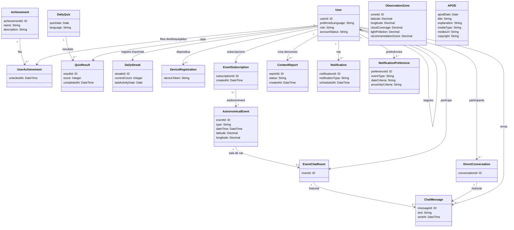

# Model de domini

Classes del diagrama UML de la incepció 2 (§7), agrupades pels seus quatre paquets.

> [!warning] Pot canviar
> Les classes i relacions representades poden canviar al llarg del projecte (així ho diu la incepció 2).

> [!note] Lectura del diagrama
> Els atributs i les etiquetes de relació s'han transcrit tal com es llegeixen a la imatge. Les multiplicitats d'alguns extrems no es llegeixen amb claredat (línies que se solapen al voltant de `User`); aquí només es llisten les que es veuen bé i la resta es dona sense multiplicitat.

> [!info] Implementat: usuari
> `User` ja té taula i entitat (TG-135), amb més atributs que el diagrama; vegeu [[#Usuari (implementat)]].

## Gamificació

| Classe | Atributs |
|---|---|
| `Achievement` | `achievementId: ID`, `name: String`, `description: String` |
| `UserAchievement` | `unlockedAt: DateTime` |
| `DailyQuiz` | `quizDate: Date`, `language: String` |
| `QuizResult` | `resultId: ID`, `score: Integer`, `completedAt: DateTime` |
| `DailyStreak` | `streakId: ID`, `currentCount: Integer`, `lastActivityDate: Date` |

## Usuaris i esdeveniments

| Classe | Atributs |
|---|---|
| `User` | `userId: ID`, `preferredLanguage: String`, `role: String`, `accountStatus: String` |
| `DeviceRegistration` | `deviceToken: String` |
| `EventSubscription` | `subscriptionId: ID`, `createdAt: DateTime` |
| `AstronomicalEvent` | `eventId: ID`, `type: String`, `dateTime: DateTime`, `latitude: Decimal`, `longitude: Decimal` |
| `ObservationZone` | `zoneId: ID`, `latitude: Decimal`, `longitude: Decimal`, `cloudCoverage: Decimal`, `lightPollution: Decimal`, `recommendationScore: Decimal` |
| `APOD` | `apodDate: Date`, `title: String`, `explanation: String`, `mediaType: String` (`image`/`video`), `mediaUrl: String`, `copyright: String` (opcional) |

## Notificacions i moderació

| Classe | Atributs |
|---|---|
| `ContentReport` | `reportId: ID`, `status: String`, `createdAt: DateTime` |
| `Notification` | `notificationId: ID`, `notificationType: String`, `scheduledAt: DateTime` |
| `NotificationPreference` | `preferenceId: ID`, `eventType: String`, `dateCriteria: String`, `proximityCriteria: String` |

## Comunitat i missatgeria

| Classe | Atributs |
|---|---|
| `EventChatRoom` | `roomId: ID` |
| `DirectConversation` | `conversationId: ID` |
| `ChatMessage` | `messageId: ID`, `text: String`, `sentAt: DateTime` |

## Relacions principals

Etiquetes tal com apareixen al diagrama:

- `Achievement` 1 — 0..* `UserAchievement` («fita»); `User` — `UserAchievement` («fites desbloquejades»).
- `DailyQuiz` 1 — 0..* `QuizResult` («resultats»); `User` — `QuizResult` («obté»).
- `User` — `DailyStreak` («registre d'activitat»).
- `User` 1 — 0..* `DeviceRegistration` («dispositius»); `User` — `User` («segueix»).
- `User` — `EventSubscription` («subscripcions»); `EventSubscription` 0..* — 1 `AstronomicalEvent` («esdeveniment»).
- `User` 1 — 0..* `ContentReport` («crea denúncies»); `User` 1 — 0..* `Notification` («rep»); `User` 1 — 0..* `NotificationPreference` («preferències»).
- `AstronomicalEvent` 1 — 0..1 `EventChatRoom` («sala de xat»).
- `EventChatRoom` 1 — 0..* `ChatMessage` («historial»); `DirectConversation` 1 — 0..* `ChatMessage` («historial»).
- `User` — `EventChatRoom` («participa»); `User` — `ChatMessage` («envia»); `User` 2 — 0..* `DirectConversation` («participants»: 2 usuaris per conversa).
- No s'assigna amb certesa: les tres multiplicitats «1» de la part superior de `User`, l'extrem `User` de les relacions «fites desbloquejades», «obté», «registre d'activitat» i «subscripcions», les de les tres línies llargues de la part inferior (`User` amb `EventChatRoom`, `ChatMessage` i `DirectConversation`, més enllà del «2» ja indicat) i la de l'autorelació «segueix». Es donen sense multiplicitat.
- `ObservationZone` i `APOD` apareixen al paquet «Usuaris i esdeveniments» sense cap relació dibuixada.

## Usuari (implementat)

Entitat `app/domain/users/models.py`; taules a `app/infrastructure/users/tables.py` (migració `create_users`). Convencions: [[0023-convencions-del-model-de-dades]].

| Camp | Notes |
|---|---|
| `id` | `uuid` UUIDv7, clau primària interna |
| `email` | únic, en minúscules; mai clau |
| `display_name`, `avatar_url` | opcionals (perfil de Google) |
| `preferred_language` | `ca` (per defecte), `es`, `en` |
| `role` | `user` (per defecte), `moderator`, `admin` |
| `status` | `active` (per defecte), `suspended`, `banned` |
| `created_at`, `last_login_at` | `timestamptz` |
| `deleted_at` | nul = actiu; soft delete |

`user_identities(provider, subject, user_id, created_at)`: identitat externa (`google_sub` = `subject`), PK `(provider, subject)`, FK a `users`. A l'entitat de domini, `google_sub` és un camp de `User`; el repositori ho mapeja.

## Esdeveniment astronòmic (implementat)

Entitat `AstronomicalEvent` a `app/domain/events/models.py`; port `EventRepository` a `app/domain/events/ports.py`; taula `astronomical_events` a `app/infrastructure/events/tables.py` (migració `create_astronomical_events`) i repositori de lectura `SqlEventRepository`. La va crear TG-351 en lloc de TG-50 (acord entre Raquel i Manel, 09/11/2026). Forma pública: [[contracte-esdeveniments]].

| Camp | Notes |
|---|---|
| `id` | `uuid` UUIDv7, clau primària interna i estable |
| `source`, `external_id` | origen de l'esdeveniment; `UNIQUE (source, external_id)`. `source`: `launch_library_2`, `usno`, `skyfield`, `catalog` (fixats a [[0031-fonts-d-esdeveniments-sota-demanda|ADR-0031]]) |
| `title`, `summary` | text, en l'idioma de la font; no buit (ho comproven l'entitat i `EventResponse`) |
| `category` | `lunar`, `solar`, `meteor_shower`, `launch` |
| `starts_at`, `ends_at` | `timestamptz`; `CHECK ends_at >= starts_at` (a l'entitat, `EVENT_ENDS_BEFORE_START`). Índex a cadascuna |
| `latitude`, `longitude` | `double precision`, opcionals però totes dues o cap; índex GiST d'expressió `geography` (sense `geoalchemy2`) |
| `source_url` | opcional; només https (l'adaptador hi aplica `safe_https_url`) |
| `created_at`, `updated_at` | `timestamptz`, `now()` per defecte |

Consultes del port, ordenades per `starts_at`:

- `list_between(start, end)`: els esdeveniments que se solapen amb `[start, end)`, és a dir, `starts_at < end` i `ends_at >= start`. Un esdeveniment instantani a `start` hi surt.
- `list_starting_between(start, end)`: els que compleixen `start <= starts_at < end`.

Escriptura i consulta per id (TG-50):

- `upsert_many(drafts)`: desa els `EventDraft` (l'esdeveniment tal com el dona una font, amb `source` i `external_id` i sense `id`). Si `(source, external_id)` ja hi és, n'actualitza les dades i `updated_at` (`now()`) i en conserva l'`id` i `created_at`. Si el lot repeteix una clau, es desa l'últim.
- `exists(event_id)`: si l'esdeveniment existeix (el fa servir TG-64 per a la sala de xat).

Les fonts implementen el port `EventSource` (nom, TTL i `fetch()`); `EventService` les refresca sota demanda abans de cada consulta ([[0031-fonts-d-esdeveniments-sota-demanda]]).

> [!todo] Pendent per a TG-51 (proximitat)
> - L'índex GiST és parcial (`WHERE latitude IS NOT NULL`). La consulta de proximitat ha de fer servir la mateixa expressió, `ST_SetSRID(ST_MakePoint(longitude, latitude), 4326)::geography`, i el mateix predicat.

## Quiz diari (implementat)

Entitats `app/domain/quiz/models.py`; taules a `app/infrastructure/quiz/tables.py` (migracions `create_quiz` i `seed_quiz_questions`, TG-60). `DailyQuiz` és la taula `quiz_days`: la primera vegada que es demana un dia s'hi desa la primera pregunta que encara no ha sortit o, si ja han sortit totes, la que fa més temps que va sortir (`next_question`). El dia no canvia si el banc creix, i les preguntes noves surten abans de cap repetició ([[contracte-quiz]]).

| Taula | Camps |
|---|---|
| `quiz_questions` | `id` UUIDv7 fix (ve del fitxer del seed), `position` (única, ordre de rotació), `correct_option` 0-3, `source_url` |
| `quiz_question_translations` | PK `(question_id, language)`, `statement`, `options` (4 textos), `explanation`; FK a `quiz_questions` amb `CASCADE` |
| `quiz_days` (`DailyQuiz`) | PK `quiz_date`, `question_id` (FK, `RESTRICT`) |
| `quiz_answers` (`QuizResult`) | `id` UUIDv7, `user_id` (FK a `users`, `CASCADE`), `quiz_date`, `question_id` (FK, `RESTRICT`), `chosen_option`, `correct`, `answered_at`; única `(user_id, quiz_date)` |

`score` del diagrama és `correct` (cert o fals): hi ha una sola pregunta per dia.

Desfer la migració `seed_quiz_questions` només esborra les preguntes sense respostes ni dies; tornar-la a aplicar insereix la resta amb els mateixos `id`. `Language` és a `app/domain/shared/language.py` perquè el fan servir users i quiz.

## Diagrama (transcripció)

## Enllaços

- [[visio-general]], [[backend-hexagonal]], [[postgres]]
- [[0004-arquitectura-hexagonal-i-tdd-al-domini]], [[0006-postgresql-postgis-font-de-veritat]]
- [[epiques-i-us]]
