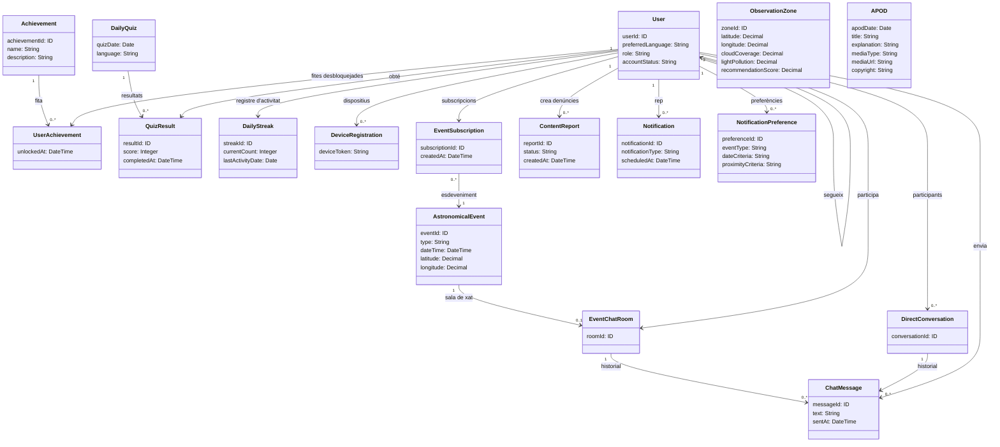

# Model de domini

Classes del diagrama UML de la incepció 2 (§7), agrupades pels seus quatre paquets.

> [!warning] Pot canviar
> Les classes i relacions representades poden canviar al llarg del projecte (així ho diu la incepció 2).

> [!note] Lectura del diagrama
> Els atributs i les etiquetes de relació s'han transcrit tal com es llegeixen a la imatge. Les multiplicitats d'alguns extrems no es llegeixen amb claredat (línies que se solapen al voltant de `User`); aquí només es llisten les que es veuen bé i la resta es dona sense multiplicitat.

> [!info] Implementat: usuari
> `User` ja té taula i entitat (TG-135), amb més atributs que el diagrama; vegeu [[#Usuari (implementat)]].

> [!info] Implementat: ratxa diària
> `DailyStreak` ja té entitat, taula i endpoints (TG-56); vegeu [[#Ratxa diària (implementat)]].

> [!info] Implementat: fites
> `Achievement` i `UserAchievement` ja tenen entitats, taules, catàleg de 34 fites i el motor que les desbloqueja (TG-58); vegeu [[#Fites (implementat)]].

## Gamificació

| Classe | Atributs |
|---|---|
| `Achievement` | `achievementId: ID`, `name: String`, `description: String` |
| `UserAchievement` | `unlockedAt: DateTime` |
| `DailyQuiz` | `quizDate: Date`, `language: String` |
| `QuizResult` | `resultId: ID`, `score: Integer`, `completedAt: DateTime` |
| `DailyStreak` | `streakId: ID`, `currentCount: Integer`, `lastActivityDate: Date` |

## Usuaris i esdeveniments

| Classe | Atributs |
|---|---|
| `User` | `userId: ID`, `preferredLanguage: String`, `role: String`, `accountStatus: String` |
| `DeviceRegistration` | `deviceToken: String` |
| `EventSubscription` | `subscriptionId: ID`, `createdAt: DateTime` |
| `AstronomicalEvent` | `eventId: ID`, `type: String`, `dateTime: DateTime`, `latitude: Decimal`, `longitude: Decimal` |
| `ObservationZone` | `zoneId: ID`, `latitude: Decimal`, `longitude: Decimal`, `cloudCoverage: Decimal`, `lightPollution: Decimal`, `recommendationScore: Decimal` |
| `APOD` | `apodDate: Date`, `title: String`, `explanation: String`, `mediaType: String` (`image`/`video`), `mediaUrl: String`, `copyright: String` (opcional) |

## Notificacions i moderació

| Classe | Atributs |
|---|---|
| `ContentReport` | `reportId: ID`, `status: String`, `createdAt: DateTime` |
| `Notification` | `notificationId: ID`, `notificationType: String`, `scheduledAt: DateTime` |
| `NotificationPreference` | `preferenceId: ID`, `eventType: String`, `dateCriteria: String`, `proximityCriteria: String` |

## Comunitat i missatgeria

| Classe | Atributs |
|---|---|
| `EventChatRoom` | `roomId: ID` |
| `DirectConversation` | `conversationId: ID` |
| `ChatMessage` | `messageId: ID`, `text: String`, `sentAt: DateTime` |

## Relacions principals

Etiquetes tal com apareixen al diagrama:

- `Achievement` 1 — 0..* `UserAchievement` («fita»); `User` — `UserAchievement` («fites desbloquejades»).
- `DailyQuiz` 1 — 0..* `QuizResult` («resultats»); `User` — `QuizResult` («obté»).
- `User` — `DailyStreak` («registre d'activitat»).
- `User` 1 — 0..* `DeviceRegistration` («dispositius»); `User` — `User` («segueix»).
- `User` — `EventSubscription` («subscripcions»); `EventSubscription` 0..* — 1 `AstronomicalEvent` («esdeveniment»).
- `User` 1 — 0..* `ContentReport` («crea denúncies»); `User` 1 — 0..* `Notification` («rep»); `User` 1 — 0..* `NotificationPreference` («preferències»).
- `AstronomicalEvent` 1 — 0..1 `EventChatRoom` («sala de xat»).
- `EventChatRoom` 1 — 0..* `ChatMessage` («historial»); `DirectConversation` 1 — 0..* `ChatMessage` («historial»).
- `User` — `EventChatRoom` («participa»); `User` — `ChatMessage` («envia»); `User` 2 — 0..* `DirectConversation` («participants»: 2 usuaris per conversa).
- No s'assigna amb certesa: les tres multiplicitats «1» de la part superior de `User`, l'extrem `User` de les relacions «fites desbloquejades», «obté», «registre d'activitat» i «subscripcions», les de les tres línies llargues de la part inferior (`User` amb `EventChatRoom`, `ChatMessage` i `DirectConversation`, més enllà del «2» ja indicat) i la de l'autorelació «segueix». Es donen sense multiplicitat.
- `ObservationZone` i `APOD` apareixen al paquet «Usuaris i esdeveniments» sense cap relació dibuixada.

## Usuari (implementat)

Entitat `app/domain/users/models.py`; taules a `app/infrastructure/users/tables.py` (migració `create_users`). Convencions: [[0023-convencions-del-model-de-dades]].

| Camp | Notes |
|---|---|
| `id` | `uuid` UUIDv7, clau primària interna |
| `email` | únic, en minúscules; mai clau |
| `display_name`, `avatar_url` | opcionals (perfil de Google) |
| `preferred_language` | `ca` (per defecte), `es`, `en` |
| `role` | `user` (per defecte), `moderator`, `admin` |
| `status` | `active` (per defecte), `suspended`, `banned` |
| `created_at`, `last_login_at` | `timestamptz` |
| `deleted_at` | nul = actiu; soft delete |

`user_identities(provider, subject, user_id, created_at)`: identitat externa (`google_sub` = `subject`), PK `(provider, subject)`, FK a `users`. A l'entitat de domini, `google_sub` és un camp de `User`; el repositori ho mapeja.

## Xat d'esdeveniment (domini implementat)

Entitats a `app/domain/chat/models.py`, ports a `app/domain/chat/ports.py` i codis a `app/domain/chat/errors.py` (US #64). La persistència és implementada (TG-448 i TG-450; vegeu [[#Persistència del xat]]); l'API encara no. Els atributs concreten els del diagrama: `roomId` és `id` i `messageId` és `id`.

| Entitat | Camps | Notes |
|---|---|---|
| `EventChatRoom` | `id` (UUIDv7), `event_id`, `created_at` | una sala com a màxim per esdeveniment (0..1); immutable |
| `ChatMessage` | `id` (UUIDv7), `room_id`, `author_id`, `text`, `sent_at` | immutable; el servidor assigna `id` i `sent_at` (UTC) |

Regles del text: es retallen els espais dels extrems i s'eliminen els caràcters de control (`Cc`; el NUL fa fallar PostgreSQL), els surrogats (`Cs`) i els separadors de línia i de paràgraf (`Zl`, `Zp`), excepte el salt de línia i la tabulació. A més, s'eliminen només els invisibles perillosos, que són els de la propietat Unicode `Default_Ignorable_Code_Point` (UCD 18) menys els benignes: bidi embeddings, overrides i isolates, zero-width space, word joiner, guionet suau, fillers de hangul, selectors de variació que no són d'emoji i tots els tags (poden amagar text ASCII). Es conserven ZWJ i ZWNJ (emojis compostos i alguns scripts), LRM, RLM i ALM (marques direccionals d'un sol caràcter), els selectors d'emoji `FE0E`/`FE0F` i, de les tag sequences, només les banderes d'Anglaterra, Escòcia i Gal·les. No s'elimina cap caràcter pel fet de ser no assignat (`Cn`): els emojis nous passen encara que la versió d'Unicode de Python no els conegui. Un text amb només marques invisibles (o el braille en blanc) és buit. Efecte acceptat per l'equip (11/11/2026): l'escriptura mongola (selectors de variació i separador de vocal) i els selectors de variació ideogràfics perden aquests caràcters. Un cop net, buit dona `CHAT_MESSAGE_EMPTY` i de més de 1000 caràcters `CHAT_MESSAGE_TOO_LONG`; mai es trunca. `CHAT_MESSAGE_REJECTED` és per a un text que el moderador ha refusat.

Ports: `ChatRepository` (sales, missatges, `require_event(event_id)` i pàgina d'històric amb ordre i cursor exclusiu `(sent_at, id)`), `MessageModerator` (`moderate(text) -> ModerationResult`, que substituirà #81), `SendRateLimiter` i `EventSubscriptions` (`is_subscribed(user_id, event_id)`, que compleix `SqlEventSubscriptionRepository` de TG-53; vegeu [[#Subscripció a un esdeveniment (implementat al backend)]]). El cursor públic codifica data i id en base64url. El servei desa el missatge amb `ChatRepository.add_message` i després el publica al `PubSub` de `domain/shared/ports.py`, al canal `room:chat:event:<event_id>` (sala `chat:event:<event_id>` segons [[0030-protocol-websocket-i-revocacio-per-pub-sub|ADR-0030]]), amb un sobre `{from: null, frame}`. Si desar falla, no es publica; si publicar falla, el missatge queda desat (surt a l'històric) i es llança `PUBSUB_UNAVAILABLE`. El servei comprova l'existència amb `require_event` (404), després la subscripció (403) i només aleshores crea la sala. El contracte no demostra atomicitat entre PostgreSQL i Redis; reintents i duplicats i la identitat de connexió es resolen amb TG-459.

### Persistència del xat

Taules a `app/infrastructure/chat/tables.py` (migració `b3e9a6d2c581_create_chat`, darrere de la de `event_subscriptions`) i adaptador `SqlChatRepository` a `app/infrastructure/chat/repository.py` (TG-448 i TG-450). Segueix [[0023-convencions-del-model-de-dades]] i [[0024-defensa-en-profunditat-contra-injeccio-sql-i-xss|ADR-0024]] (només paràmetres lligats).

| Taula | Camps | Restriccions i índexs |
|---|---|---|
| `event_chat_rooms` | `id` (UUIDv7), `event_id`, `created_at` | `event_id` FK a `astronomical_events` `ON DELETE CASCADE` i `UNIQUE` (una sala com a màxim per esdeveniment) |
| `chat_messages` | `id` (UUIDv7), `room_id`, `author_id`, `text` (`varchar(1000)`), `sent_at` (`timestamptz`), `client_message_id` (`uuid`, `NOT NULL`, el genera el client; TG-654) | FK a la sala i a `users`, totes dues `ON DELETE CASCADE`; `UNIQUE(author_id, client_message_id)` (idempotència dels reenviaments, [[0030-protocol-websocket-i-revocacio-per-pub-sub]]); `CHECK length(text) >= 1` (xarxa de seguretat sobre el domini; el màxim el dona el tipus); índex `(room_id, sent_at DESC, id DESC)` per a l'històric i índex per `author_id` per a la cascada en esborrar un usuari |

- `sent_at` té `server_default now()` (ADR-0023), però el domini sempre envia el valor: l'ordre del cursor en depèn.
- `get_or_create_room` fa `INSERT ... ON CONFLICT (event_id) DO NOTHING RETURNING` i, si no retorna res, rellegeix la sala: dues peticions alhora deixen una sola fila. Si l'esdeveniment no existeix (o s'esborra a mig camí), `NotFoundError(EVENT_NOT_FOUND)`.
- `page` demana `limit + 1` files, ordenades per `(sent_at, id)` descendent i estrictament anteriors al cursor; el `next_cursor` és el de l'últim missatge retornat només si hi ha més files. Rebutja `limit < 1` (el servei ja valida 1..50).
- `list_rooms_of` és una sola consulta: sales existents dels esdeveniments subscrits (join amb `event_subscriptions`) amb l'últim missatge (`LEFT JOIN LATERAL`), per data de l'últim missatge descendent; les sales sense missatges van al final, per `created_at` descendent.
- Errors: `OperationalError`, `InterfaceError` i `OSError` de la base de dades es tradueixen a `ExternalServiceError` amb el codi `DATABASE_UNAVAILABLE` (a `app/application/shared/error_codes.py`, patró 503 per als repositoris; vegeu [[0018-errors-rfc-9457-amb-codis-estables|ADR-0018]]). `add_message` només tradueix a `NotFoundError(CHAT_ROOM_NOT_FOUND)` (`app/application/chat/errors.py`) la violació de la FK `fk_chat_messages_room_id_event_chat_rooms`; qualsevol altra `IntegrityError` (id repetit, `CHECK` del text, autor inexistent) no es tradueix. Els dos codis són al catàleg de `gestio-errors` amb els textos pendents fins que el router (TG-455) els exposi.

## Xat directe (domini implementat)

Entitats a `app/domain/direct_chat/models.py`, ports a `ports.py` i codis a `errors.py` (US #65, tasques #399 i #400). Només el domini: serveis, persistència i API vindran amb les tasques #401 a #408. El mòdul no importa cap altra feature ([[backend-hexagonal]]; contracte d'import-linter «The direct chat does not import other features»), per això no reutilitza `ChatMessage` ni els ports de `app/domain/chat`.

| Entitat | Camps | Notes |
|---|---|---|
| `DirectConversation` | `id` (UUIDv7), `user_a_id`, `user_b_id`, `created_at`, `user_a_read_at`, `user_b_read_at` | exactament 2 participants; immutable |
| `DirectMessage` | `id` (UUIDv7), `conversation_id`, `sender_id`, `text`, `sent_at`, `client_message_id` | immutable; el servidor assigna `id` i `sent_at` (UTC); `client_message_id` és la clau d'idempotència, com al xat d'esdeveniment ([[0030-protocol-websocket-i-revocacio-per-pub-sub]]) |
| `UserBlock` | `blocker_id`, `blocked_id`, `created_at` | direccional: que A bloquegi B no implica que B bloquegi A |

- **Una conversa per parella:** la parella es desa ordenada (`user_a_id < user_b_id`), de manera que (A, B) i (B, A) són la mateixa clau. `DirectConversation.create(a, b)` ordena els ids; el constructor rebutja una parella desordenada. És una regla del domini; la restricció única de la base de dades la reforçarà a #406.
- **No llegits:** cada participant té una marca de llegit (`*_read_at`, buida al principi). `mark_read(user_id, at)` retorna una conversa nova i la marca no retrocedeix. Un missatge és no llegit per a un usuari si és de l'altre participant i posterior a la seva marca; `is_unread_for` rebutja (`VALIDATION_ERROR`) un missatge d'una altra conversa, i `mark_read` una data sense zona horària. El recompte és un `COUNT` agregat al repositori, sense comptadors desnormalitzats.
- **Text:** mateixes regles de neteja que el xat d'esdeveniment (`clean_user_text` i `has_visible_text` de `app/domain/shared/text.py`, vegeu [[#Xat d'esdeveniment (domini implementat)]]). Buit o de més de 1000 caràcters (`MESSAGE_MAX_LENGTH`) dona `VALIDATION_ERROR` (criteri 7 de #65); mai es trunca.
- **Errors del domini:** `CANNOT_MESSAGE_SELF` (parella amb un mateix usuari, també en bloquejar), `VALIDATION_ERROR` i `NOT_A_PARTICIPANT` ([[0018-errors-rfc-9457-amb-codis-estables|ADR-0018]]). `USER_NOT_FOUND`, `CONVERSATION_NOT_FOUND` i `USER_BLOCKED` són dels serveis i s'afegiran amb ells.
- **Ports:** `DirectConversationRepository` (`get_or_create` per parella, `get`, `mark_read`, `list_of`), `DirectMessageRepository` (`find_by_client_id`, `add` idempotent, `page` amb cursor exclusiu `(sent_at, id)`, `count_unread`), `UserBlockRepository` (`block` i `unblock` idempotents, `is_blocked`) i `PushNotifier` (`notify(recipient_id, message)`).
- **Push:** `NoopPushNotifier` (`app/infrastructure/direct_chat/push_notifier.py`) no fa res i porta `TODO(TG-73)`: les notificacions reals (FCM) són de la US #73 i no afegeixen dependències aquí.
- **Per a #402:** `MessageModerator`, `SendRateLimiter` i `PubSub` són a `app/domain/chat` i `app/domain/shared`; quan el servei del xat directe els necessiti, els ports del xat es mouran a `app/domain/shared` en aquella PR.

## Esdeveniment astronòmic (implementat)

Entitat `AstronomicalEvent` a `app/domain/events/models.py`; port `EventRepository` a `app/domain/events/ports.py`; taula `astronomical_events` a `app/infrastructure/events/tables.py` (migració `create_astronomical_events`) i repositori de lectura `SqlEventRepository`. La va crear TG-351 en lloc de TG-50 (acord entre Raquel i Manel, 09/11/2026). Forma pública: [[contracte-esdeveniments]].

| Camp | Notes |
|---|---|
| `id` | `uuid` UUIDv7, clau primària interna i estable |
| `source`, `external_id` | origen de l'esdeveniment; `UNIQUE (source, external_id)`. `source`: `launch_library_2`, `usno`, `skyfield`, `catalog` (fixats a [[0031-fonts-d-esdeveniments-sota-demanda|ADR-0031]]) |
| `title`, `summary` | text, en l'idioma de la font; no buit (ho comproven l'entitat i `EventResponse`) |
| `category` | `lunar`, `solar`, `meteor_shower`, `launch` |
| `starts_at`, `ends_at` | `timestamptz`; `CHECK ends_at >= starts_at` (a l'entitat, `EVENT_ENDS_BEFORE_START`). Índex a cadascuna |
| `latitude`, `longitude` | `double precision`, opcionals però totes dues o cap; índex GiST d'expressió `geography` (sense `geoalchemy2`) |
| `source_url` | opcional; només https (l'adaptador hi aplica `safe_https_url`) |
| `created_at`, `updated_at` | `timestamptz`, `now()` per defecte |

Consultes del port, ordenades per `starts_at`:

- `list_between(start, end)`: els esdeveniments que se solapen amb `[start, end)`, és a dir, `starts_at < end` i `ends_at >= start`. Un esdeveniment instantani a `start` hi surt.
- `list_starting_between(start, end)`: els que compleixen `start <= starts_at < end`.
- `search(query)` (TG-51): els que se solapen amb `[query.start, query.end)`, de les `query.categories` (totes si és buit) i, amb `query.near`, només els que tenen ubicació dins del radi més tots els que no en tenen; ordenats per `starts_at` i `id`. És una sola sentència `UNION ALL` de dues branques disjuntes: la dels que tenen ubicació filtra amb `ST_DWithin` sobre l'expressió de l'índex GiST (`LOCATION_GEOGRAPHY`, compartida amb `tables.py`) i el seu predicat `latitude IS NOT NULL`, i l'altra agafa `latitude IS NULL`. Un `OR` hauria impedit fer servir l'índex.

Value objects del llistat (TG-51), immutables:

- `Proximity`: `location` i `radius_km` (1–20.000).
- `EventQuery`: `start`, `end`, `categories` i `near`. `EventQuery.from_filters` el construeix a partir dels filtres de `GET /api/events`: dies UTC amb `to` inclòs (`end` és les 00:00Z del dia següent), `from` per defecte avui i `to` 30 dies després de `from`, i 500 km de radi per defecte. Llança `ValidationError(VALIDATION_ERROR)` si `from` és posterior a `to`, si `to - from` passa de 90 dies o si la proximitat és incompleta (`lat` sense `lon` o al revés, o `radius_km` sense coordenades).

Escriptura i consulta per id (TG-50):

- `upsert_many(drafts)`: desa els `EventDraft` (l'esdeveniment tal com el dona una font, amb `source` i `external_id` i sense `id`). Si `(source, external_id)` ja hi és, n'actualitza les dades i `updated_at` (`now()`) i en conserva l'`id` i `created_at`. Si el lot repeteix una clau, es desa l'últim.
- `exists(event_id)`: si l'esdeveniment existeix (el fa servir TG-64 per a la sala de xat).
- `get(event_id)`: l'esdeveniment, o `None` si no existeix (TG-53, per saber si ha acabat abans de subscriure-s'hi).

Les fonts implementen el port `EventSource` (nom, TTL i `fetch()`); `EventService` les refresca sota demanda abans de cada consulta ([[0031-fonts-d-esdeveniments-sota-demanda]]).

> [!success] Proximitat resolta a TG-51
> L'índex GiST és parcial (`WHERE latitude IS NOT NULL`) i `search` fa servir la mateixa expressió, `ST_SetSRID(ST_MakePoint(longitude, latitude), 4326)::geography`, i el mateix predicat. Un test d'integració ho comprova amb `EXPLAIN` (`Index Cond`).

## Quiz diari (implementat)

Entitats `app/domain/quiz/models.py`; taules a `app/infrastructure/quiz/tables.py` (migracions `create_quiz` i `seed_quiz_questions`, TG-60). `DailyQuiz` és la taula `quiz_days`: la primera vegada que es demana un dia s'hi desa la primera pregunta que encara no ha sortit o, si ja han sortit totes, la que fa més temps que va sortir (`next_question`). El dia no canvia si el banc creix, i les preguntes noves surten abans de cap repetició ([[contracte-quiz]]).

| Taula | Camps |
|---|---|
| `quiz_questions` | `id` UUIDv7 fix (ve del fitxer del seed), `position` (única, ordre de rotació), `correct_option` 0-3, `source_url` |
| `quiz_question_translations` | PK `(question_id, language)`, `statement`, `options` (4 textos), `explanation`; FK a `quiz_questions` amb `CASCADE` |
| `quiz_days` (`DailyQuiz`) | PK `quiz_date`, `question_id` (FK, `RESTRICT`) |
| `quiz_answers` (`QuizResult`) | `id` UUIDv7, `user_id` (FK a `users`, `CASCADE`), `quiz_date`, `question_id` (FK, `RESTRICT`), `chosen_option`, `correct`, `answered_at`; única `(user_id, quiz_date)` |

`score` del diagrama és `correct` (cert o fals): hi ha una sola pregunta per dia.

Desfer la migració `seed_quiz_questions` només esborra les preguntes sense respostes ni dies; tornar-la a aplicar insereix la resta amb els mateixos `id`. `Language` és a `app/domain/shared/language.py` perquè el fan servir users i quiz.

## Ratxa diària (implementat)

Entitat `DailyStreak` a `app/domain/streaks/models.py`; port `StreakRepository` a `app/domain/streaks/ports.py`; cas d'ús `StreakService` a `app/application/streaks/streak_service.py`; taula `daily_streaks` a `app/infrastructure/streaks/tables.py` (migració `create_daily_streaks`), repositori `SqlStreakRepository` i router `app/infrastructure/streaks/router.py`. Convencions de la taula: [[0023-convencions-del-model-de-dades]]. Vinculada a `User` com a «registre d'activitat».

| Camp | Notes |
|---|---|
| `id` | `uuid` UUIDv7, clau primària interna |
| `user_id` | `uuid`, únic (una ratxa per usuari), FK a `users.id` amb `ON DELETE RESTRICT` |
| `current_count` | enter; `CHECK current_count >= 1` |
| `last_activity_date` | `date`: l'últim dia UTC amb activitat |

**El dia és el dia UTC**, igual per a tots els usuaris (decisió de l'equip, 11/11/2026). `StreakService` el calcula amb un rellotge injectat; l'app no envia cap zona horària. Una activitat a les 23:50 UTC i una a les 00:10 UTC del dia següent són dos dies consecutius.

Regles (a `DailyStreak`):

- **Registrar** (`register_activity`): sense ratxa prèvia, 1; si l'última activitat és d'ahir, +1; si ja és d'avui, no canvia res; si és anterior a ahir, torna a 1.
- **Consultar** (`count_on`): `current_count` si l'última activitat és d'avui o d'ahir; sinó 0. El càlcul es fa en el moment de la consulta: no hi ha cap procés programat ni cache, i la consulta no escriu mai.
- `SqlStreakRepository.register_activity(user_id, today)` llegeix i escriu en una sola transacció: bloqueja la fila amb `SELECT ... FOR UPDATE` i crida `today()` ja amb el pany agafat. Així dues peticions alhora no compten dos cops i, a mitjanit UTC, l'ordre en què agafen el pany no canvia el resultat (el rellotge només avança). Sense fila prèvia, l'`INSERT ... ON CONFLICT DO NOTHING` fa de guarda i qui perd la cursa bloqueja la fila de qui guanya.

Endpoints (privats, amb sessió; l'usuari s'obté de la sessió com a `GET /api/users/me`, amb els mateixos 401, 403 i 503):

| Ruta | Què fa | Resposta |
|---|---|---|
| `POST /api/streaks/me/activity` | Registra l'activitat d'avui; idempotent dins del dia | `200` `{"current_count": N}` |
| `GET /api/streaks/me` | Consulta la ratxa vigent | `200` `{"current_count": N}` (0 si no en té o s'ha trencat) |

> [!todo] Pendent
> - Les rutes i el format de resposta els ha decidit TG-56; la visualització a l'app (TG-57) els ha de consumir i, si cal canviar-los, acordar-ho amb qui la faci.
> - Mutation testing del domini (`app/domain/streaks/`) pendent de l'eina (US #359-#362).

## Sortida d'observació (implementat)

Entitat `Outing` a `app/domain/outings/models.py` (la ubicació és el `Location` compartit de `app/domain/shared/location.py`); ports `OutingRepository` i `EventLookup` a `app/domain/outings/ports.py` (la sortida no importa res de la funcionalitat d'esdeveniments: ho vigila un contracte d'import-linter); cas d'ús `OutingService` a `app/application/outings/outing_service.py`; taula `outings` a `app/infrastructure/outings/tables.py` (migració `create_outings`), repositori `SqlOutingRepository` i router `app/infrastructure/outings/router.py` (TG-629). Una sortida la crea una usuària per quedar amb altres persones a observar el cel. **No és un esdeveniment astronòmic**: té una taula a part i mai surt a `/api/events/*`, així que el contracte amb Spotwise ([[contracte-spotwise]]) no canvia.

| Camp | Notes |
|---|---|
| `id` | `uuid` UUIDv7, el genera el domini; per defecte `uuidv7()` al servidor ([[0023-convencions-del-model-de-dades\|ADR-0023]]) |
| `author_id` | `uuid`, FK a `users.id` amb `ON DELETE RESTRICT` |
| `event_id` | `uuid` o null: l'esdeveniment astronòmic relacionat. FK a `astronomical_events.id` amb `ON DELETE SET NULL` |
| `title` | 1-120 caràcters, sense blancs als extrems ni caràcters de control |
| `description` | 0-2.000 caràcters; conserva salts de línia i tabuladors |
| `starts_at`, `ends_at` | `timestamptz`; `CHECK ends_at >= starts_at` |
| `latitude`, `longitude` | obligatòries; `CHECK` de rang −90..90 i −180..180 |
| `created_at`, `updated_at` | les posa el servei amb el rellotge injectat; per defecte `now()` al servidor |

Regles:

- **Crear:** l'inici no pot ser abans d'ara (`OUTING_STARTS_IN_PAST`) i la fi no pot ser anterior a l'inici (`OUTING_ENDS_BEFORE_START`). Un text massa llarg és un error, mai es retalla.
- **Editar** (`Outing.update` amb `OutingChanges`): només canvien els camps enviats; `event_id: null` treu l'esdeveniment. La regla de l'inici futur només s'aplica si canvien `starts_at` o `ends_at`: es pot corregir el títol d'una sortida que ja ha començat (decisió de Raquel, 17/11/2026).
- **Permisos** (`OutingService`): qualsevol sessió llegeix; només l'autora edita o esborra (`ForbiddenError` `OUTING_FORBIDDEN`, 403). Una sortida que no existeix és `NotFoundError` `OUTING_NOT_FOUND` (404).
- **Esdeveniment relacionat:** si se'n dona un que no existeix, `ValidationError` `OUTING_EVENT_NOT_FOUND` (422): és un camp del cos, no la URL (decisió de Raquel, 17/11/2026). La FK n'és la defensa en profunditat.
- **Autora a la resposta:** `OutingDetails` porta l'`OutingAuthor` (`id`, `display_name`, `avatar_url`) amb un join a `users`; mai el correu.

Endpoints a [[api#Sortides d'observació (TG-629)]].

## Publicacions d'esdeveniment (implementat)

Publicacions de text de la comunitat sota un esdeveniment (TG-628). Només text: les imatges vindran amb TG-68 i la moderació amb TG-81. Entitat `Post` (i el value object `PostAuthor`) a `app/domain/posts/models.py`; port `PostRepository` a `app/domain/posts/ports.py`; cas d'ús `PostService` a `app/application/posts/post_service.py`; taula `posts` a `app/infrastructure/posts/tables.py` (migració `create_posts`), repositori `SqlPostRepository` i router `app/infrastructure/posts/router.py`. Convencions de la taula: [[0023-convencions-del-model-de-dades]].

| Camp | Notes |
|---|---|
| `id` | `uuid` UUIDv7 (`uuidv7()`), clau primària |
| `event_id` | FK a `astronomical_events.id` amb `ON DELETE CASCADE` |
| `user_id` | l'autora; FK a `users.id` amb `ON DELETE CASCADE`. Al domini és `author: PostAuthor(id, name)` |
| `text` | `varchar(1000)`, `CHECK length(text) BETWEEN 1 AND 1000` |
| `created_at`, `edited_at` | `timestamptz`; `edited_at` és `null` fins a la primera edició |

Índex `ix_posts_event_id_created_at_id` (`event_id`, `created_at DESC`, `id DESC`) per a la llista paginada.

Regles:

- **Text:** el mateix netejat que els missatges de xat (vegeu [[#Xat d'esdeveniment (domini implementat)]]), amb la mateixa funció, `clean_user_text` d'`app/domain/shared/text.py`: sense caràcters de control ni invisibles perillosos i sense blancs als extrems. Buit dona `POST_TEXT_EMPTY` i de més de 1.000 caràcters `POST_TEXT_TOO_LONG` (422); mai es trunca. L'app el mostra sempre com a text pla, mai com a HTML ni com a enllaç ([[0024-defensa-en-profunditat-contra-injeccio-sql-i-xss|ADR-0024]]).
- **Autoria:** només l'autora pot editar o esborrar (`POST_FORBIDDEN`, 403); una publicació inexistent dona `POST_NOT_FOUND` (404). El servei comprova primer l'existència i després l'autoria. L'autora surt sempre de la sessió, mai del cos ni de la ruta.
- **Esdeveniment:** crear o llistar en un esdeveniment inexistent dona `EVENT_NOT_FOUND` (404), amb el port propi `EventLookup.exists` (`app/domain/posts/ports.py`), que compleix `SqlEventRepository`; `posts` no importa la feature `events` (vegeu [[backend-hexagonal]]).
- **Nom de l'autora:** `display_name` del perfil, o `null` si no en té. El correu no surt mai: és una dada personal. L'app hi posa un nom genèric amb els 6 últims caràcters hexadecimals de l'`id` (`Usuari/a #3f9a2c`), que distingeix dues autores sense nom. Aquests caràcters són la part aleatòria del UUIDv7. L'`id` complet ja és públic a `author.id` i no dona cap permís (l'autoria es comprova amb la sessió), però porta la data de creació del compte (decisió de la persona responsable, 17/11/2026).
- **Ordre i paginació:** de la més nova a la més antiga per `(created_at, id)`, amb cursor exclusiu. El cursor públic és opac: `[created_at, id]` en JSON i base64url sense farciment, de 256 caràcters com a màxim. Un cursor mal format o no canònic dona `INVALID_CURSOR` (422). `limit` d'1 a 50, per defecte 20.

Endpoints (privats, amb sessió; 401 `INVALID_SESSION` sense sessió vàlida):

| Ruta | Què fa | Resposta |
|---|---|---|
| `POST /api/events/{event_id}/posts` | Crea una publicació (`{"text": "..."}`) | `201` publicació; 404, 422 |
| `GET /api/events/{event_id}/posts?cursor=&limit=` | Llista les publicacions de l'esdeveniment | `200` `{"items": [...], "next_cursor": "..." \| null}`; 404, 422 |
| `PATCH /api/posts/{post_id}` | Edita el text i desa `edited_at` | `200` publicació; 403, 404, 422 |
| `DELETE /api/posts/{post_id}` | Esborra la publicació | `204`; 403, 404 |

Cada publicació: `{"id", "author": {"id", "name"}, "text", "created_at", "edited_at"}`; `author.name` pot ser `null`. El cos de les peticions rebutja camps desconeguts (`extra="forbid"`).

A l'app (`src/features/posts/`), la secció `EventPosts` va al final de la fitxa de l'esdeveniment (vegeu [[frontend]]).

> [!todo] Pendent
> - Moderació del text (TG-81) i imatges (TG-68).

## Subscripció a un esdeveniment (implementat al backend)

Un usuari se subscriu a un esdeveniment per tenir-lo a «Els meus esdeveniments» i entrar a la seva sala de xat (TG-53). Viu dins la feature `events`, perquè necessita l'esdeveniment sencer (`ends_at`) i la seva forma pública (`EventResponse`); així no s'importa cap altra feature (vegeu [[backend-hexagonal]]). Entitat `EventSubscription` a `app/domain/events/models.py`; port `EventSubscriptionRepository` a `app/domain/events/ports.py`; codis a `app/domain/events/errors.py`; cas d'ús `SubscriptionService` a `app/application/events/subscription_service.py`; taula `event_subscriptions` a `app/infrastructure/events/tables.py` (migració `create_event_subscriptions`), repositori `SqlEventSubscriptionRepository` i router `app/infrastructure/events/subscriptions_router.py`. Convencions de la taula: [[0023-convencions-del-model-de-dades]].

| Camp | Notes |
|---|---|
| `id` | `uuid` UUIDv7 (`uuidv7()`), clau primària |
| `user_id` | FK a `users.id` amb `ON DELETE CASCADE` |
| `event_id` | FK a `astronomical_events.id` amb `ON DELETE CASCADE`; índex `ix_event_subscriptions_event_id` |
| `created_at` | `timestamptz`, `now()` per defecte |

`UNIQUE (user_id, event_id)` (`uq_event_subscriptions_user_id`), que també serveix per a les consultes per usuari.

Regles:

- **Acabat:** `AstronomicalEvent.has_ended(now)` és `ends_at < now`. Un esdeveniment en curs, o que acaba just ara, s'hi pot subscriure. `EventSubscription.create(user_id, event, now)` refusa un esdeveniment acabat amb `EVENT_ALREADY_ENDED` (409, `ConflictError`).
- **Ordre al servei** (`subscribe`): esdeveniment inexistent → `EVENT_NOT_FOUND` (404); ja subscrit → no canvia res (200), encara que l'esdeveniment hagi acabat; acabat → 409; si no, es crea (201). La idempotència va primer perquè un `PUT` repetit no canviï de resposta (decisió de la persona responsable, 17/11/2026).
- **Concurrència:** `INSERT ... ON CONFLICT (user_id, event_id) DO NOTHING RETURNING id`; dues peticions alhora deixen una sola fila i només una rep 201.
- **Baixa:** idempotent; no comprova que l'esdeveniment existeixi.
- **Les meves subscripcions:** tots els esdeveniments subscrits, també els acabats, ordenats per `starts_at` i després per `id`, sense paginar.
- **Xat (TG-64):** `SqlEventSubscriptionRepository.is_subscribed(user_id, event_id)` compleix per estructura el port `EventSubscriptions` de `app/domain/chat/ports.py`, que ja fa servir `ChatService`. La connexió del repositori amb el servei del xat és feina de TG-64.

Endpoints (privats, amb sessió; l'usuari surt de la sessió com a `GET /api/users/me`, amb els mateixos 401, 403 i 503):

| Ruta | Què fa | Resposta |
|---|---|---|
| `PUT /api/events/{event_id}/subscription` | Subscriu l'usuari de la sessió | `201` o `200`, sense cos; 404, 409, 422 |
| `DELETE /api/events/{event_id}/subscription` | Dona de baixa | `204`; 422 si l'identificador no és vàlid |
| `GET /api/me/subscriptions` | Esdeveniments subscrits | `200` `EventResponse[]` ([[contracte-esdeveniments]]) |

> [!todo] Pendent
> - L'app (botó al llistat de TG-51 i secció «Els meus esdeveniments») va a la PR 2 de TG-53.

## Diagrama (transcripció)

## Fites (implementat)

Entitats `Achievement` i `UserAchievement` a `app/domain/achievements/models.py`; regles pures (`unlockable`, `progress`, `next_achievement`) a `rules.py`; port `AchievementRepository` a `ports.py`; cas d'ús `AchievementService` a `app/application/achievements/achievement_service.py`; taules `achievements` i `user_achievements` a `app/infrastructure/achievements/tables.py`, repositori `SqlAchievementRepository` i migració amb el catàleg inicial. Convencions de les taules: [[0023-convencions-del-model-de-dades]]. El catàleg de partida és a [[catalog-de-fites]].

`Achievement` (una fila del catàleg; s'amplia afegint files, sense tocar el motor):

| Camp | Notes |
|---|---|
| `id` | `uuid` UUIDv7 |
| `code` | text únic i no buit; identifica la fita en les dades |
| `name`, `description` | text |
| `kind` | tipus d'activitat que mesura (13 valors: `streak_days`, `quiz_completed`, `event_subscription`, `message_sent`...) |
| `threshold` | enter `>= 1`: el valor del `kind` que la desbloqueja |
| `category` | secció del catàleg: ratxes, quiz, esdeveniments, social o minijoc (independent del `kind`) |
| `position` | enter `>= 1`: ordre dins la categoria |

`UserAchievement` (una fita desbloquejada): `id`, `user_id` (FK a `users.id`, `ON DELETE RESTRICT`), `achievement_id` (FK a `achievements.id`, `ON DELETE RESTRICT`) i `unlocked_at` (`timestamptz`, sempre en UTC). El parell (`user_id`, `achievement_id`) és únic: un usuari no pot tenir dues vegades la mateixa fita.

Flux del motor (`AchievementService`):

- **Desbloquejar** (`record_activity(user_id, activity, value)`): `value` és el total de l'usuari per a aquella activitat (p. ex. 7 dies de ratxa). Desbloqueja les fites d'aquell `kind` amb `threshold <= value` que encara faltin. Una activitat desconeguda no falla ni desbloqueja res. Només retorna les desbloquejades en aquesta crida.
- **Només un cop:** `unlock` insereix amb `ON CONFLICT DO NOTHING` sobre el parell únic; dues peticions alhora no desbloquegen dues vegades i la que perd no ho informa.
- **Progrés** (`list_progress(user_id)`): per a cada fita, valor actual i meta. El valor actual mai passa de la meta i una fita desbloquejada surt sempre amb la barra plena. Per a les de ratxa és `StreakService.get_current_streak` (0 si ha caducat); les altres queden a 0 fins que la seva US hi connecti l'activitat.

**Connexió amb la ratxa:** `StreakService.register_activity` avisa un port genèric, `ActivityLog` (`app/domain/shared/ports.py`), amb l'activitat `"streak_days"` i la ratxa actual. `AchievementService` implementa aquest port (`record`). El port viu a `domain/shared` i l'activitat és un text perquè les features no s'importin entre elles ([[backend-hexagonal]]). Si el motor falla, la ratxa ja registrada es manté i només es registra un avís. Quiz (TG-61) i subscripció (TG-53) hi connectaran la seva activitat de la mateixa manera, sense tocar el motor.

> [!todo] Pendent
> - Registrar l'activitat en consultar l'APOD, l'endpoint `GET /api/users/me/achievements` (amb data de desbloqueig, progrés i meta) i els errors documentats: següent PR de TG-58. El port `AchievementRepository` encara només retorna els ids desbloquejats; caldrà afegir-hi les dates.
> - Les fites de quiz i subscripció queden a 0 fins que TG-61 i TG-53 hi connectin l'activitat.

## Enllaços

- [[visio-general]], [[backend-hexagonal]], [[postgres]]
- [[0004-arquitectura-hexagonal-i-tdd-al-domini]], [[0006-postgresql-postgis-font-de-veritat]]
- [[epiques-i-us]]
